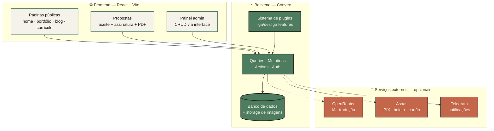
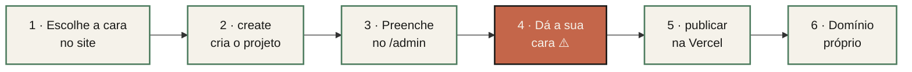
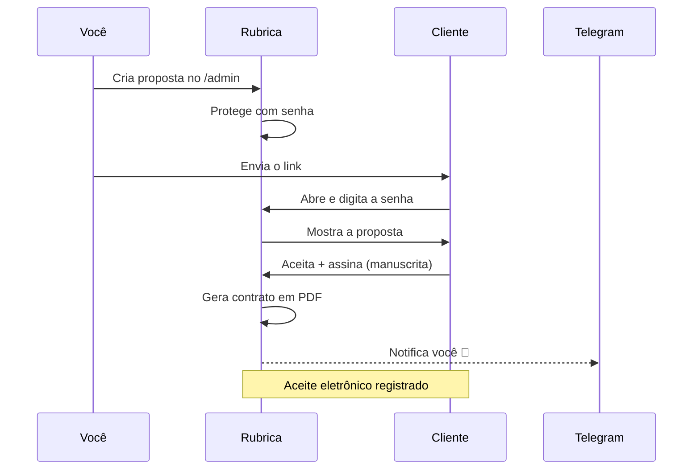

<div align="center">


<br />
<br />

# Rubrica

### _Assine com a sua cara._

Um sistema completo de portfólio profissional — pronto para você criar com um comando, personalizar e publicar com domínio próprio.

**[Veja os 13 layouts funcionando e monte o seu →](https://userubrica.vercel.app)**

<br />

[](./LICENSE)
[](https://convex.dev)
[](https://vercel.com)
[](https://www.typescriptlang.org)
[](https://github.com/MierzwaMatheus/rubrica/actions/workflows/ci.yml)

</div>

<br />

## O que é o Rubrica

A maioria das pessoas trava na mesma encruzilhada: começar um portfólio do zero dá trabalho demais, e os construtores prontos deixam todo mundo com a mesma cara.

Rubrica é a base que faltava no meio do caminho. É a estrutura técnica completa — home, portfólio, blog, currículo, propostas comerciais, painel admin, pagamentos — já resolvida. Você não monta o sistema. Você escolhe a cara, preenche o conteúdo e publica.

A base técnica é coletiva. A identidade é sua.

> **Por que isso existe**
>
> Rubrica foi feito para qualquer profissional criativo que leva o próprio trabalho a sério e quer que isso apareça. Dev iniciante ou sênior, designer, freelancer — a fundação já está pronta. Você foca no que importa: o seu conteúdo e a sua marca.
>
> Presença profissional não é luxo. É o mínimo que o seu trabalho merece.

<br />

## O que você coloca no ar

| | Módulo | O que entrega |
|---|---|---|
| 🏠 | **Home** | Apresentação, números de destaque, cases em destaque, serviços, depoimentos e chamada de contato |
| 💼 | **Portfólio** | Filtro por categoria e estudos de caso com papel, contexto, decisões, métricas e aprendizados |
| ✍️ | **Blog** | Editor rich text (TipTap), tags, busca e RSS automático |
| 📄 | **Currículo** | Estruturado, com export em PDF otimizado para ATS |
| 🤝 | **Propostas** | Proteção por senha, aceite eletrônico, assinatura manuscrita e contrato em PDF |
| ⚙️ | **Admin** | CRUD de tudo via interface — sem tocar no código, inclusive cores, fontes e os textos fixos do site |
| 🧩 | **Plugins** | Liga e desliga features que você não quer expor |
| 🤖 | **IA** _(opcional)_ | Tradução automática e geração de CV otimizado para vagas |
| 💳 | **Pagamentos** _(opcional)_ | Link de checkout com PIX, boleto e cartão em até 12x via Asaas. O cartão é digitado na página segura do Asaas, nunca no seu site |
| 🔔 | **Notificações** _(opcional)_ | Telegram quando alguém aceita uma proposta ou paga |
| 🧠 | **Skills de IA** | O seu agente (Claude Code, Codex, OpenCode) edita o site e escreve apresentação, cases, currículo e posts com a sua voz |

<br />

## Templates e esquemas de cores

Ao criar o projeto, você escolhe um de **13 layouts** e um de **15 esquemas de cores**, cada um com modo claro e escuro (ou automático, seguindo o sistema de quem visita), uma textura opcional e as fontes. Qualquer combinação funciona. No [combinador do site](https://userubrica.vercel.app/#combinador), você troca tudo isso ao vivo no app de verdade, nas 5 páginas.

| [Cyberpunk](./docs/templates/cyberpunk.md) | [Brutalism Terminal](./docs/templates/brutalist.md) | [Swiss Grid](./docs/templates/swiss.md) | [Bento](./docs/templates/bento.md) | [Magazine](./docs/templates/magazine.md) |
|---|---|---|---|---|
|  |  |  |  |  |
| [**Desktop Retrô**](./docs/templates/desktop.md) | [**Índice**](./docs/templates/index.md) | [**Monografia**](./docs/templates/monograph.md) | [**Zine**](./docs/templates/zine.md) | |
|  |  |  |  | |
| [**Blueprint**](./docs/templates/blueprint.md) | [**Jardim Digital**](./docs/templates/garden.md) | [**Conversa**](./docs/templates/chat.md) | [**Pôster Cinético**](./docs/templates/poster.md) | |
|  |  |  |  | |

- [**Guia dos templates**](./docs/templates/README.md): conceito de cada layout e o que cada página tem de exclusivo, com capturas.
- [**Esquemas de cores**](./docs/templates/cores.md): os 15 esquemas nos dois modos, os 11 papéis de cor, o modo claro/escuro com alternância e as texturas.

<br />

## Como funciona

Rubrica tem três camadas: o frontend que o mundo vê, o backend que guarda tudo, e os serviços externos que você liga só se precisar.



<br />

## Pré-requisitos

Antes de começar, você vai precisar de:

- **Node.js 20+** e **git** instalados (pnpm é opcional: o CLI usa npm se você não tiver)
- Conta no **[Convex](https://convex.dev)** _(gratuita)_ — backend, banco e storage. O CLI abre o login no navegador.
- Conta no **[Vercel](https://vercel.com)** _(gratuita)_ — hospedagem do site
- _(Só no caminho manual)_ Conta no **[GitHub](https://github.com)** — para o fork e o deploy contínuo
- _(Só para as skills de IA)_ **Python 3.8+**
- _(Opcional)_ Contas no **[OpenRouter](https://openrouter.ai)**, **[Asaas](https://asaas.com)** ou **[Telegram BotFather](https://t.me/BotFather)** — só se for usar as features opcionais

<br />

## Começando

O caminho mais curto é o CLI `create-rubrica`. Ele cria o projeto, prepara o banco, cria o seu login do painel e publica, sem copiar variável nenhuma.



1. **Escolha a cara no [site do Rubrica](https://userubrica.vercel.app).** No combinador, teste layout, cores, modo, textura e fontes no app funcionando. Na seção **Crie o seu**, preencha os seus dados e copie o comando pronto (nada sai do navegador).
2. **Cole o comando no terminal.** Ele cria o projeto com as suas escolhas, conecta o Convex (login pelo navegador) e pede só a senha do painel:
   ```bash
   npx create-rubrica@latest meu-portfolio --receita <código-do-site>
   ```
   Sem o site, `npx create-rubrica@latest meu-portfolio` faz as mesmas perguntas no terminal (no modo **Rápido**, só layout, plugins e identidade).
3. **Rode e preencha o conteúdo:** `npm run dev` (ou `pnpm dev`), entre em `http://localhost:3000/login` e siga para [o painel admin](#7--preencher-o-conteúdo-no-admin).
4. **Dê a sua cara** ([veja onde mexer](#8--personalize-o-visual-não-pule)). Não é opcional: é o que separa o seu portfólio de "mais um".
5. **Publique:** `npx create-rubrica publicar` cria o projeto na Vercel, prepara o banco de produção, cria o admin do site publicado e põe no ar. Rodar de novo só publica.
6. **Domínio próprio:** [passo a passo](#10--domínio-próprio).

### Comandos do CLI

Rode na pasta do projeto. Detalhes no [README do CLI](./cli/README.md).

| Comando | Para quê |
|---|---|
| `npx create-rubrica@latest <pasta>` | Cria o projeto (aceita `--receita` do site e opções como `--layout` e `--esquema`) |
| `npx create-rubrica setup` | Conecta o Convex, gera as chaves de login, cria o admin e os dados iniciais; liga Telegram e Vercel se você quiser |
| `npx create-rubrica config` | Troca layout, cores, modo, textura, fontes, plugins e identidade depois de criado |
| `npx create-rubrica publicar` | Põe o site no ar na Vercel (e publica de novo nas próximas vezes) |
| `npx create-rubrica senha` | Troca a senha do painel e libera o login bloqueado, no site publicado ou no local |
| `npx create-rubrica@latest update` | Traz a versão nova do Rubrica sem desfazer o que você personalizou |

<br />

## Caminho manual (fork)

Para quem prefere fazer cada etapa à mão. Os passos 7 e 8 valem também para quem usou o CLI.



```mermaid
flowchart LR
    A["1 · Fork<br/>+ clone"] --> B["2 · Convex<br/>provisiona backend"]
    B --> C["3 · .env<br/>local"]
    C --> D["4 · Vars no<br/>servidor Convex"]
    D --> E["5 · pnpm dev<br/>roda local"]
    E --> F["6 · Cria usuário<br/>root"]
    F --> G["7 · Preenche<br/>no /admin"]
    G --> H["8 · Personaliza<br/>o visual ⚠️"]
    H --> I["9 · Deploy<br/>no Vercel"]
    I --> J["10 · Domínio<br/>próprio"]

    classDef step fill:#F5F2EA,stroke:#4D7C5F,stroke-width:2px,color:#1A1A18
    classDef highlight fill:#C4664A,stroke:#1A1A18,stroke-width:2px,color:#F5F2EA
    class A,B,C,D,E,F,G,I,J step
    class H highlight
```

> O passo **8 não é opcional**. É o que separa o seu portfólio de "mais um".

### 1 · Fork e clone

```bash
gh repo fork mierzwamatheus/rubrica --clone
cd rubrica
pnpm install
```

### 2 · Provisionar o Convex

O Convex é o backend completo — banco, storage de imagens, autenticação e funções server-side.

```bash
npx convex dev
```

Na primeira vez, o CLI faz tudo sozinho: pede login no navegador, cria o projeto na sua conta, gera o `.env.local` com `VITE_CONVEX_URL` e `CONVEX_DEPLOY_KEY`, sobe o schema e as funções, e fica em modo watch. Deixe rodando enquanto desenvolve.

### 3 · Configurar o `.env` local

```bash
cp .env.example .env
```

Quatro variáveis e a gente explica cada uma:

| Variável | De onde vem | Para quê |
|---|---|---|
| `VITE_CONVEX_URL` | Convex Dashboard → Settings | URL do backend no frontend |
| `CONVEX_URL` | Mesma URL acima | Usado pelos scripts de build (RSS, sitemap) |
| `CONVEX_DEPLOY_KEY` | Convex Dashboard → Settings → Deploy Keys | Necessário para `convex deploy` no build |
| `SITE_URL` | URL final do site | URL canônica do RSS e do sitemap |

### 4 · Variáveis no servidor Convex

Essas ficam **no servidor Convex**, não no `.env` local. Setam-se via CLI:

```bash
npx convex env set NOME_DA_VAR valor
```

**Obrigatórias para o sistema rodar** (o `npx create-rubrica setup` configura todas):

- `JWT_PRIVATE_KEY` e `JWKS` — chaves do login
- `SITE_URL` — URL pública do site
- `BOOTSTRAP_ALLOWED=true` — habilita criar o primeiro usuário (você remove depois)

**Obrigatória se usar o plugin `playground`:**

- `PLAYGROUND_KEY_PEPPER=<32+ caracteres aleatórios>` — pepper para fingerprint de API keys

**Opcionais — só se ativar a feature correspondente:**

| Variável | Habilita |
|---|---|
| `OPENROUTER_API_KEY` | Tradução automática + geração de CV com IA |
| `ASAAS_API_KEY` | Pagamentos via Asaas (sandbox ou produção, detectado pela chave) |
| `ASAAS_WEBHOOK_TOKEN` | Confirmação dos pagamentos (o mesmo token cadastrado no webhook do Asaas) |
| `TELEGRAM_BOT_TOKEN` | Notificações no Telegram |
| `TELEGRAM_ADMIN_CHAT_ID` | Chat onde as notificações chegam |
| `VERCEL_DEPLOY_HOOK_URL` | Botão "Publicar" do admin |
| `VERCEL_WEBHOOK_SECRET` | Webhook de notificação de deploy |

### 5 · Rodar em desenvolvimento

Em outro terminal, com o `npx convex dev` ainda rodando:

```bash
pnpm dev
```

Abre em `http://localhost:3000`.

### 6 · Criar seu usuário root

1. Acesse `http://localhost:3000/login` com `BOOTSTRAP_ALLOWED=true` setado
2. A tela de bootstrap aparece → crie email e senha
3. **Remova o bootstrap imediatamente:**

```bash
npx convex env remove BOOTSTRAP_ALLOWED
```

> ⚠️ Se esquecer essa etapa, qualquer pessoa que descobrir o link consegue criar usuário root no seu sistema.

> **Esqueceu a senha do painel ou ficou bloqueado?** Na pasta do projeto, rode `npx create-rubrica senha`. Ele troca a senha no site publicado ou no do seu computador e libera o login.

### 7 · Preencher o conteúdo no admin

Logado em `/admin`, tudo é gerenciado por interface. Você não toca no código para mudar texto, imagem ou dado.

| Rota | O que você configura |
|---|---|
| `/admin/contact` | Nome, email, telefone, avatar, redes sociais |
| `/admin/home` | Apresentação, números de destaque, disponibilidade, serviços e princípios de trabalho |
| `/admin/projects` | Projetos do portfólio (imagens, categoria, links, estudo de caso com métricas) |
| `/admin/blog` | Posts (editor rich text, tags, destaque) |
| `/admin/resume` | Currículo (experiências, formação, skills, idiomas, certificações) |
| `/admin/about` | Rotina diária + FAQ |
| `/admin/depoimentos` | Depoimentos (curados ou recebidos pelo formulário público) |
| `/admin/proposals` | Propostas comerciais com senha, aceite e contrato |
| `/admin/contatos` | Pedidos de contato recebidos pelo site |
| `/admin/site-config` | **Site & Aparência:** identidade, SEO, fontes e as 4 cores de cada modo |
| `/admin/textos` | Os textos fixos do site, em português e inglês |
| `/admin/plugins` | **Liga/desliga features** (blog, propostas, pagamentos, etc.) |

#### Ou pelo seu agente de IA

O repositório já vem com a skill **`rubrica`** para Claude Code, Codex e OpenCode. Com ela, o agente lê e altera o conteúdo do site por você: textos fixos (em pt-BR e en-US), identidade, SEO, cores, perfil, home, posts, imagens, contatos, plugins e a publicação.

- Abra o agente na pasta do projeto e peça em linguagem comum, por exemplo: "troque o título da home e traduza para o inglês" ou "escreva um post sobre X e deixe em rascunho". No Claude Code, também dá para chamar com `/rubrica`.
- No primeiro uso, faça o login num terminal seu (a senha nunca passa pelo agente):
  ```bash
  python3 .agents/skills/rubrica/scripts/rubrica.py login --email voce@exemplo.com
  ```
- A skill usa o Convex do `VITE_CONVEX_URL` do `.env.local`. Para mexer em outro (ex.: produção), defina `RUBRICA_CONVEX_URL`.
- Onde ela mora: `.agents/skills/rubrica/` (lido pelo Codex e pelo OpenCode) e o atalho `.claude/skills/rubrica` (lido pelo Claude Code). Requer Python 3.8+.

Para escrever conteúdo novo com calma, há skills estrategistas que entrevistam você, escrevem em pt-BR e en-US e entregam um plano que a `rubrica` aplica depois do seu "ok". Todas começam pela sua voz: na primeira vez, o agente manda você para a [entrevista de voz](https://userubrica.vercel.app/voz), onde você responde falando ou digitando (uns 20 minutos, nada sai do navegador) e cola o resultado na conversa.

| Skill | Para quê |
|---|---|
| `rubrica-voz` | extrai o seu tom de voz da entrevista e monta a parte pessoal da página Sobre (fora do trabalho, dia a dia, FAQ pessoal) |
| `rubrica-apresentacao` | frase da home, cargo, "Sobre", números de destaque, princípios de trabalho e SEO da home |
| `rubrica-case` | transforma dados técnicos, prints e resultados num case com visão de negócio, sem inventar números |
| `rubrica-curriculo` | experiências, formação, habilidades e idiomas, de tarefas a conquistas |
| `rubrica-blog` | post do tema ao rascunho: briefing, suas opiniões, SEO, fontes verificadas, edição, revisão e capa |
| `rubrica-pilar` | revisão de todo texto antes de ir ao site: sinais de texto de IA, fatos sem origem e tradução |

Os planos, a entrevista e o seu perfil editorial (público, voz, palavras vetadas) ficam em `.rubrica/`, na pasta do projeto, fora do git por padrão (são dados pessoais).

### 8 · Personalize o visual _(não pule)_

Esta é a etapa **mais importante** depois do deploy técnico. Identidade visual é o que vai te diferenciar. Onde mexer:

- **Layout, esquema, modo, textura e fontes** — teste as combinações no [combinador](https://userubrica.vercel.app/#combinador) e aplique com `npx create-rubrica config` → Aparência. No fork, copie os arquivos de `templates/layouts/<layout>/` para `src/components/` e `src/pages/`. Veja o [guia dos templates](./docs/templates/README.md) e os [esquemas de cores](./docs/templates/cores.md).
- **Cores e fontes pelo painel** — em **Site & Aparência**, troque as 4 cores principais de cada modo (claro e escuro) e as fontes, sem mexer no código. "Usar as cores do esquema" desfaz.
- **Textos** — o seu agente de IA, com as skills `rubrica-*`, escreve apresentação, cases, currículo e posts com a sua voz ([veja acima](#ou-pelo-seu-agente-de-ia)).
- `public/favicon.ico` — troque pelo seu logo
- No código: o esquema de cores fica em `src/index.css` (modo claro em `:root`, escuro em `.dark`); a estrutura em `src/components/Layout.tsx` e `src/pages/`; os componentes shadcn/ui em `src/components/ui/`.

Teste com `pnpm dev` enquanto altera. Não suba sem dar a sua cara.

### 9 · Deploy no Vercel

> **Projeto criado pelo CLI?** Rode `npx create-rubrica publicar` na pasta do projeto: ele cria o projeto na Vercel, prepara o banco de produção, cria o admin do site publicado e publica, sem copiar variável nenhuma. Os passos abaixo são o caminho manual (e o do fork).

1. Em [vercel.com/new](https://vercel.com/new), importe o repositório forkado
2. **Framework preset:** Vite
3. **Build command:** já vem no `vercel.json` (`npm run build:i18n && npm run build`: exporta os textos do site, publica o Convex, gera dados estáticos, RSS e sitemap, e faz o build do Vite) — não mude
4. **Output directory:** `dist`
5. **Adicione as env vars** (Settings → Environment Variables): `VITE_CONVEX_URL`, `CONVEX_URL`, `CONVEX_DEPLOY_KEY` _(sem essa, o build falha)_ e `SITE_URL`
6. Clique em **Deploy**

A partir daqui, todo `git push` na branch principal dispara um deploy automático.

### 10 · Domínio próprio

1. **Vercel → seu projeto → Settings → Domains → Add Domain**
2. Adicione `seudominio.com` e `www.seudominio.com`
3. **Configure o DNS** no seu registrador (Registro.br, Cloudflare, GoDaddy…):
   - Raiz (`seudominio.com`): registro **A** → `76.76.21.21`
   - `www`: registro **CNAME** → `cname.vercel-dns.com`
4. Aguarde a propagação (minutos a horas)
5. O SSL é emitido automaticamente pela Vercel via Let's Encrypt
6. **Atualize a `SITE_URL`** no Vercel para a URL final
7. Force um redeploy para regenerar `sitemap.xml` e `rss.xml`

<br />

## Atualizando para versões novas

Atualizar não desfaz o que você personalizou. Em projeto criado pelo CLI:

```bash
npx create-rubrica@latest update --dry-run   # mostra o que mudaria
npx create-rubrica@latest update             # aplica
```

O CLI mescla, arquivo por arquivo, as mudanças do Rubrica com as suas. Quando os dois mexeram no mesmo trecho, o seu arquivo fica intacto e a versão nova é salva ao lado, como `<arquivo>.rubrica-new`. No fork, `git fetch upstream --tags && git merge vX.Y.Z` faz o mesmo. Conteúdo e configurações do admin ficam no banco e nunca são tocados.

Guia completo: [Atualizando o seu Rubrica](./docs/atualizacao.md). O que mudou em cada versão: [CHANGELOG](./CHANGELOG.md).

<br />

## O fluxo de propostas

É aqui que o Rubrica vira ferramenta de fechar negócio, não só de mostrar trabalho. Da criação ao contrato assinado:



<br />

## Quando ativar cada feature opcional

| Feature | Plugin (`/admin/plugins`) | Env vars | Conta externa |
|---|---|---|---|
| Pagamentos (PIX, boleto e cartão) | `payments` | `ASAAS_API_KEY` + `ASAAS_WEBHOOK_TOKEN` | Asaas |
| Geração de CV com IA | `ai-resumes` | `OPENROUTER_API_KEY` | OpenRouter |
| Tradução automática (i18n) | `i18n` | `OPENROUTER_API_KEY` | OpenRouter |
| Notificações Telegram | _(built-in)_ | `TELEGRAM_BOT_TOKEN` + `TELEGRAM_ADMIN_CHAT_ID` | BotFather |

> **Quer só o básico?** Se você quer apenas home + projetos + currículo, desative blog, propostas, pagamentos, IA e playground em `/admin/plugins`. As rotas somem da sidebar e do roteador.

### Configurando os pagamentos (Asaas)

1. Crie uma conta no [sandbox do Asaas](https://sandbox.asaas.com) para testar e gere a chave em **Integrações → Chave de API**.
2. Rode `npx create-rubrica setup` e informe a chave. O setup grava `ASAAS_API_KEY`, gera o `ASAAS_WEBHOOK_TOKEN` e mostra a URL e o token do webhook. Sem o CLI: `npx convex env set ASAAS_API_KEY ...` e `npx convex env set ASAAS_WEBHOOK_TOKEN <token aleatório>`.
3. No Asaas, em **Integrações → Webhooks**, cadastre a URL `https://<seu-deployment>.convex.site/webhooks/asaas` com o mesmo token e os eventos de cobrança ligados. Sem o webhook, nenhum pagamento aparece como pago.
4. Para o cliente voltar ao seu site depois de pagar com cartão, cadastre o domínio do site no Asaas em **Minha Conta → Informações**. Sem isso, o pagamento funciona, mas o cliente fica na página do Asaas.
5. Em `/admin/payment-links`, cadastre o cliente, gere o link de checkout e mande para ele. O cliente escolhe PIX, boleto ou cartão. O cartão abre a página segura do Asaas.
6. Funcionou no sandbox? Troque para a chave de produção (`$aact_prod_...`) e cadastre o webhook também na conta de produção.

O checkout só vira **pago** quando o Asaas confirma pelo webhook. Você recebe a notificação no Telegram, se estiver configurado.

<br />

## Scripts úteis

```bash
pnpm dev          # dev local + convex em watch (porta 3000)
pnpm build        # convex deploy + dados estáticos + RSS + sitemap + vite build
pnpm build:i18n   # exporta os textos do site (Convex) para src/i18n/translations
pnpm preview      # preview do build de produção
pnpm check        # type-check (tsc --noEmit)
pnpm format       # prettier
pnpm test         # vitest
```

<br />

## Estrutura do projeto

```
rubrica/
├── convex/              # Backend: schema, queries, mutations, actions
├── src/
│   ├── pages/           # Páginas públicas + /admin/*
│   ├── components/      # Componentes (UI, admin, layout)
│   ├── contexts/        # AuthContext, ThemeContext, PluginsContext
│   └── index.css        # ← Personalize cores e tema aqui
├── domain/              # Casos de uso sem framework (ex.: o gerador de RSS)
├── scripts/             # Build-time: RSS, sitemap, fetch de dados estáticos
├── templates/           # Layouts que o CLI aplica (veja docs/templates)
├── site/                # Site público do Rubrica (Astro): combinador e "Crie o seu"
├── .agents/skills/      # Skills de IA: rubrica e as estrategistas rubrica-*
├── public/              # Assets estáticos (favicon, dados de exemplo/gerados)
├── docs/features.md     # Referência técnica completa
├── docs/templates/      # Guia dos layouts e das paletas, com capturas
├── docs/atualizacao.md  # Como atualizar sem perder personalizações
├── cli/                 # create-rubrica: create, setup, config, publicar, senha e update
├── .github/workflows/   # CI: tipos e testes do template e do CLI, e o build do site
├── .env.example         # Template de variáveis de ambiente
└── vercel.json          # Build command, rewrites SPA, security headers
```

> Procurando a referência técnica detalhada — schema do banco, lista de features, rotas, plugins, design system? Veja [`docs/features.md`](./docs/features.md).

<br />

## Troubleshooting

| Sintoma | Causa provável |
|---|---|
| `convex deploy` falha no Vercel | Falta `CONVEX_DEPLOY_KEY` nas env vars do Vercel |
| Login não funciona / bootstrap não aparece | `BOOTSTRAP_ALLOWED` removido antes de criar o primeiro usuário — sete de novo, crie e remova |
| Plugin desativado ainda aparece em produção | Falta um redeploy para regenerar `public/data/plugins.json` |
| Notificações Telegram não chegam | Você ainda não enviou `/start` para o seu bot |
| Cliente pagou e o checkout não vira "pago" | Webhook do Asaas não cadastrado, com token diferente do `ASAAS_WEBHOOK_TOKEN` ou cadastrado na conta errada (sandbox × produção) |
| "Pagamentos não configurados" no checkout | Falta `ASAAS_API_KEY` no Convex |
| Imagens quebradas após deploy | IDs do Convex Storage são por deployment; ao migrar dev → prod, reupload é necessário |

<br />

## Uma palavra antes de você publicar

Rubrica não é produto de empresa. É infraestrutura de comunidade. Quanto mais gente usa, melhora e distribui, mais sobe o nível médio de como profissionais se apresentam na web.

Mas portfólio sem cara é portfólio igual. Use a base sem culpa — e use bem. Gaste o tempo que economizou na sua identidade visual e na sua copy. É ali que mora a diferença entre "mais um" e um portfólio que marca.

Se o Rubrica te ajudou, considere mandar um PR. O objetivo é coletivo.

<br />

## Licença

GNU GPL v3.0 — veja [`LICENSE`](./LICENSE).

<br />

<div align="center">

Feito com ❤️ por **[Matheus Mierzwa](https://github.com/MierzwaMatheus)**

_Assine com a sua cara._

</div>