<div align="center">


<br />
<br />

# Rubrica

### _Assine com a sua cara._

Um site rápido, em HTML estático, com painel para editar sem tocar no código. Para o seu portfólio ou para o site da empresa de um cliente: você escolhe o tema, monta as páginas com blocos e publica com domínio próprio.

**[Veja os 14 temas funcionando e monte o seu →](https://userubrica.vercel.app)**

<br />

[](./CHANGELOG.md)
[](https://astro.build)
[](https://vercel.com)
[](https://www.typescriptlang.org)
[](https://github.com/MierzwaMatheus/rubrica/actions/workflows/ci.yml)

</div>

<br />

## O que é o Rubrica

A maioria das pessoas trava na mesma encruzilhada: montar um site profissional do zero dá trabalho demais, e os construtores prontos deixam todo mundo com a mesma cara.

Rubrica é a base que faltava no meio do caminho. É a estrutura técnica completa (páginas, blog, propostas comerciais, painel, pagamentos, SEO, idiomas) já resolvida. Você não monta o sistema: escolhe a cara, preenche o conteúdo e publica.

A base técnica é coletiva. A identidade é sua.

> **Novidade da v2.** O Rubrica deixou de ser um template copiado para o seu projeto e virou um **núcleo em pacote** (`@rubrica/core`) com **temas** (`@rubrica/theme-*`). Atualizar é subir a versão de um pacote, sem mesclar arquivos. Veja o que mudou no [CHANGELOG](./CHANGELOG.md) e, se você já tem um site v1, [como migrar](./docs/guia/migrar.md).

<br />

## Para quem é

- **Profissionais criativos** (devs, designers, freelancers) que querem um portfólio com a própria cara: linha **pessoal**.
- **Agências e freelancers que mantêm sites de clientes**: linha **empresa**. Cada cliente tem a sua instalação (repositório, Convex e Vercel próprios), e o cliente final usa só o painel, com o papel que a agência der a ele.

## As duas linhas

| | Pessoal | Empresa |
|---|---|---|
| Páginas de partida | Início, sobre, currículo, projetos, blog, depoimentos | Início, quem somos, serviços, preços, equipe, cases, contato |
| Coleções próprias | Currículo, dia a dia | Planos e preços, equipe, dados da empresa |
| Blocos próprios | `curriculo` | `precos`, `equipe`, `localizacao`, `logos-clientes` |
| Em comum | Blog, projetos e cases, serviços, depoimentos, FAQ, propostas, contratos, pagamentos, contatos, LGPD, idiomas, MCP | |

<br />

## O que você coloca no ar

| | Recurso | O que entrega |
|---|---|---|
| 🧱 | **Páginas com blocos** | Monte e reordene as páginas no painel, com prévia ao vivo. Crie páginas novas sem código |
| ⚡ | **HTML estático** | Astro gera tudo no build: rápido, com SEO completo (sitemap, RSS, `hreflang`, dados estruturados) e quase nenhum JavaScript |
| 🎨 | **14 temas e 15 esquemas de cores** | Qualquer esquema funciona em qualquer tema, claro e escuro. As fontes se trocam no painel |
| 🌍 | **Vários idiomas** | Quantos você quiser, com o principal à sua escolha. O que não foi traduzido não aparece no idioma |
| ✍️ | **Blog** | Editor rich text, tags, busca e RSS automático |
| 🤝 | **Propostas e contratos** | Proteção por senha, aceite eletrônico, assinatura manuscrita e contrato em PDF |
| 💳 | **Pagamentos** _(opcional)_ | Checkout com PIX, boleto e cartão via Asaas. O cartão é digitado na página segura do Asaas |
| 📬 | **Contatos e LGPD** | Pedidos no painel, no Telegram, por e-mail ou num webhook, com consentimento registrado e política de privacidade gerada |
| 👥 | **Papéis** | `root` (agência), `admin` (dono), editores e `comercial`: cada um vê só o que pode mexer |
| 🧩 | **Plugins** | Liga e desliga o que você não quer expor |
| 🤖 | **Agentes (MCP)** | Servidor MCP local: o Claude Code ou o Codex editam o conteúdo, com prévia antes de gravar |

<br />

## Os 14 temas

Cada tema é um pacote que muda a forma do site sem mudar o conteúdo, e todos passam pela mesma bateria de testes (acessibilidade, SEO, JavaScript por página e Lighthouse). No [combinador do site](https://userubrica.vercel.app/#combinador) você troca tema, esquema e modo ao vivo.

| Padrão | Cyberpunk | Brutalism Terminal | Swiss Grid | Bento |
|---|---|---|---|---|
| 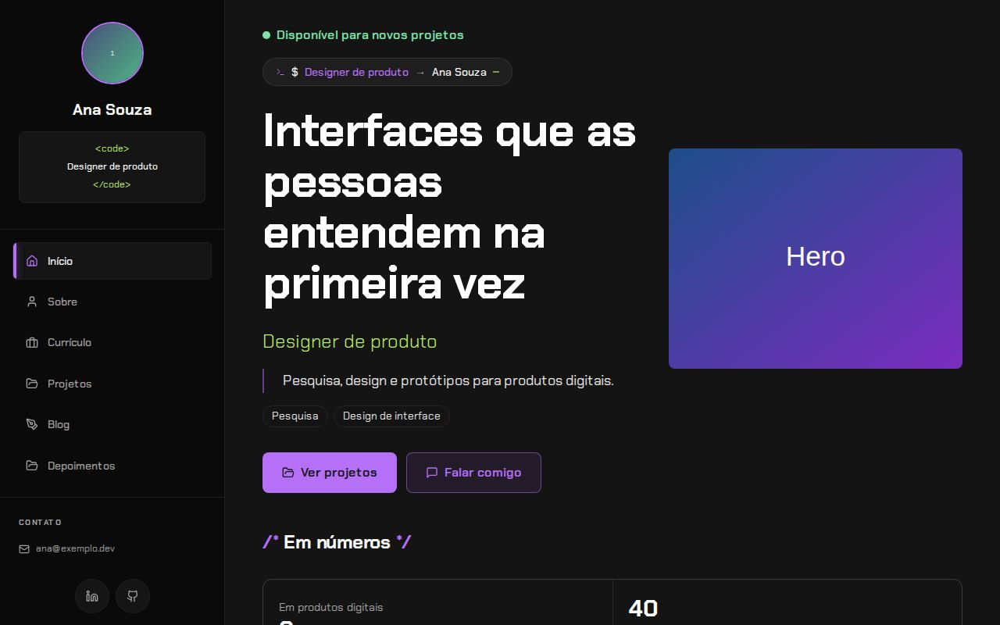 | 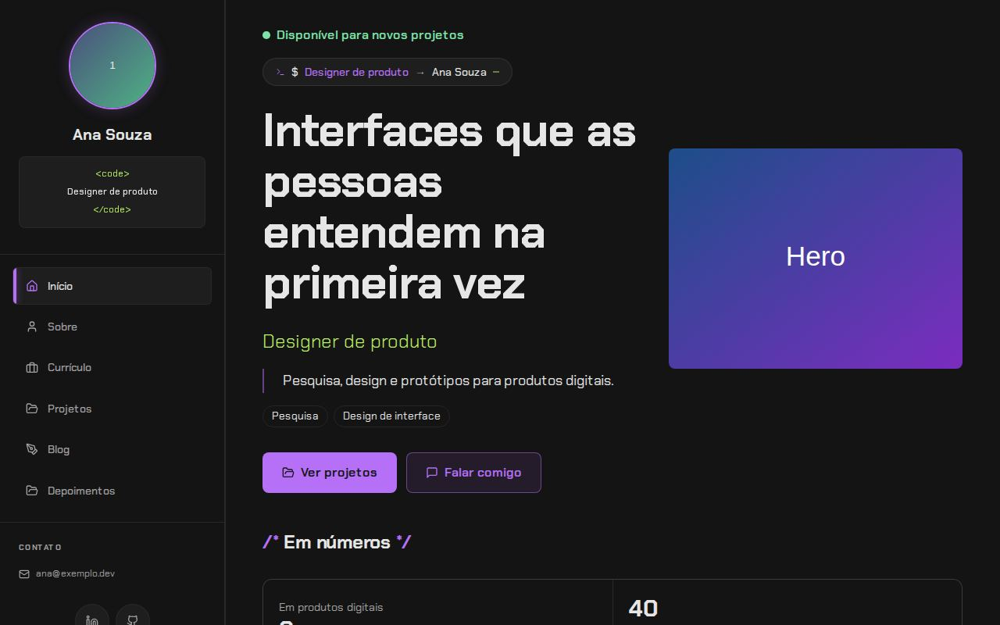 | 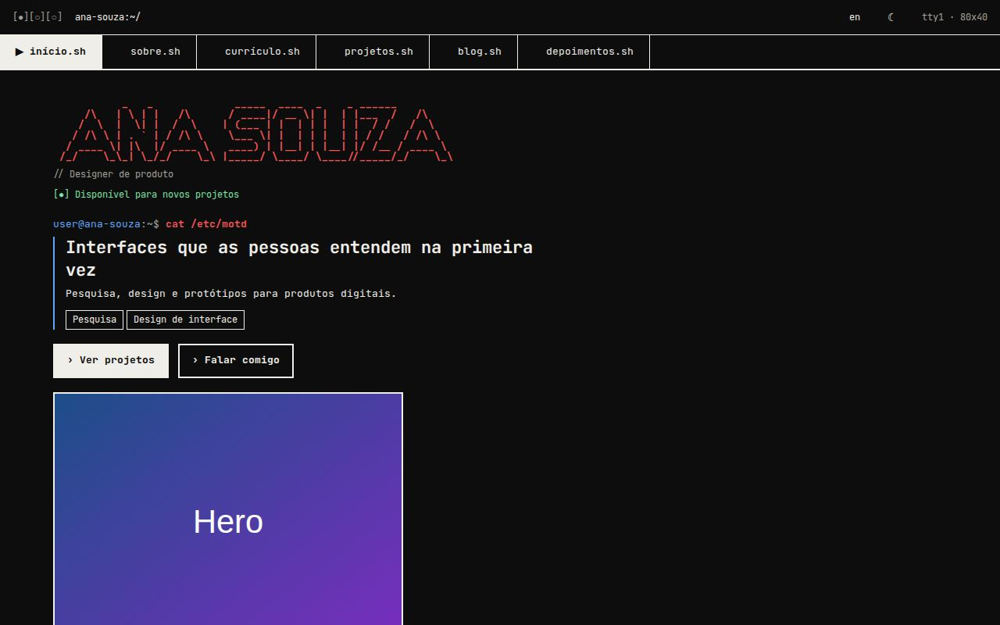 | 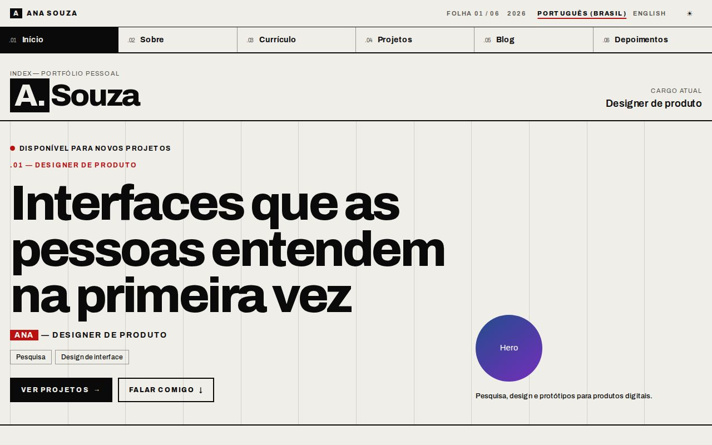 | 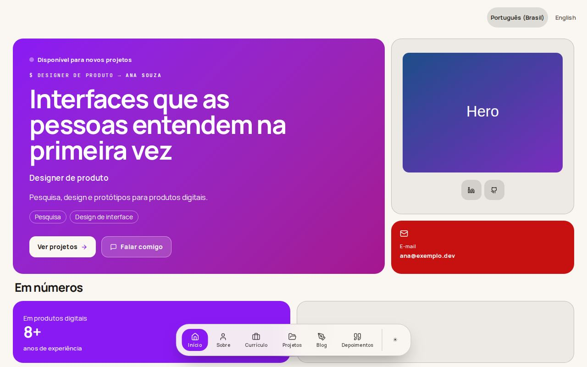 |
| **Magazine** | **Desktop Retrô** | **Índice** | **Monografia** | **Zine** |
| 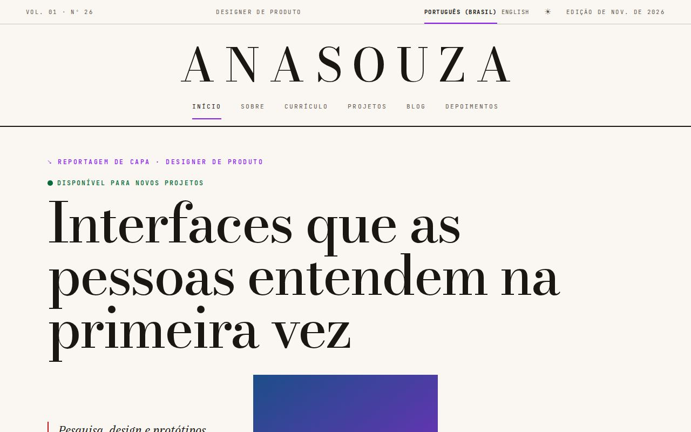 | 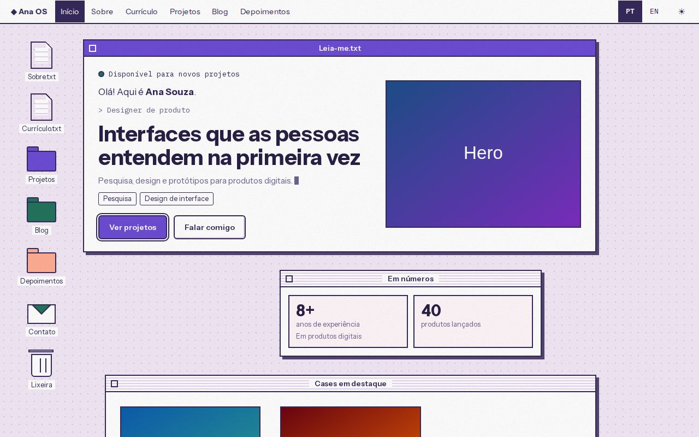 | 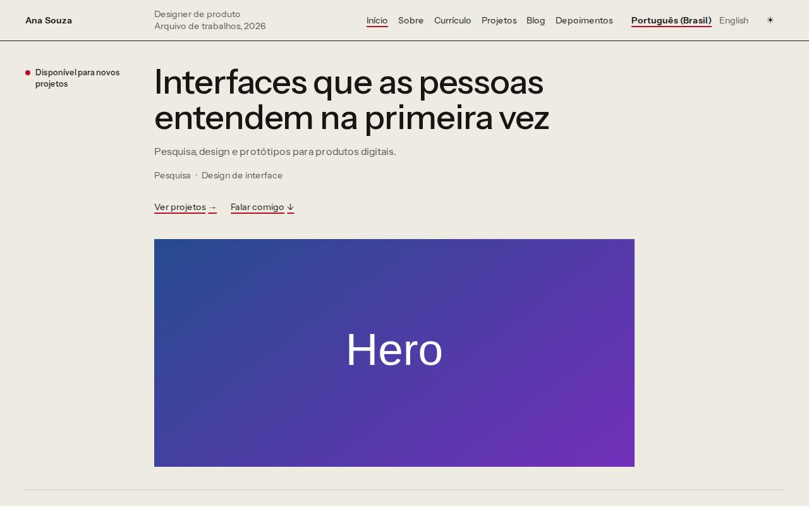 | 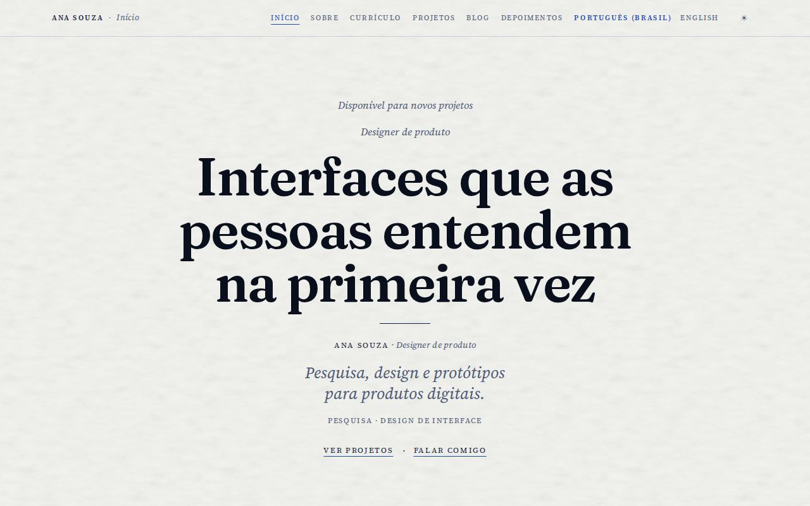 | 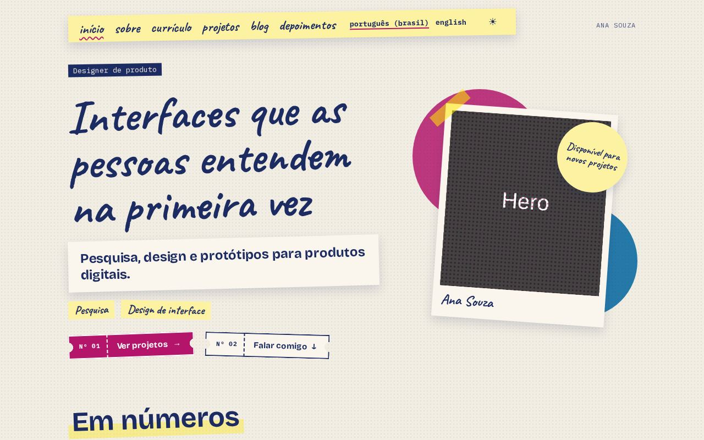 |
| **Blueprint** | **Jardim Digital** | **Conversa** | **Pôster Cinético** | |
| 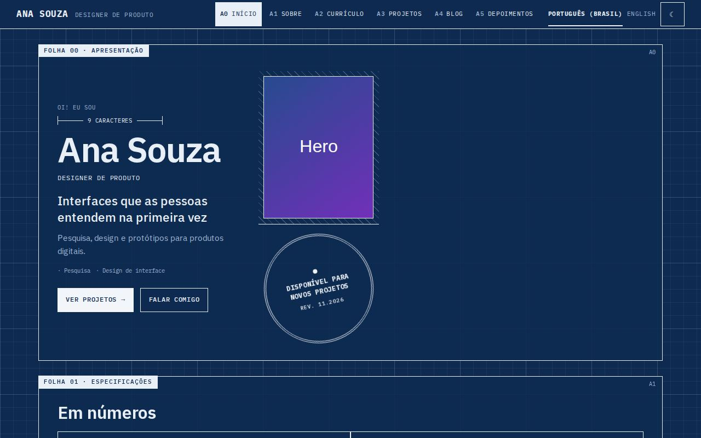 | 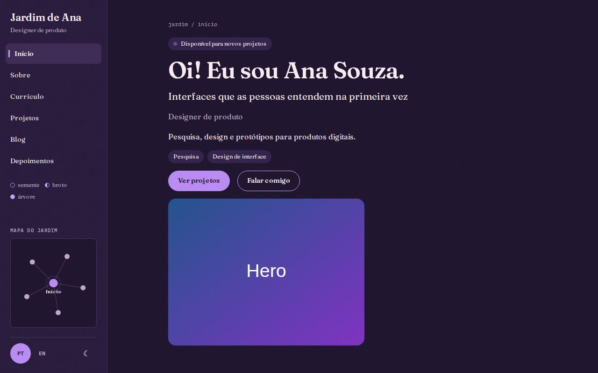 | 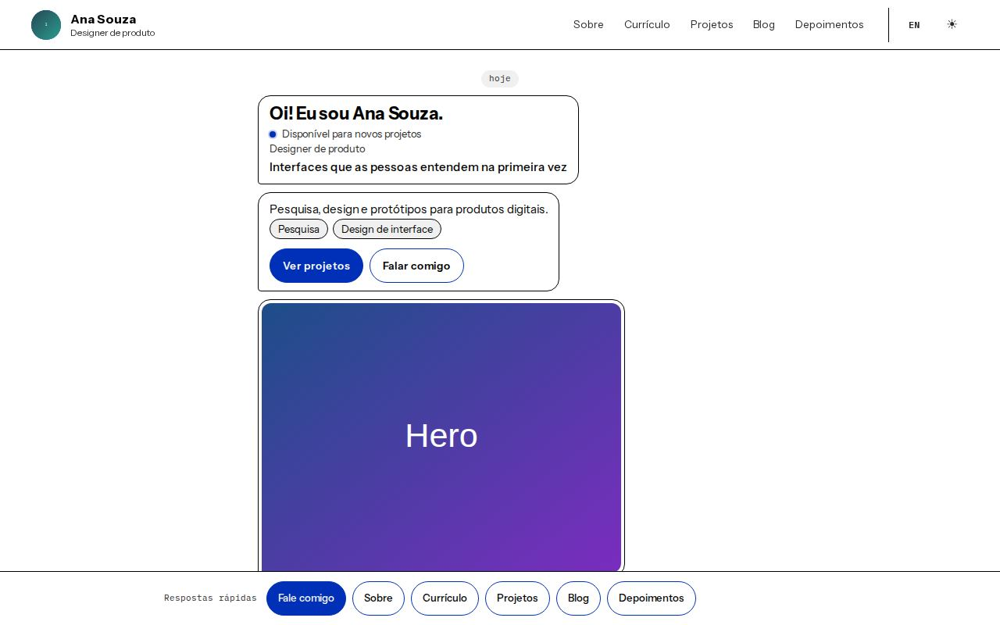 | 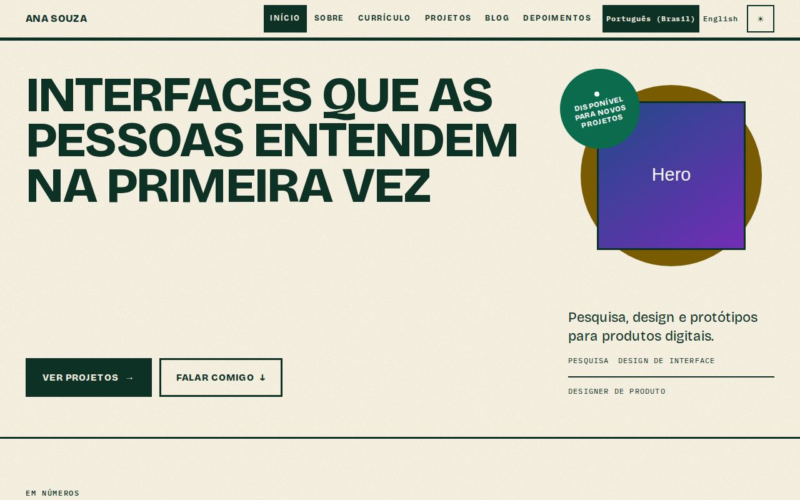 | |

Como escolher, trocar, ejetar um componente e criar um tema: [guia de temas](./docs/guia/temas.md).

<br />

## Como funciona

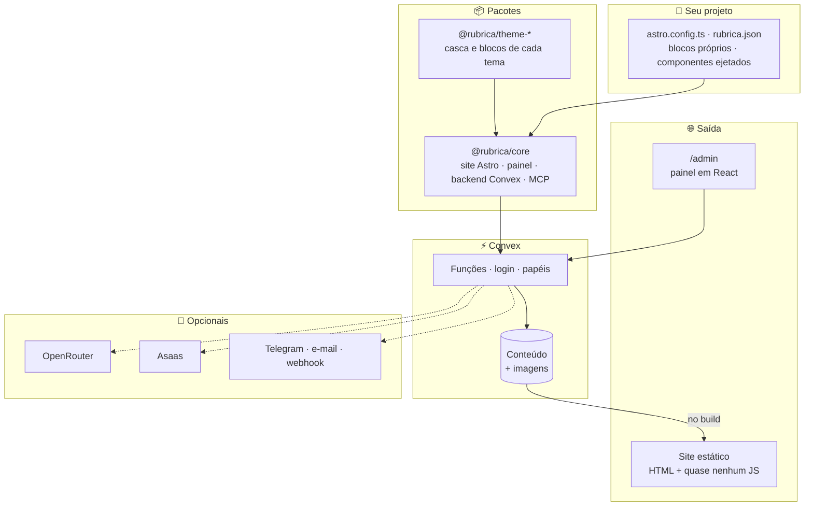

O build lê o conteúdo do Convex e gera todas as páginas. Salvar no painel muda o banco na hora; o site no ar muda no próximo build (o botão **Publicar** do painel dispara o rebuild). Isso funciona em qualquer hospedagem estática; a Vercel é a oficial e a única que o CLI automatiza.

<br />

## Começando

Precisa de **Node.js 22.23+** e **git**, e de contas gratuitas no **[Convex](https://convex.dev)** (backend) e na **[Vercel](https://vercel.com)** (hospedagem). O CLI `create-rubrica` cria o projeto, prepara o banco, cria o seu login do painel e publica, sem copiar variável nenhuma.

```bash
npx create-rubrica@latest meu-site --tipo pessoal --tema padrao   # cria o projeto (use --tipo empresa para um site de empresa)
cd meu-site
pnpm dev                                                          # o site, em http://localhost:4321 (painel em /admin)
pnpm dev:convex                                                   # o backend de desenvolvimento, em outro terminal
npx create-rubrica publicar                                       # põe no ar na Vercel
```

Ou monte a aparência no [combinador do site](https://userubrica.vercel.app/#combinador) e copie de lá o comando pronto, com as suas escolhas.

| Guia | O que tem |
|---|---|
| [**Começando**](./docs/guia/comecando.md) | Do zero ao site rodando no computador |
| [**Conteúdo e painel**](./docs/guia/conteudo.md) | Páginas com blocos, coleções, plugins e papéis |
| [**Temas**](./docs/guia/temas.md) | Escolher, trocar, esquemas de cor, fontes, ejetar um componente e criar um tema |
| [**Idiomas**](./docs/guia/idiomas.md) | N idiomas, o principal configurável e conteúdo sem tradução |
| [**Publicar o site**](./docs/guia/publicar.md) | Vercel, outras hospedagens, domínio próprio |
| [**Integrações**](./docs/guia/integracoes.md) | Telegram, e-mail, webhook, OpenRouter, Asaas, Umami e as variáveis de ambiente |
| [**Agentes de IA**](./docs/guia/agentes.md) | MCP local e skills |
| [**Migrar da v1**](./docs/guia/migrar.md) | Passo a passo, o que converte e o que não converte |
| [**Comandos do CLI**](./docs/guia/cli.md) | `create`, `setup`, `config`, `publicar`, `update`, `ejetar`, `verificar`, `testar-tema`, `mcp`, `migrar` e mais |
| [**Atualizar o Rubrica**](./docs/guia/atualizar.md) | Subir a versão, Renovate e Dependabot |

A documentação também está no [site do Rubrica](https://userubrica.vercel.app/docs), em português e inglês.

<br />

## Vem da v1?

`npx create-rubrica@latest migrar` leva o site para a v2 numa branch nova, converte os dados (de um export do Convex) num arquivo de import e lista o que você personalizou, com a sugestão de cada item. Ele **não grava em banco nenhum**: o import vai para um Convex de desenvolvimento novo, e a produção só com o seu "ok". Guia completo: [Migrar da v1](./docs/guia/migrar.md). A v1 recebe correções de bug e segurança por 6 meses depois do lançamento da v2 (branch `v1`); a documentação dela está arquivada em [`docs/v1`](./docs/v1/README.md).

<br />

## O fluxo de propostas

É aqui que o Rubrica vira ferramenta de fechar negócio, não só de mostrar trabalho. Da criação ao contrato assinado:

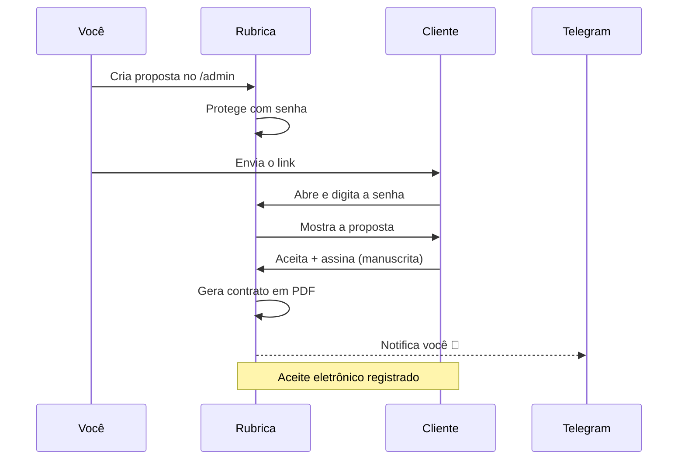

<br />

## Estrutura do repositório

Este repositório é um monorepo (a v1 fica na branch `v1`):

```
rubrica/
├── packages/
│   ├── core/              # @rubrica/core: integração Astro, painel, backend Convex, blocos, SEO, idiomas
│   ├── themes/<nome>/     # @rubrica/theme-<nome>: um pacote por tema (14)
│   ├── create-rubrica/    # o CLI
│   ├── mcp/               # @rubrica/mcp: servidor MCP local
│   └── theme-tester/      # @rubrica/theme-tester: a bateria de testes de tema
├── apps/
│   ├── demo/              # sites de demonstração (pessoal e empresa)
│   └── docs/              # o site e a documentação (userubrica.vercel.app)
└── docs/                  # guias (docs/guia), RFC e notas da v2 (docs/rfc, docs/v2), v1 arquivada
```

Quer contribuir ou criar um tema? Comece por [`docs/v2/contribuindo.md`](./docs/v2/contribuindo.md) e pelo [RFC da v2](./docs/rfc/v2.md). Comandos mais usados:

```bash
pnpm install
pnpm -r check && pnpm -r test    # tipos e testes de tudo
pnpm demo                        # abre o site de demonstração (painel em /admin, sem banco)
pnpm testar-tema padrao          # bateria de testes de um tema
pnpm changeset                   # registra uma mudança para a próxima versão
```

<br />

## Licença

Veja o arquivo [LICENSE](./LICENSE).
