# Templates e esquemas de cores

O Rubrica vem com **13 layouts** e **15 esquemas de cores**, cada esquema com modo claro e escuro. Tudo é escolhido ao criar o projeto com o CLI e pode ser trocado depois com `rubrica config`:

```bash
npx create-rubrica meu-portfolio
# Rápido: Layout → Plugins → Identidade (cores, textura e fontes vêm recomendadas pelo layout)
# Personalizado: Layout → Esquema de cores → Modo (claro/escuro/automático) → Alternância → Textura → Fontes → Plugins → Identidade
```

Layout, esquema, modo e textura são independentes: qualquer layout funciona com qualquer esquema, nos dois modos. Cada layout sugere uma combinação: o modo rápido aplica essa combinação direto, e o personalizado mostra ela como recomendada.

## Layouts originais

Usam as 4 cores do contrato original (`--bg`, `--text`, `--primary`, `--accent`).

| | Layout | Em uma frase | Navegação |
|---|---|---|---|
| 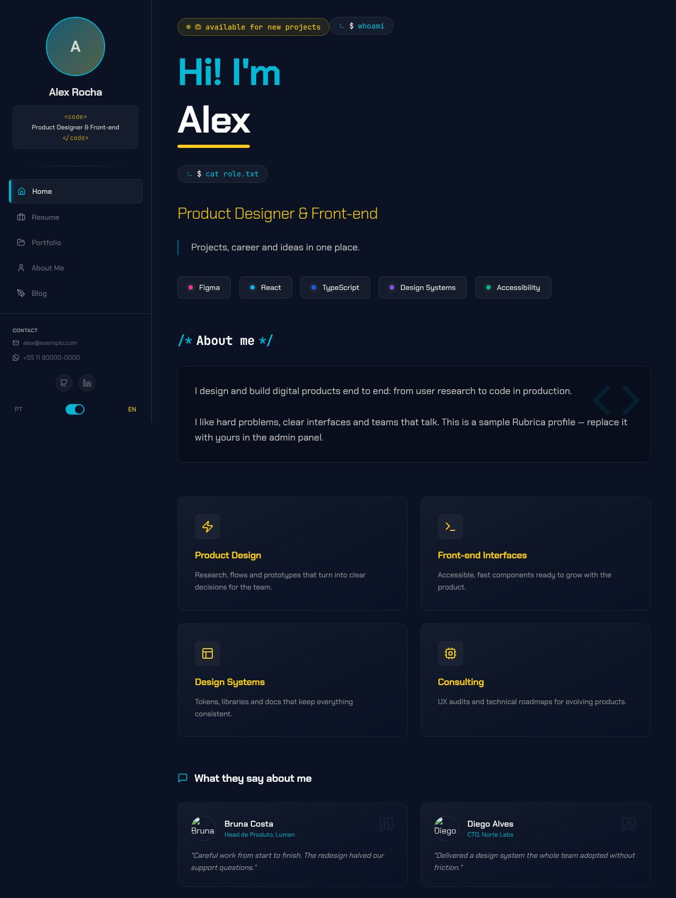 | [**Cyberpunk**](./cyberpunk.md) | O visual original do Rubrica: terminal neon com sidebar e foto de perfil | Sidebar fixa à esquerda |
| 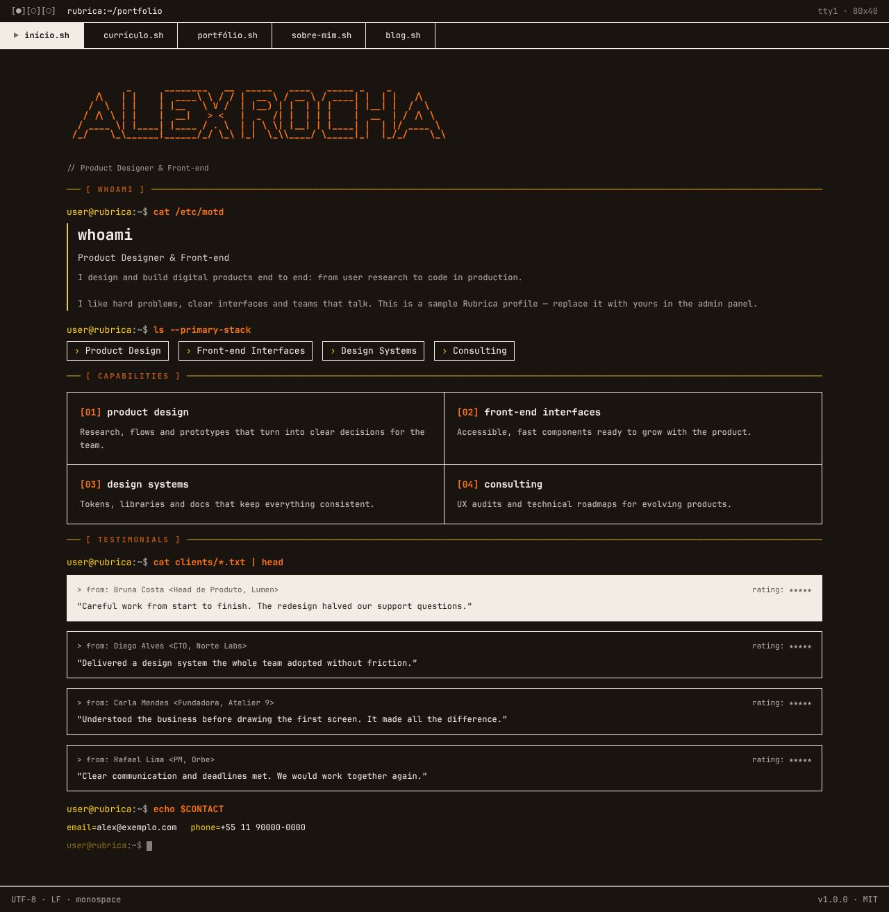 | [**Brutalism Terminal**](./brutalist.md) | O site inteiro como uma sessão de terminal Unix, em monospace e sem cantos arredondados | Abas `.sh` no topo |
| 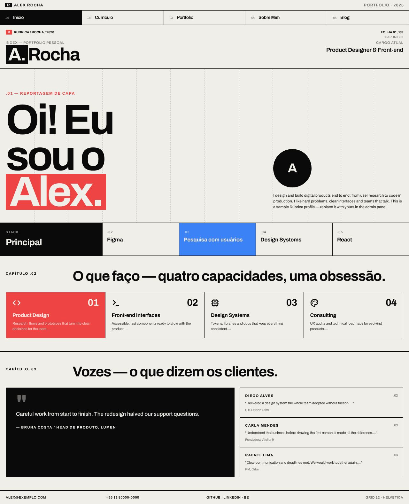 | [**Swiss Grid**](./swiss.md) | Cartaz suíço sobre grid de 12 colunas, tipografia pesada e blocos de cor sólida | Barra de 5 colunas no topo |
| 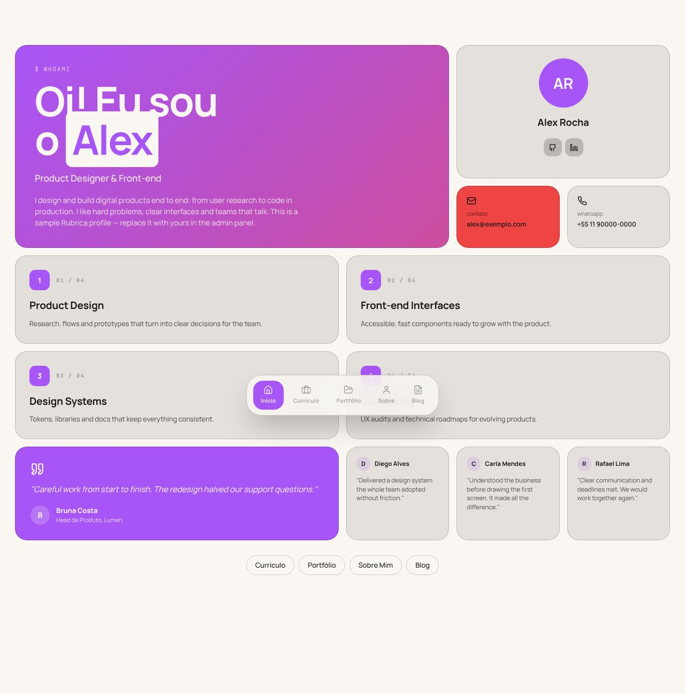 | [**Bento**](./bento.md) | Mosaico de cartões arredondados, orientado a produto | Dock flutuante no rodapé |
|  | [**Magazine**](./magazine.md) | Revista impressa: masthead, seções numeradas e display serifado | Masthead centralizado |

## Layouts novos

Usam o esquema de cores completo (11 papéis).

| | Layout | Em uma frase | Navegação | Recomendado |
|---|---|---|---|---|
| 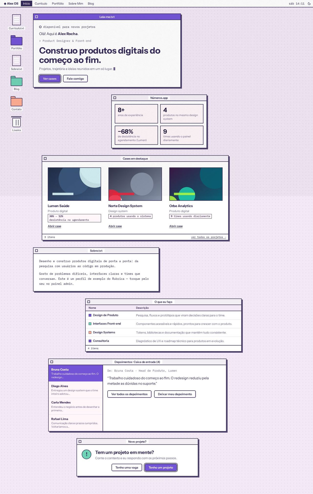 | [**Desktop Retrô**](./desktop.md) | Um sistema operacional de 1998: cada seção é uma janela sobre a área de trabalho | Barra de menu no topo e ícones da área de trabalho | Sorbet · claro · grão |
| 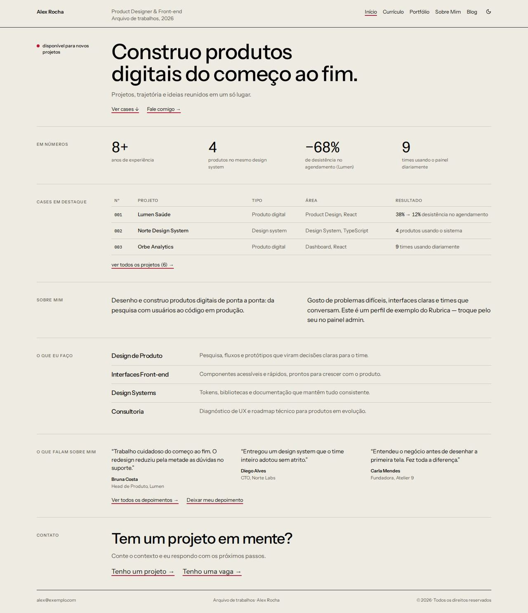 | [**Índice**](./index.md) | Catálogo de museu: rótulos à esquerda, projetos em linhas e imagem que surge no hover | Cabeçalho de 3 colunas | Sumi · claro |
| 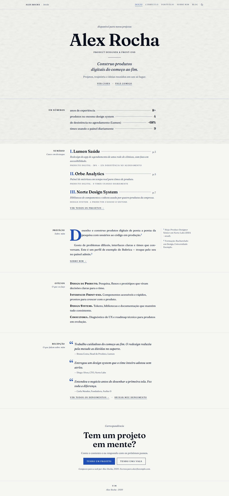 | [**Monografia**](./monograph.md) | O site como livro: folha de rosto, sumário, capitulares e notas na margem | Cabeçalho corrido em versalete | Azulejo · claro · papel |
| 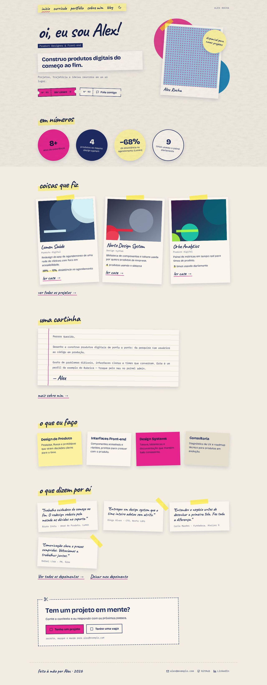 | [**Zine**](./zine.md) | Fanzine feito à mão: polaroides, fita adesiva, post-its e letra cursiva | Tira de fita adesiva | Riso · claro · papel |
| 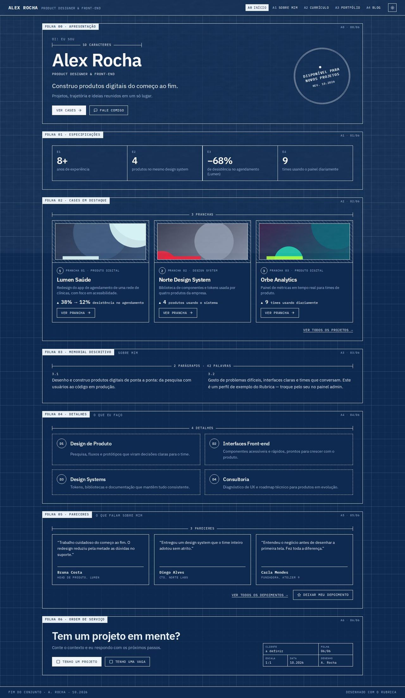 | [**Blueprint**](./blueprint.md) | Folhas técnicas numeradas sobre papel quadriculado, com cotas e carimbo | Códigos de folha no topo | Cianotipia · escuro · papel |
| 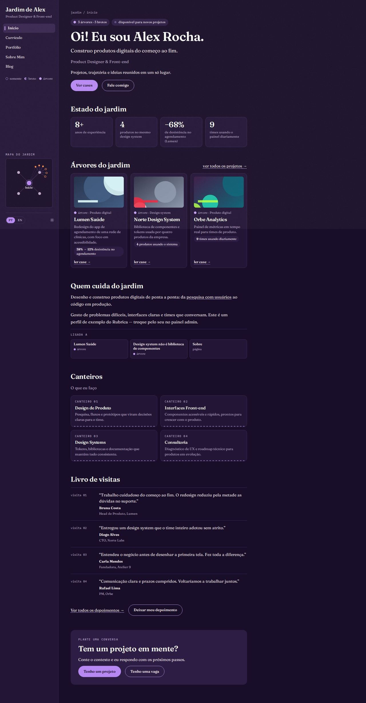 | [**Jardim Digital**](./garden.md) | Notas com estágio de crescimento, backlinks e mapa de ligações | Barra lateral com mapa | Crepúsculo · escuro · grão |
| 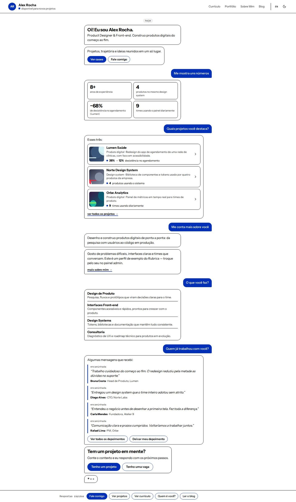 | [**Conversa**](./chat.md) | O site como conversa: cada seção responde a uma pergunta pronta | Respostas rápidas fixas no rodapé | Alto Contraste · claro |
| 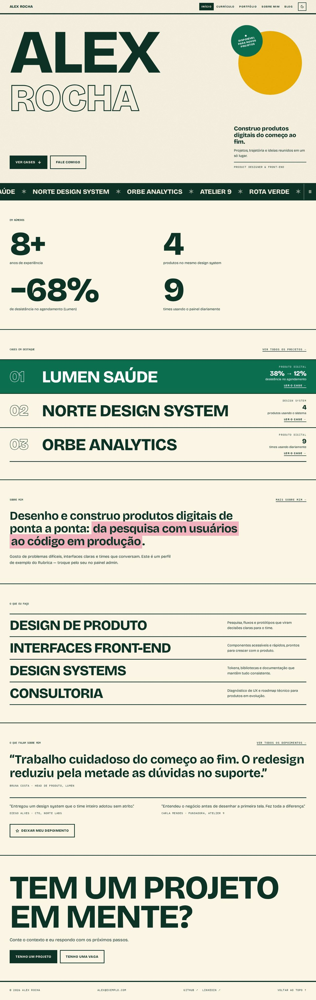 | [**Pôster Cinético**](./poster.md) | Tipografia gigante do começo ao fim, com faixa rolante de projetos | Barra fixa no topo | Tropicália · claro · grão |

## Esquemas de cores, modos e textura

Veja [**Esquemas de cores**](./cores.md): os 15 esquemas nos dois modos, os 11 papéis de cor, as 4 cores dos layouts originais, o modo claro/escuro/automático com alternância e as texturas.

Para criar ou manter um layout, veja [**Criando um layout**](./criando-um-layout.md).

## Como o CLI aplica o layout

| O que o template traz | Para onde vai no projeto |
|---|---|
| `templates/layouts/<layout>/*.tsx` (Layout, navegação) | `src/components/` |
| `templates/layouts/<layout>/pages/*.tsx` | `src/pages/` (substitui Home, Currículo, Portfólio, Sobre e Blog) |

O **Cyberpunk** não tem `pages/`: ele usa as páginas do próprio app. Páginas que nenhum layout substitui (post do blog, estudo de caso, depoimentos, propostas, checkout, admin) são compartilhadas por todos e também seguem o esquema escolhido, nos dois modos. O painel admin fica sempre no modo escuro.

## Sobre as imagens

As capturas foram geradas rodando o CLI de verdade para cada layout e fazendo o build do projeto gerado, com os **dados de exemplo** de `public/data/` (perfil fictício "Alex Rocha"). Para regenerar esses dados: `npx tsx scripts/generate-sample-data.ts`. Para ver qualquer layout em qualquer esquema: `npx tsx scripts/preview-layout.ts --layout <id> --port <porta> --scheme <esquema>` e `node scripts/shot-layout.mjs --port <porta>` (veja [Criando um layout](./criando-um-layout.md)).
