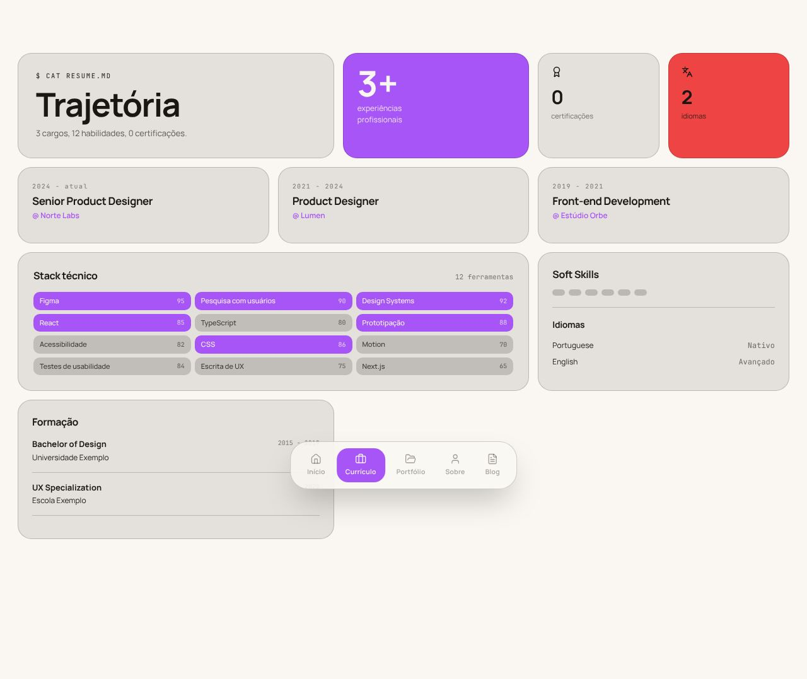
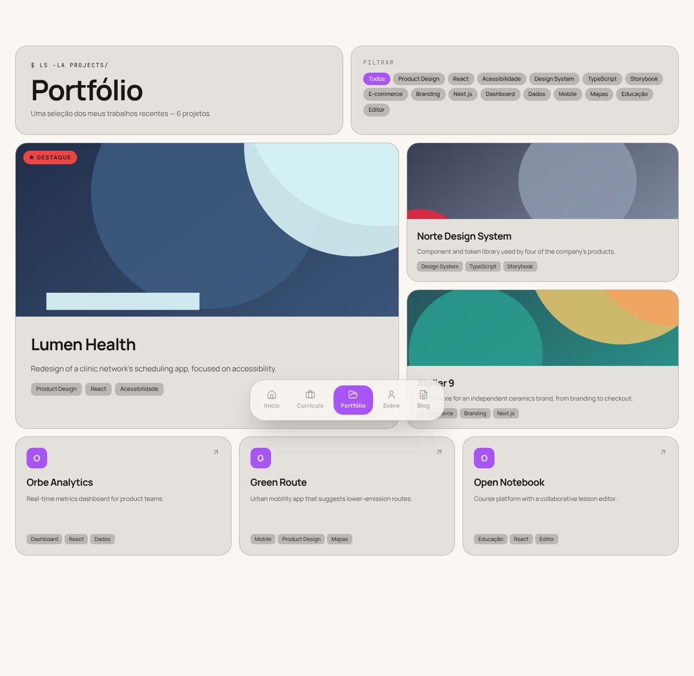
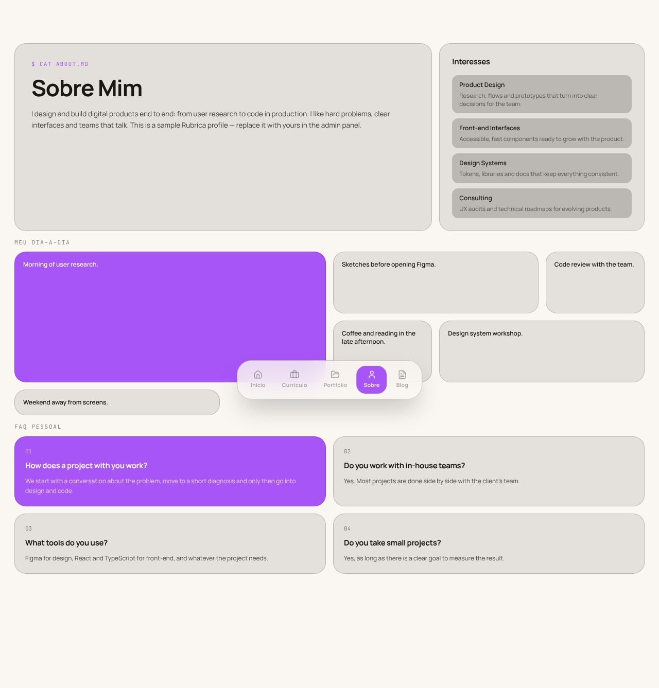
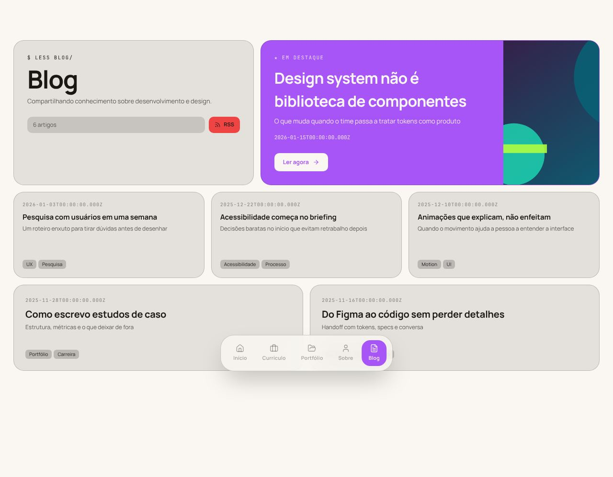

# Bento

> _Grid assimétrico com floating dock — moderno, orientado a produto._

Capturas com a paleta **Editorial Cream**. Veja o layout em todas as paletas em [Esquemas de cores](./cores.md#bento).

## Conceito

Cada página é um **mosaico de cartões** ("bento box") montado num grid de 12 colunas com 14px de espaço entre eles. Os cartões têm cantos bem arredondados (22px), borda fina e um fundo levemente tingido pela cor do texto — sem sombras, para manter o mosaico limpo. A navegação sai do topo e vira uma **dock flutuante** no rodapé, como em um sistema operacional.

A **primária** vira fundo dos cartões mais importantes (com texto na cor do fundo), o **destaque** marca cartões secundários, e o hero da Home combina as duas num gradiente. Os títulos são grandes e compactos (peso 700, 44–76px) e cada página abre com um rótulo em mono no estilo de comando: `$ whoami`, `$ cat resume.md`, `$ ls -la projects/`, `$ cat about.md`, `$ less blog/`.

- **Fontes recomendadas:** Manrope (principal) e JetBrains Mono (mono).
- **Arquivos do template:** `Layout.tsx`, `FloatingDock.tsx` e as 5 páginas em `pages/`.

## Estrutura global

- **Dock flutuante** fixa no rodapé, centralizada: cápsula translúcida com desfoque de fundo e 5 itens (ícone + rótulo) e, separado por um filete, o ícone de modo claro/escuro (só com a alternância ligada). O item ativo fica num bloco na primária. No celular, os itens ficam mais estreitos para a dock caber em 360px.
- As páginas reservam espaço no rodapé para a dock não cobrir o conteúdo.

## Páginas

### Início

- **Hero** em 8 colunas × 2 linhas com gradiente primária → destaque: `$ whoami → Nome`, a frase de valor (`home.hero.headline`), o cargo e dois botões, **"Ver cases"** e **"Fale comigo"** (abre o formulário de contato).
- Cartão de **perfil** com avatar de iniciais e botões de GitHub/LinkedIn.
- Cartões de **contato** (e-mail no destaque, WhatsApp) conforme a visibilidade de cada um.
- **Números de destaque** logo abaixo do hero: até 4 cartões vindos de `home_metrics` (admin → Home → Números), o primeiro na primária. A faixa some quando não há números.
- **"Cases em destaque"**: os 3 primeiros projetos com página de case, cada um com imagem, a primeira métrica do case e o link `$ cat case.md`.
- Serviços em 2×2 numerados "01 / 04"; depoimentos com o primeiro grande na primária e os seguintes pequenos.
- Rodapé com atalhos em pílula para as outras páginas.

### Currículo

- Linha de cartões-resumo: **"Trajetória"** com o resumo (primeiro parágrafo do "sobre") e o botão **"Baixar CV (PDF)"**, ao lado de experiências em número grande na primária, certificações e idiomas.
- **Números de destaque** (os mesmos da home) logo abaixo.
- Experiências em 3 colunas com até 3 marcadores cada; as mais antigas ficam atrás de "ver experiências anteriores".
- **"Stack técnico"**: habilidades em chips **agrupados por categoria** (campo "Grupo" no admin), o primeiro grupo na primária. Sem níveis numéricos.
- Soft skills e idiomas ao lado; formação, cursos e voluntariado na última linha.

### Portfólio

- **Filtro por categoria** em pílulas ("Todos" + as categorias dos projetos). Sem nenhuma categoria cadastrada, o filtro some.
- **Grid hierárquico**: o 1º projeto vira destaque (7 colunas × 2 linhas, imagem grande, selo "★ Destaque"), o 2º e o 3º ficam médios, e os demais viram cartões compactos com a inicial.
- Cada cartão mostra a **primeira métrica do case** e **uma ação só**: `$ cat case.md` quando há case, senão o link do projeto.

### Sobre

- Cartão "Sobre Mim" abrindo com o **"Resumo profissional"** (o texto "sobre", com os números em destaque) e, ao lado, **"Interesses"** reaproveitando os serviços da Home.
- **"Como eu trabalho"**: os princípios de trabalho (admin → Home → Princípios) em cartões numerados, o primeiro na primária.
- **"Fora do trabalho"**: o texto pessoal, depois da parte profissional.
- **"Meu dia-a-dia" como mosaico** de 6 colunas com tamanhos variados, o primeiro item maior e na primária.
- FAQ em 2×2 numerado, a primeira pergunta na primária.

### Blog

- Cartão de título com a contagem de artigos e selo "RSS".
- **Post em destaque** num cartão largo na primária, com imagem à direita e "Ler agora" (abre o post).
- Os demais posts num mosaico de 6 colunas com tamanhos variados (dois deles maiores).

## Limitações conhecidas

- Os grids são fixos (12, 6, 3 e 2 colunas) sem breakpoints: no celular as colunas encolhem, e o título de 76px pode estourar.
- O texto sobre a cor de destaque (cartão de e-mail, idiomas, RSS, selo "Destaque") vira preto ou branco conforme a luminosidade do destaque (`--bento-on-accent`, definido no `Layout.tsx`), para ficar legível nos dois modos. Precisa de navegador com sintaxe de cor relativa (`oklch(from …)`).
- Só o post em destaque tem link; os cartões de projetos e dos demais posts ainda não são clicáveis.
