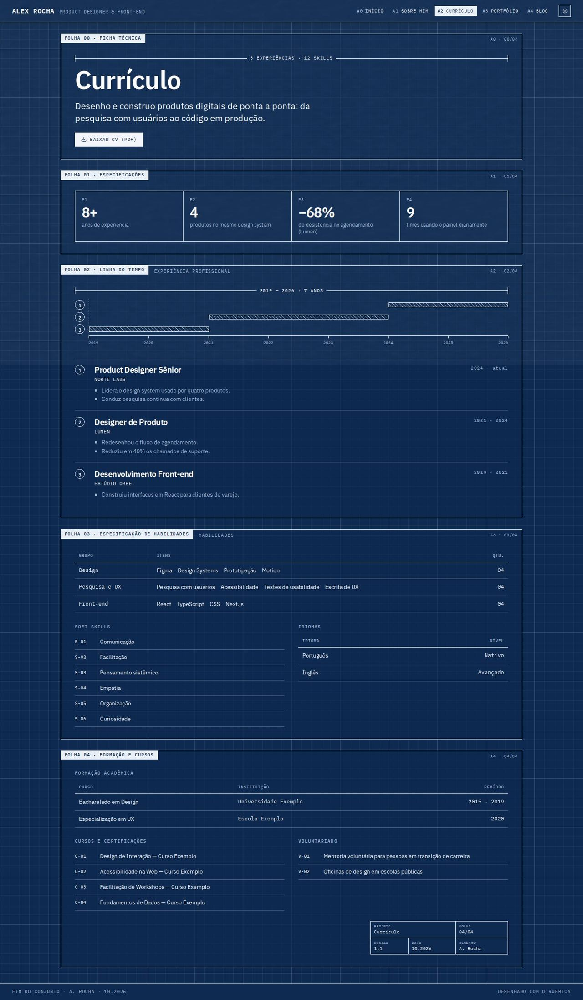
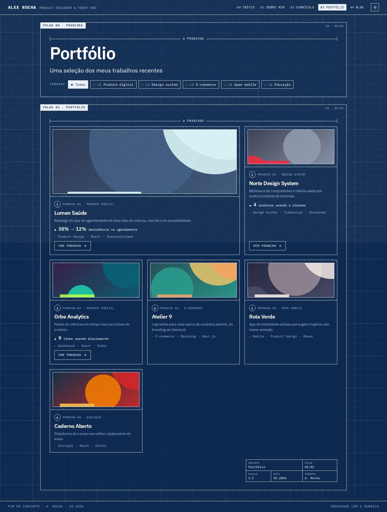
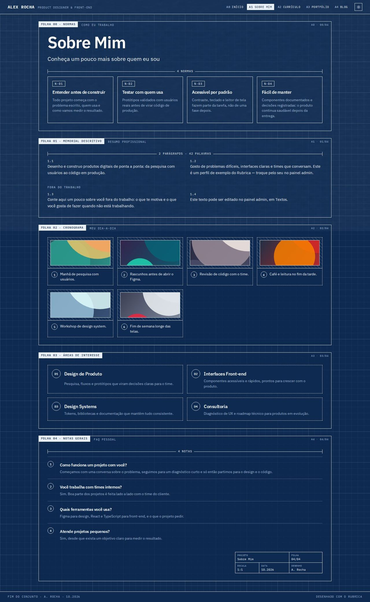
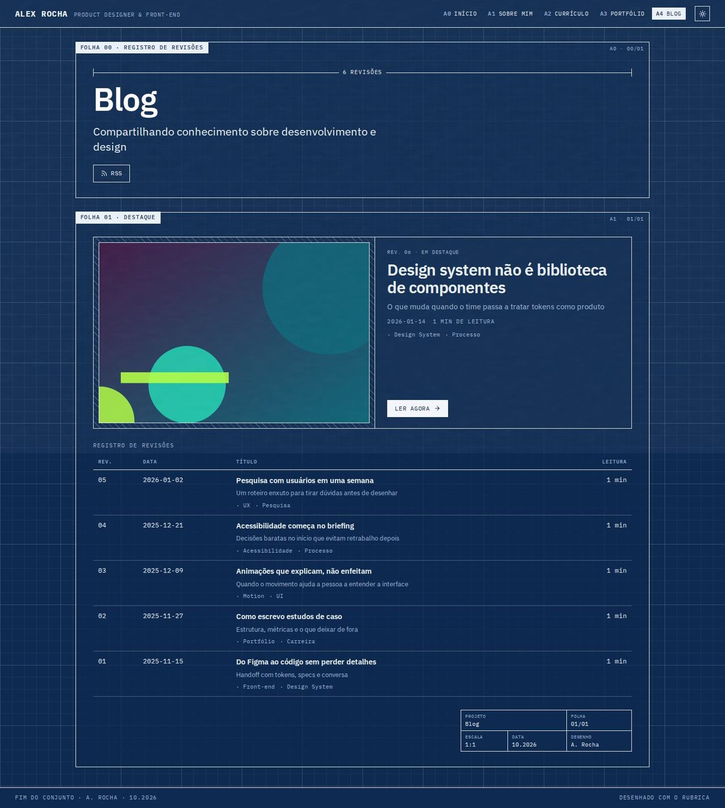

# Blueprint

> _Folhas técnicas numeradas sobre papel quadriculado, com cotas e carimbo — engenharia e precisão._

Capturas com o esquema **Cianotipia**, modo escuro (o recomendado), em 1440px.

## Conceito

Cada seção é uma **folha técnica** com moldura, sobre um papel quadriculado (grid fino de 24px e grid forte de 120px, feitos com `linear-gradient` a partir de `--text`). No canto de cada folha fica a etiqueta **"FOLHA 0X · TÍTULO"** (é o `h2` da seção) e, do outro lado, a referência "A2 · 02/06". As folhas se numeram sozinhas: quando uma seção some por falta de dados, as seguintes sobem.

O vocabulário do desenho técnico vira conteúdo:

- **Linhas de cota** medem os elementos com informação real: o número de caracteres do nome, "3 PRANCHAS", "2 PARÁGRAFOS · 42 PALAVRAS", "2019 — 2026 · 7 ANOS".
- **Números em círculo** com legenda numeram pranchas, experiências, detalhes e notas.
- **Carimbo** (tabela de título: projeto, folha, escala, data, desenho) fecha cada página.

Regra de ouro: carimbos, cotas e números em círculo ficam **sempre no fluxo** do documento, nunca posicionados por cima de outro elemento. Por isso não cobrem texto em nenhuma largura.

- **Fontes recomendadas:** IBM Plex Sans (principal) e IBM Plex Mono (mono). A mono é a voz do layout (etiquetas, rótulos, botões); a sans fica com títulos e parágrafos.
- **Aparência recomendada:** esquema `cianotipia`, modo escuro, textura `paper`.
- **Cores:** só as variáveis do esquema. O texto colorido usa `--blueprint-ink` (mistura de `--primary` com `--text`), legível mesmo com primárias claras como o amarelo do Concreto. Contornos de carimbo e círculos usam `--blueprint-mark`.
- **Arquivos do template:** `Layout.tsx`, `BlueprintHeader.tsx`, `BlueprintShared.tsx` (folha de estilo, textos pt-BR/en-US e as peças `Sheet`, `Dim`, `Num`, `TitleBlock`, `PageTitleBlock`, `Hatch`) e as 5 páginas em `pages/`.

## Estrutura global

- **Cabeçalho fixo** com o nome, a especialidade em mono e a navegação como códigos de folha: **A0 INÍCIO, A1 SOBRE MIM, A2 CURRÍCULO, A3 PORTFÓLIO, A4 BLOG**. Os itens de plugins desligados somem e os códigos seguem em sequência. A página atual fica invertida (`aria-current="page"`). O `<ColorModeToggle />` fica à direita.
- Link "Pular para o conteúdo" para teclado, e foco visível tracejado em todos os controles.
- **Rodapé** com "Fim do conjunto · A. Rocha · 10.2026".
- As páginas compartilhadas (post, case, depoimentos, proposta, checkout) aparecem dentro de uma folha simples, sobre o mesmo papel.

## Páginas

### Início

- **Folha 00 · Apresentação:** "Oi! Eu sou", a cota com o número de caracteres do nome, o nome (`h1`), o cargo, a frase de valor (`home.hero.headline`), a descrição e os botões **"Ver cases"** e **"Fale comigo"** (abre o formulário). Com a disponibilidade ligada, um **carimbo circular girado** com o texto da disponibilidade e "REV. mês.ano", numa coluna própria.
- **Especificações:** os números de destaque (até 4) como tabela E1–E4. Some sem números.
- **Cases em destaque:** cota "3 PRANCHAS" e os cases como **pranchas**: área hachurada com a imagem emoldurada, legenda "① PRANCHA 01 · categoria", título, descrição, a primeira métrica com ▲ e "VER PRANCHA →" (o cartão inteiro é clicável).
- **Memorial descritivo:** o texto "sobre" em 2 colunas, parágrafos numerados (3.1, 3.2…) e números de resultado em destaque.
- **Detalhes:** os serviços como D1–D4 em caixas tracejadas.
- **Pareceres:** até 3 depoimentos com linha de assinatura, "Ver todos os depoimentos" (plugin `testimonials`) e "Deixar meu depoimento" (plugin `testimonials-intake`).
- **Ordem de serviço:** "Tem um projeto em mente?", as caixas de marcar **"Tenho um projeto"** e **"Tenho uma vaga"** e o carimbo (cliente "a definir", folha, escala, data, desenho). Com o formulário desligado, a página fecha só com o carimbo.

### Currículo

- **Ficha técnica:** cota com o total de experiências e skills, título, resumo (primeiro parágrafo do "sobre") e **"Baixar CV (PDF)"**.
- **Especificações:** os mesmos números da home.
- **Linha do tempo:** um **eixo cotado** com os anos marcados e uma barra hachurada por experiência, numerada em círculo; abaixo, a legenda com cargo, empresa, período e descrição. As experiências antigas ficam atrás de "ver experiências anteriores". O eixo só aparece quando os períodos têm ano ("2021 - 2024", "2024 - atual").
- **Especificação de habilidades:** tabela GRUPO | ITENS | QTD. (campo "Grupo" no admin, sem níveis numéricos), soft skills codificadas S-01… e tabela de idiomas.
- **Formação e cursos:** tabela de formação, cursos e certificações (C-01…) e voluntariado (V-01…). Fecha com o carimbo.

### Portfólio

- **Pranchas:** cota com o número de projetos, título e as categorias como **CAMADAS** ligáveis ("■ Todas", "□ L1 Produto digital"…), botões com `aria-pressed`. Escolher uma camada isola os projetos dela; clicar de novo volta para todas. Sem categorias, as camadas somem.
- **Grid de pranchas numeradas:** a primeira ocupa 2 colunas (destaque), as demais em 3 colunas. Cada prancha mostra legenda, título, descrição, a primeira métrica do case com ▲, até 4 tags e **uma ação só**: "VER PRANCHA →" quando há case, senão "VER PROJETO ↗" (demo ou código).

### Sobre

- **Normas:** abre com o título e "Como eu trabalho": os princípios como normas **N-01, N-02…**. Sem princípios, a folha vira só a apresentação.
- **Memorial descritivo:** o resumo profissional em 2 colunas numeradas e, em seguida, "Fora do trabalho" (texto pessoal).
- **Cronograma:** o dia a dia em passos numerados, com a imagem de cada item na área hachurada.
- **Áreas de interesse:** os serviços da home como D1, D2…
- **Notas gerais:** o FAQ como notas numeradas (pergunta e resposta). Fecha com o carimbo.

### Blog

- **Registro de revisões:** cota com o número de posts, título, subtítulo e o botão **RSS** (`/rss.xml`).
- **Destaque:** o post em destaque (ou o mais recente) como **prancha grande**: imagem hachurada, "REV. 06 · Em destaque", título, subtítulo, data ISO, tempo de leitura, tags e "Ler agora".
- **Tabela REV | DATA | TÍTULO | LEITURA** com os demais posts (revisões numeradas da mais antiga para a mais nova), subtítulo e tags sob o título, cada título com link para `/blog/<slug>`. Sem posts, aparece "Nenhum artigo publicado ainda".

## Celular

- As folhas ficam em uma coluna; o cabeçalho deixa de ser fixo e a navegação quebra em linhas.
- O carimbo circular vai para baixo dos botões, menor; a referência "A2 · 02/06" some.
- As cotas encolhem; no eixo do currículo só ficam o primeiro e o último ano.
- As tabelas de dados (habilidades, formação, revisões do blog) viram listas: cada linha é um bloco e cada célula traz o próprio rótulo.

## Limitações conhecidas

- O texto da disponibilidade fica dentro de um círculo de 200px (150px no celular): textos muito longos (mais de ~60 caracteres) ficam cortados.
- O eixo cotado lê os anos do texto do período (`2019 - 2021`, `2024 - atual`/`present`); períodos sem ano entram só na lista, sem barra.
- O tempo de leitura é estimado a 200 palavras por minuto.
- O filtro de camadas é de seleção única (isola uma categoria), como nos outros layouts.
- As capturas de página inteira mostram uma faixa na altura da janela: é a camada de textura global (`data-texture`), que é fixa na tela.
