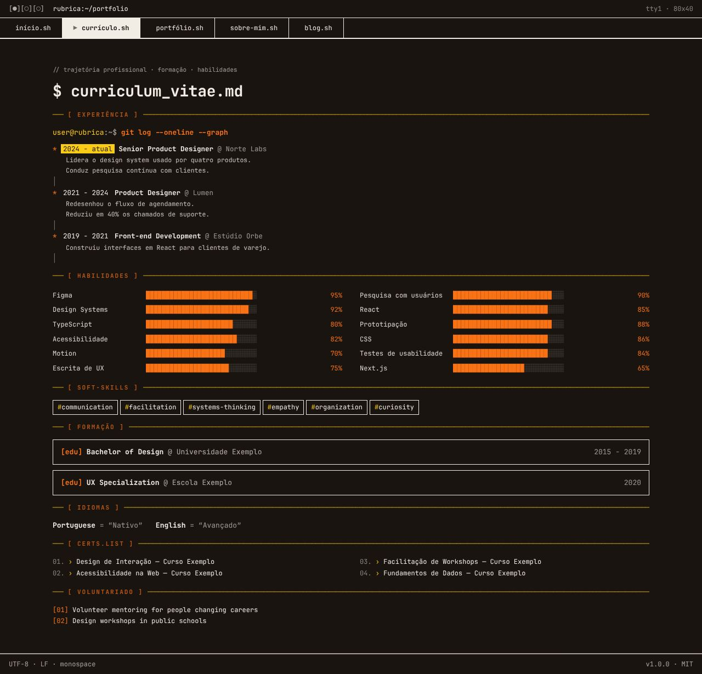
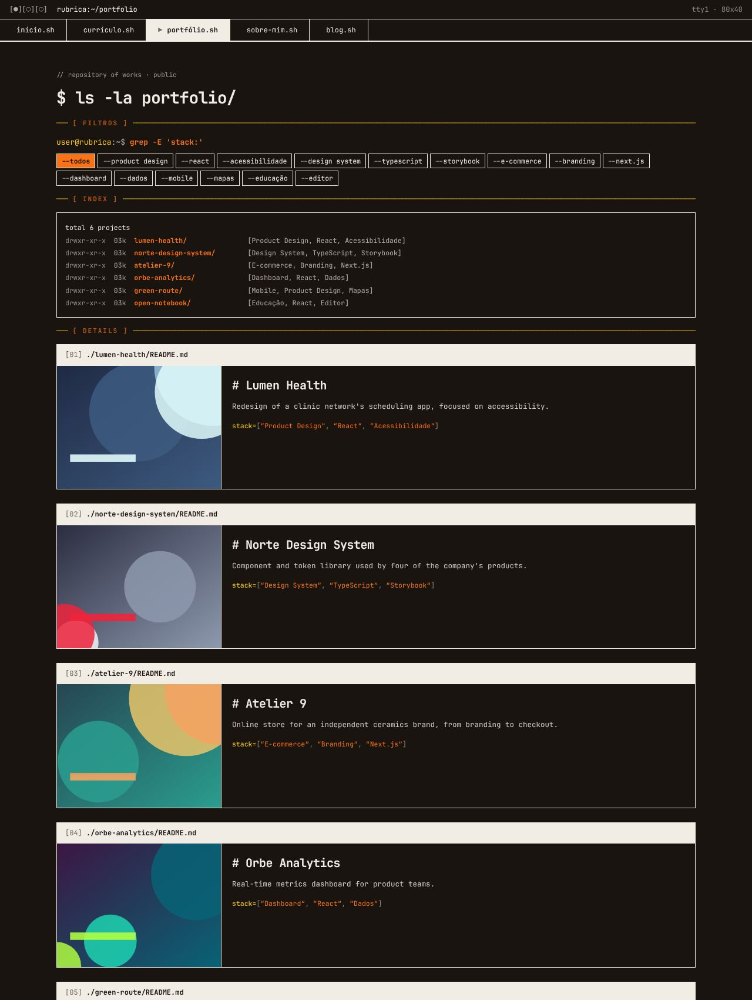
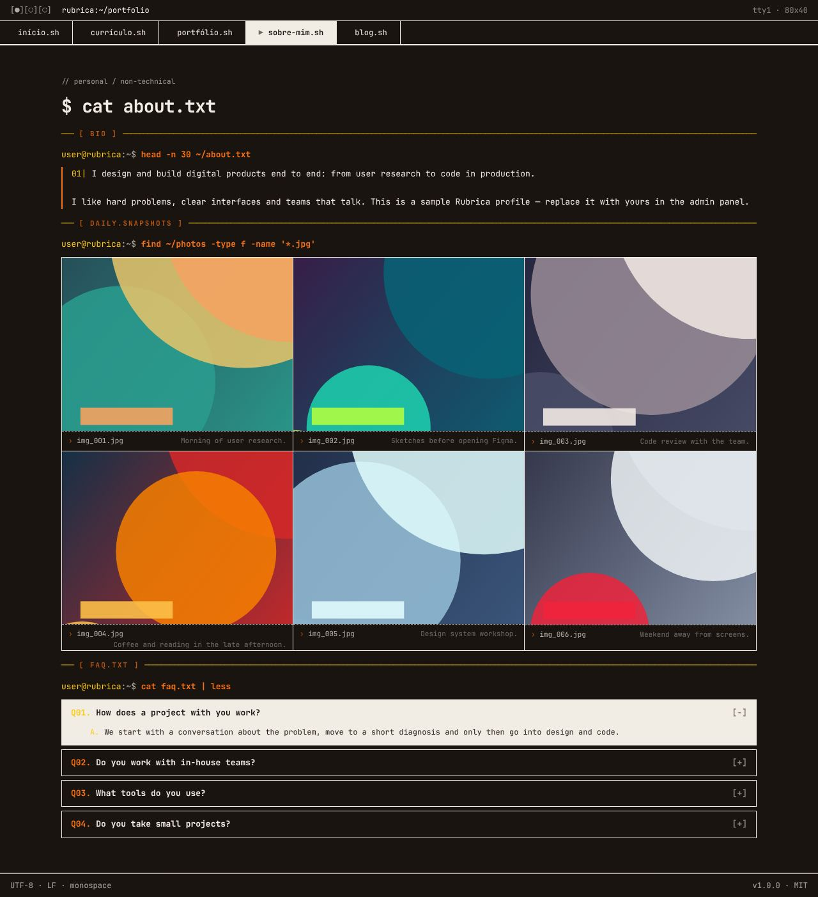
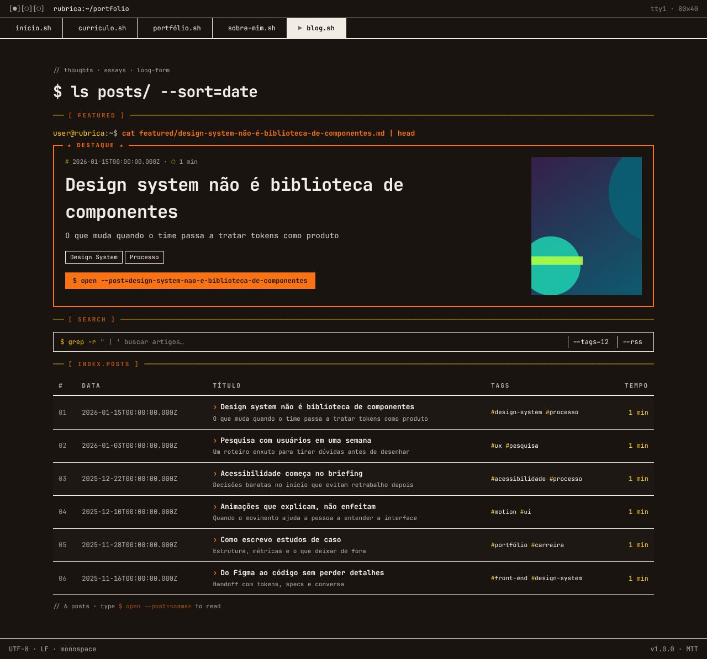

# Brutalism Terminal

> _Identidade hacker total — monospace, sem bordas arredondadas._

Capturas com a paleta **Solar Warm**. Veja o layout em todas as paletas em [Esquemas de cores](./cores.md#brutalism-terminal).

## Conceito

O site inteiro imita uma sessão de terminal Unix. Cada seção é um **comando** (`user@rubrica:~$ cat about.txt`) seguido da sua "saída", e as seções são separadas por réguas ASCII como `─── [ WHOAMI ] ────`. Toda a interface usa fonte monospace em 13px, a largura máxima é de 1200px e **não existe nenhum canto arredondado**: tudo são caixas retas com bordas sólidas de 1–2px na cor do texto.

As cores seguem um código fixo: a **primária** pinta comandos, rótulos e destaques; o **destaque** pinta o host do prompt e os marcadores (`›`, `#`, traço das réguas); e o item ativo ou mais importante aparece **invertido** (fundo na cor do texto, texto na cor do fundo).

- **Fonte recomendada:** JetBrains Mono — o layout usa `--font-mono` em tudo.
- **Arquivos do template:** `Layout.tsx`, `Navbar.tsx` e as 5 páginas em `pages/`.

## Estrutura global

- **Barra de janela**: `[●][○][○]  rubrica:~/portfolio` à esquerda; à direita, o botão de modo claro/escuro ("modo escuro"/"modo claro"; no celular só o ícone, e só com a alternância ligada) e `tty1 · 80x40` (escondido no celular).
- **Abas como scripts**: `início.sh`, `currículo.sh`, `portfólio.sh`, `sobre-mim.sh`, `blog.sh`. A aba ativa fica invertida e ganha o marcador `▶`; abas de plugins desligados somem.
- **Rodapé** de status: `UTF-8 · LF · monospace` e `v1.0.0 · MIT`.
- No celular, as abas rolam na horizontal.

## Páginas

### Início

- O nome vira um **banner ASCII** gerado com [figlet](https://github.com/patorjk/figlet.js) (fonte "Big") na primária; enquanto ele é gerado, aparece o nome em texto grande.
- `cat /etc/motd` mostra a **frase de valor** (`home.hero.headline`), o cargo e o texto "sobre", seguidos dos botões `› Ver cases` e `› Fale comigo` (este só com o formulário de contato ativo).
- `[ STATS ]`: até 4 **números de destaque** (admin → Home → Números) em caixas lado a lado; some quando não há números.
- `[ CASES EM DESTAQUE ]`: `ls -la cases/ --featured` mostra os 3 primeiros projetos com case, cada um com a primeira métrica e o link `$ cat case.md`.
- `[ CAPABILITIES ]` detalha os serviços numerados (`[01]`, `[02]`…).
- `cat clients/*.txt | head` mostra os depoimentos como arquivos (`> from: nome <cargo>`), com o primeiro invertido.
- `[ CONTACT ]`: `./contato.sh` com dois caminhos, `› Tenho um projeto` e `› Tenho uma vaga`.
- `echo $CONTACT` imprime `email=` e `phone=` conforme a visibilidade de cada um, e a página termina com um **cursor piscando**.

### Currículo

- `[ RESUMO ]`: `cat summary.txt` com o primeiro parágrafo do "sobre", os números de destaque e o botão `↓ Baixar CV (PDF)`.
- Experiência como **`git log --oneline --graph`**: cada cargo é um commit, com o período atual destacado. As 2 mais recentes aparecem; as anteriores ficam atrás de `[+] ver experiências anteriores`.
- Habilidades **agrupadas por categoria** (`## design`, `## front-end`…) em chips, sem nível numérico. Skills sem grupo vão para `## stack`.
- Soft skills como `#hashtags-em-kebab`, idiomas como `Nome = "nível"`, formação em caixas `[edu]`, cursos numerados em 2 colunas e voluntariado num bloco `<pre>`.

### Portfólio

- **Filtro por categoria** em forma de flags: `--todos`, `--produto-digital`, `--e-commerce`… A linha some quando nenhum projeto tem categoria.
- `[ INDEX ]`: a lista de projetos no formato de `ls -la` (`drwxr-xr-x`, nome-em-kebab/ e a categoria).
- `[ DETAILS ]`: um "README" por projeto, com cabeçalho invertido `[01] ./nome/README.md`, imagem, descrição, a **primeira métrica do case** e `stack=[…]`. A ação é uma só: `$ cat case.md` quando há case; senão, `$ open --demo` e `$ open --source` quando há links.

### Sobre

- `[ RESUMO PROFISSIONAL ]`: `head -n 30 ~/about.txt`, o texto "sobre" em parágrafos numerados (`01|`), com os números de resultado em destaque.
- `[ COMO EU TRABALHO ]`: `cat ~/method.md` com os princípios de trabalho (admin → Home → Princípios) em caixas numeradas; some quando não há princípios.
- `[ FORA DO TRABALHO ]`: `cat ~/offline.txt` com o texto pessoal, depois do profissional.
- `find ~/photos`: o dia-a-dia em grade de 3 colunas, com legendas `img_001.jpg`.
- `cat faq.txt | less`: FAQ em `
` (`Q01.` / `A.`), o primeiro aberto e invertido.

### Blog

- `[ FEATURED ]`: o post em destaque numa caixa com borda na primária e selo `★ DESTAQUE ★`, com data, tempo de leitura, tags e o "botão" `$ open --post=<slug>`.
- Barra de busca decorativa (`$ grep -r`, `--tags`, `--rss`).
- `[ INDEX.POSTS ]`: os posts como uma **tabela** (#, data, título, tags, tempo de leitura) com linhas zebradas.

## Limitações conhecidas

- As páginas usam grades fixas (2 e 3 colunas) sem breakpoints: no celular, o conteúdo encolhe em vez de reorganizar.
- A barra de busca do Blog é decorativa, e os posts da tabela ainda não têm link.
