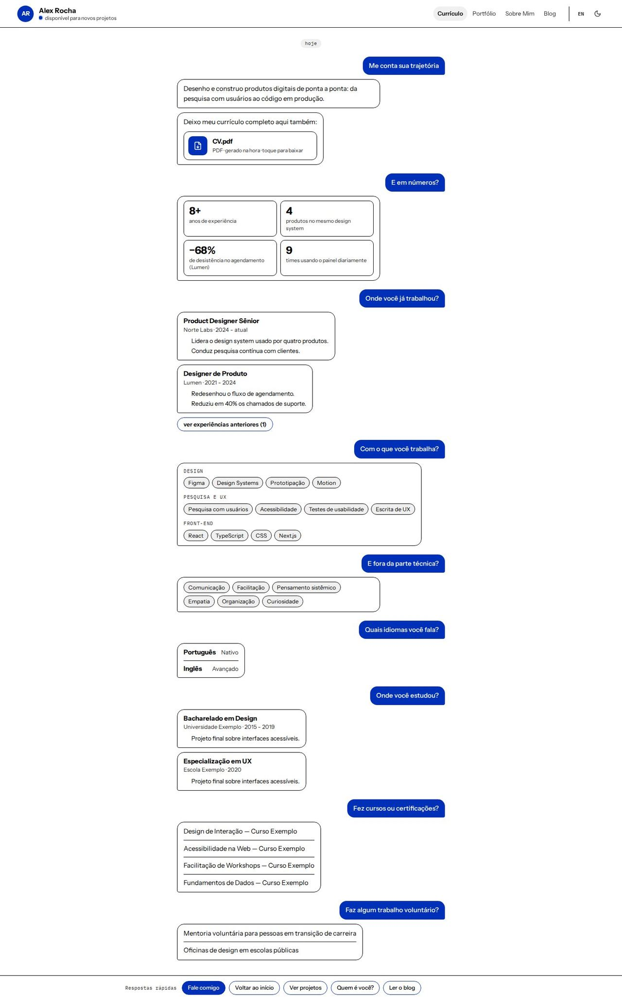
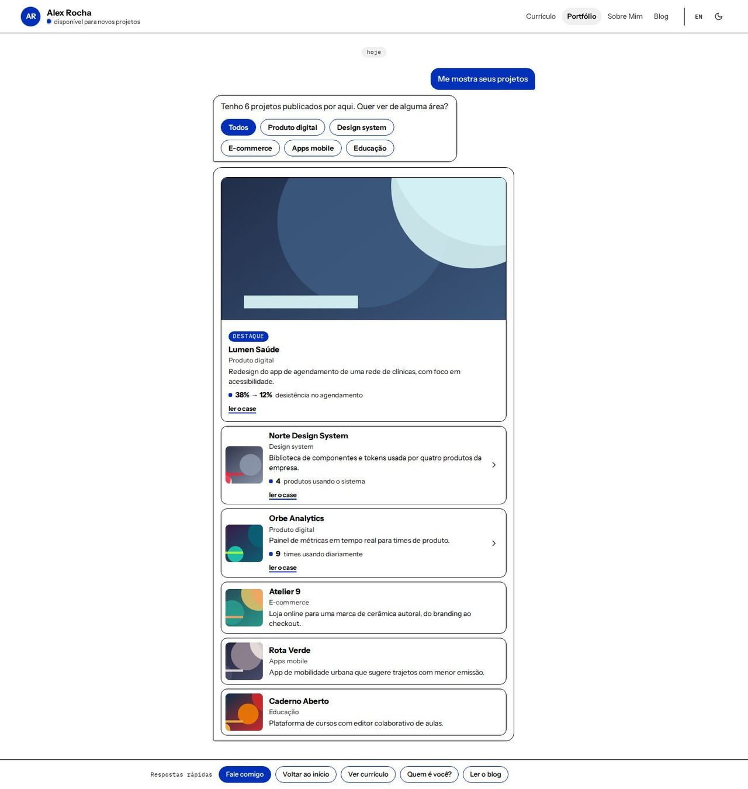
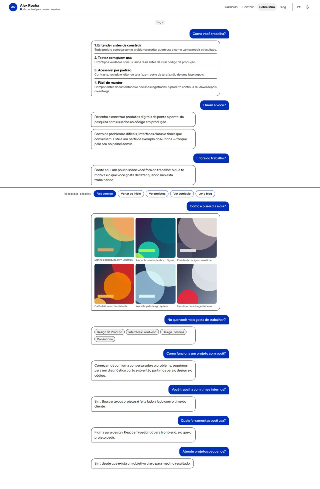
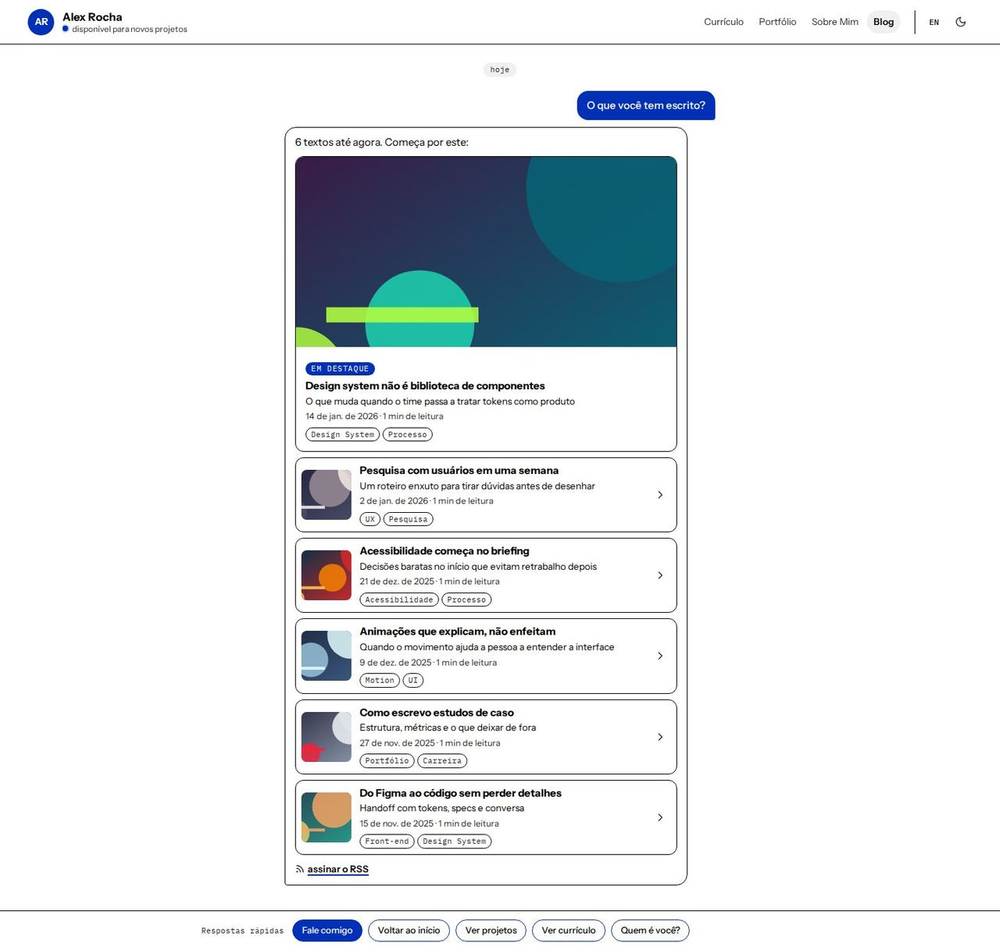

# Conversa

> _O site como conversa: cada seção responde a uma pergunta pronta._

Capturas com o esquema **Alto Contraste**, modo claro. O layout usa o esquema completo e funciona com qualquer esquema, nos dois modos.

## Conceito

**Proximidade.** O site inteiro é uma conversa com a pessoa dona do portfólio, como num aplicativo de mensagens. Quem visita "pergunta" (balões à direita, na primária) e a pessoa responde (balões à esquerda, na cor de superfície). Não há campo de texto falso: as perguntas já vêm prontas e a navegação são **respostas rápidas** fixas no rodapé.

A conversa fica numa coluna centralizada de ~620px. Respostas usam `--surface` com borda `--line`; perguntas usam `--primary` com texto em `--on-primary`; mini cartões (números, cases, anexos) usam `--bg` dentro do balão. Links de texto ficam na cor do texto com sublinhado na primária, para que o contraste não dependa da primária sobre o fundo.

Todo o conteúdo aparece no carregamento: nada fica escondido atrás de animação. Os três pontinhos de "digitando…" no fim da Home são só decoração (`aria-hidden`) e param com `prefers-reduced-motion`.

- **Esquema recomendado:** Alto Contraste, modo claro, sem textura.
- **Fontes recomendadas:** Instrument Sans (principal) e IBM Plex Mono (mono: marcador "hoje", rótulos de grupo, "encaminhada").
- **Arquivos do template:** `Layout.tsx`, `ChatHeader.tsx`, `ChatShared.tsx` e as 5 páginas em `pages/`.

## Estrutura global

- **Cabeçalho fixo** (`ChatHeader.tsx`), como o topo de uma conversa: avatar (foto da barra lateral, ou as iniciais na primária), nome e status — a disponibilidade com um ponto na primária quando ligada, senão o cargo. À direita, os links das páginas (respeitando os plugins), a troca de idioma (plugin `i18n`) e o `<ColorModeToggle />`. No celular os links somem do cabeçalho: a navegação fica no rodapé.
- **Rodapé de respostas rápidas** (`Layout.tsx`): "Fale comigo" (abre o formulário, plugin `contact-wizard`) seguido de links para as outras páginas — "Voltar ao início", "Ver projetos", "Ver currículo", "Quem é você?", "Ler o blog" — sem a página atual e sem as desligadas. Usa `position: sticky`: fica preso embaixo enquanto a página rola e, no fim, volta para o lugar dele, então nunca cobre o fim da conversa. No celular as respostas ficam numa linha que rola de lado, com "Fale comigo" sempre à vista.
- **Seções acessíveis:** cada bloco é um `<section>` com um título visualmente escondido ("Cases em destaque", "Experiência Profissional"…), para quem usa leitor de tela navegar pelos títulos. Cada página tem um `<h1>` (na Home, o "Oi! Eu sou…").
- **Páginas do app** (post, case, depoimentos, propostas, checkout) recebem a moldura com margem (`ct-shared`) e mantêm cabeçalho e rodapé.
- **Textos do layout** (as perguntas, "hoje", "encaminhada", rótulos das respostas rápidas) ficam em `ChatShared.tsx`, em pt-BR e en-US. O resto vem das traduções do app.

## Páginas

### Início

- Marcador "hoje" e dois balões de apresentação: **"Oi! Eu sou {nome}."** com o cargo e a frase de valor (`home.hero.headline`), depois a descrição com **"Ver cases"** (vai para os cases na própria conversa) e **"Fale comigo"**.
- **"Me mostra uns números"** → até 4 números de destaque em mini cartões 2×2. Sem números, a pergunta não aparece.
- **"Quais projetos você destaca?"** → "Esses três:" e os cases como cartões de link (miniatura, categoria e descrição, primeira métrica do case), cada um levando a `/portfolio/<slug>`, e "ver todos os projetos".
- **"Me conta mais sobre você"** → um balão por parágrafo do "sobre", com os números em destaque, e "mais sobre mim".
- **"O que você faz?"** → os serviços numa lista dentro do balão.
- **"Quem já trabalhou com você?"** → os depoimentos como **mensagens encaminhadas**, com "Ver todos os depoimentos" e "Deixar meu depoimento" conforme os plugins.
- Chamada final **"Tem um projeto em mente?"** com "Tenho um projeto" e "Tenho uma vaga".

### Currículo

- **"Me conta sua trajetória"** → o resumo (primeiro parágrafo do "sobre") e um anexo **CV.pdf** (cartão de arquivo) que gera e baixa o PDF.
- **"E em números?"** → os números de destaque.
- **"Onde você já trabalhou?"** → uma experiência por balão. As mais antigas ficam atrás de "ver experiências anteriores", que expande na própria conversa (`aria-expanded`).
- **"Com o que você trabalha?"** → habilidades em chips agrupados pelo campo "Grupo", sem níveis numéricos.
- Soft skills, idiomas, formação, cursos e certificações e voluntariado, cada um com a sua pergunta. Bloco vazio não aparece.

### Portfólio

- **"Me mostra seus projetos"** → "Tenho N projetos publicados por aqui. Quer ver de alguma área?" e as categorias como respostas rápidas ("Todos" + categorias). Sem categorias, o filtro some.
- Escolher uma categoria **vira uma pergunta na conversa** ("Só os de E-commerce") e a resposta traz só os projetos daquela área.
- Projetos como cartões de link; sem filtro, o primeiro vira **destaque** com imagem grande. Cada cartão mostra a primeira métrica do case e **uma ação só**: o case quando existe, senão o link do projeto (demo ou código). Sem link nenhum, o cartão não é clicável.

### Sobre

- **"Como você trabalha?"** → abre a conversa com os princípios de trabalho numerados.
- **"Quem é você?"** → o resumo profissional, um balão por parágrafo, com números em destaque.
- **"E fora do trabalho?"** → o texto pessoal, depois da parte profissional.
- **"Como é o seu dia a dia?"** → as fotos do dia a dia numa galeria dentro do balão, com legenda.
- **"No que você mais gosta de trabalhar?"** → os interesses (os serviços da Home) em chips.
- **FAQ como pares reais de pergunta e resposta**: cada pergunta do FAQ é um balão da visita e cada resposta, um balão da pessoa.

### Blog

- **"O que você tem escrito?"** → "N textos até agora. Começa por este:" e os posts como **prévias de link**: o destaque primeiro, com capa grande e selo "Em Destaque", depois os demais com miniatura.
- Cada prévia mostra título, subtítulo, data, tempo de leitura e até 4 tags, e leva a `/blog/<slug>`.
- No fim, "assinar o RSS" (`/rss.xml`, gerado no build).

## Limitações conhecidas

- O rodapé fixo ocupa ~60px da tela enquanto a página rola (no fim ele volta para o lugar dele e não cobre nada).
- Prints de página inteira feitos com a viewport menor que a página mostram o cabeçalho e o rodapé "sticky" no meio da imagem. É um efeito da captura, não do site; os prints desta doc foram feitos com a viewport do tamanho da página.
- Projetos sem case, sem demo e sem repositório aparecem como cartão sem ação.
- O filtro do portfólio não fica na URL: recarregar a página volta para "Todos".
- O link do RSS aponta para `/rss.xml`, que só existe quando o feed é gerado no build.
