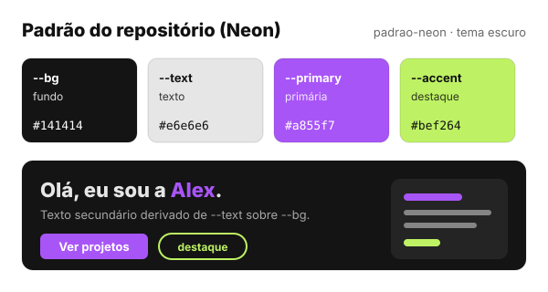

# Esquemas de cores

Todo tema do Rubrica é definido por **4 cores** — e só por elas. Isso é o que permite trocar a paleta de qualquer layout sem tocar em nenhum componente.

## O contrato de 4 cores

| Variável | Papel | Onde aparece |
|---|---|---|
| `--bg` | **Fundo** | Fundo das páginas; base das superfícies (cards, sidebar) |
| `--text` | **Texto** | Texto principal; base dos textos secundários, bordas e divisórias |
| `--primary` | **Primária** | Identidade: links ativos, títulos de seção, botões, blocos de destaque |
| `--accent` | **Destaque** | Segunda cor de marca: rótulos, sublinhados, selos, cards secundários |

As quatro guardam **cores completas** (hex, `hsl()`, `rgb()`…) e ficam em `src/index.css`, no bloco `:root`. Todo o resto é **derivado** delas:

| Token derivado | Como é calculado | Usado em |
|---|---|---|
| `--surface` | `--bg` 4 pontos mais escuro | cards, popovers, sidebar |
| `--subtle` | 1,4% de `--text` sobre `--bg` | fundos sutis, hover |
| `--line` | 8,5% de `--text` sobre `--bg` | bordas e inputs |
| `--text-muted` | 68% de `--text` sobre `--bg` | textos secundários |
| `--text-strong` | `--text` afastado do meio-tom | títulos (branco no escuro, quase preto no claro) |

Por isso uma paleta clara e uma escura funcionam igualmente bem: as superfícies, bordas e textos secundários se ajustam sozinhos.

### Regras para quem cria ou edita um layout

- Templates em `templates/layouts/` só usam `var(--bg)`, `var(--text)`, `var(--primary)` e `var(--accent)` (e misturas delas, como `color-mix()`).
- Nada de cores fixas pensadas para um fundo só: `text-white`, `text-gray-*`, `bg-white/10`… — use `text-foreground`, `text-foreground/65`, `bg-foreground/10`, `text-foreground-strong`.
- O teste `tests/app/colorContract.test.ts` verifica essas regras em todos os templates.

## Como escolher ou mudar a paleta

1. **Ao criar o projeto**: o CLI pergunta o "Tema visual" e grava as 4 cores no `src/index.css`.
2. **Depois, pelo CLI**: `rubrica config` permite trocar a paleta.
3. **Pelo painel admin**: em **Site & Aparência** (`/admin/site-config`), seção **Aparência**, escolha as 4 cores com o seletor (com indicador de contraste WCAG). Elas são salvas no Convex e aplicadas por cima da paleta do projeto, sem novo deploy.
4. **À mão**: edite as 4 variáveis no `:root` de `src/index.css`.

## As paletas

### Editorial Cream — `editorial-cream`

Papel creme e tinta quase preta, com roxo e vermelho como cores de marca. Refinado e atemporal — feito para blogs e portfólios com muito texto.

### Paper Noir — `paper-noir`

Off-white e preto puro com vermelho e azul primários. Contraste máximo e uma identidade editorial forte, na linha do design suíço.

### Midnight Blue — `midnight-blue`

Azul-noite profundo com ciano e amarelo. Tech e premium — para devs e designers que preferem o escuro.

### Solar Warm — `solar-warm`

Marrom quase preto com laranja e amarelo. Energia e calor — para marcas pessoais vibrantes.

### Padrão do repositório (Neon)

São os valores de `src/index.css` no repositório, antes de qualquer paleta ser aplicada: o visual original do Rubrica, com roxo e verde-limão neon. Não é uma opção do CLI — todo projeto criado recebe uma das 4 paletas acima.

## Na prática: a página inicial de cada layout

Mesma página, mesmo conteúdo — só as 4 cores mudam.

### Cyberpunk

| Editorial Cream | Paper Noir |
|---|---|
|  |  |
| **Midnight Blue** | **Solar Warm** |
|  |  |

### Brutalism Terminal

| Editorial Cream | Paper Noir |
|---|---|
|  |  |
| **Midnight Blue** | **Solar Warm** |
|  |  |

### Swiss Grid

| Editorial Cream | Paper Noir |
|---|---|
|  |  |
| **Midnight Blue** | **Solar Warm** |
|  |  |

### Bento

| Editorial Cream | Paper Noir |
|---|---|
|  |  |
| **Midnight Blue** | **Solar Warm** |
|  |  |

### Magazine

| Editorial Cream | Paper Noir |
|---|---|
|  |  |
| **Midnight Blue** | **Solar Warm** |
|  |  |
