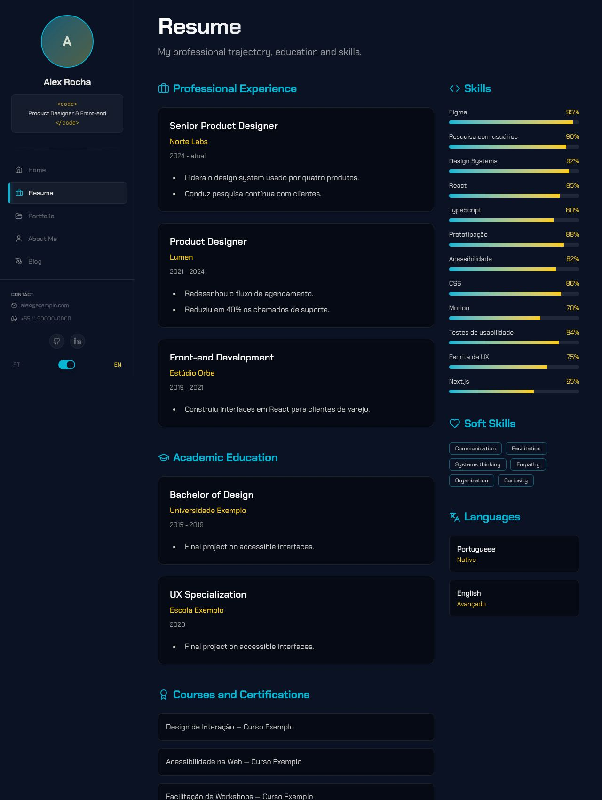
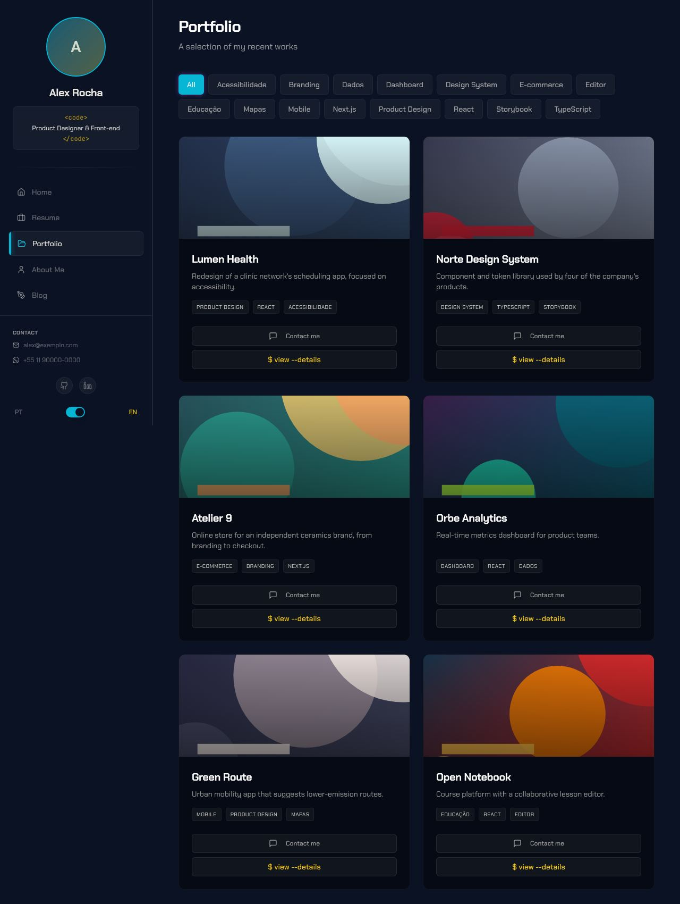
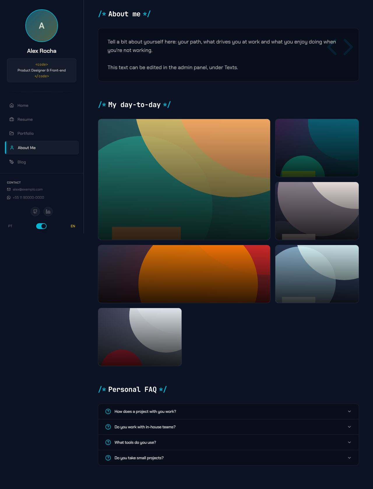
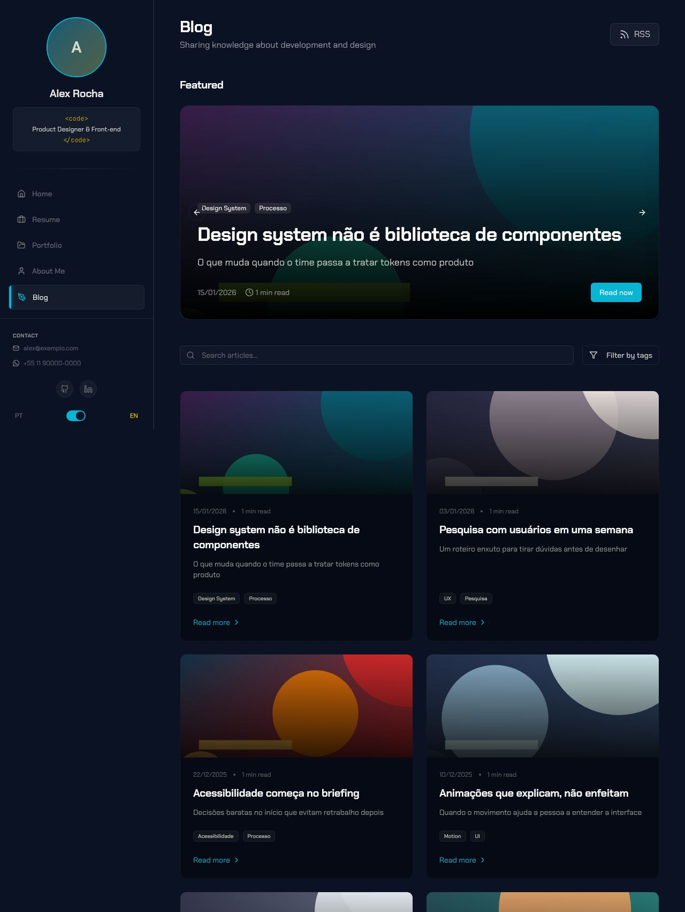

# Cyberpunk

> _Sidebar lateral com foto de perfil — dev, designer, freelancer._

Capturas com a paleta **Midnight Blue**. Veja o layout em todas as paletas em [Esquemas de cores](./cores.md#cyberpunk).

## Conceito

É o visual original do Rubrica: um portfólio escuro com estética de terminal neon. Uma sidebar fixa à esquerda concentra a identidade (foto, nome, cargo) e a navegação, enquanto o conteúdo rola à direita. A linguagem de código aparece nos detalhes: o cargo entre `<code>…</code>`, prompts como `$ cat role.txt` e títulos de seção no formato `/* Sobre mim */`.

A **primária** marca o que é navegação e estrutura: item ativo com brilho, ícones, títulos de seção, filtros ativos. O **destaque** marca o que é conteúdo: cargo, sublinhado do nome, títulos dos serviços, botão "Baixar CV".

- **Fontes recomendadas:** Chakra Petch (principal) e JetBrains Mono (mono).
- **Arquivos do template:** `Layout.tsx` e `Sidebar.tsx`. Este é o único layout **sem pasta `pages/`**: ele usa as páginas do próprio app (`src/pages/`).

## Estrutura global

A sidebar (`w-72`, fixa) tem, de cima para baixo:

1. Foto de perfil redonda com borda na primária e gradiente primária → destaque (a inicial do nome quando não há foto)
2. Nome e cargo em uma caixa `<code>`
3. Navegação com ícones — Currículo, Portfólio, Sobre e Blog somem quando o plugin correspondente está desligado
4. Contato (e-mail e WhatsApp, cada um só se estiver marcado como visível) e redes sociais com URL preenchida
5. Botão de modo claro/escuro ("Modo escuro"/"Modo claro", logo acima do idioma; só aparece com a alternância ligada) e alternância de idioma PT/EN
6. Botão do assistente de contato (plugin `contact-wizard`) e **"Baixar CV"**, que gera um PDF com currículo e projetos

Abaixo de `lg`, a sidebar vira um cabeçalho fixo com mini-avatar, o ícone de modo claro/escuro ao lado do botão de menu e um menu lateral com o mesmo conteúdo.

## Páginas

### Início

- Entrada em cascata: cada bloco aparece com fade e leve subida.
- Hero em uma tela só:
  - o selo "disponível para novos projetos";
  - `$ whoami → nome`;
  - o título (`home.hero.headline`, editável em **Textos**), o cargo e a frase de apresentação;
  - dois botões: **Ver cases** e **Fale comigo**, que abre o assistente de contato.
- **Faixa de números** logo abaixo do hero: até 4 resultados editáveis no admin, na aba **Home → Números** (chave `home_metrics`). Sem números, a faixa não aparece.
- **Cases em destaque**: os 3 primeiros projetos com estudo de caso, cada um com a primeira métrica do case e o link `$ cat case.md`.
- "Sobre mim" em parágrafos, com os números em destaque, e serviços em grade de 2 colunas.
- Depoimentos com foto. Com os plugins de depoimentos ligados: link "Ver todos" e botão "Deixar meu depoimento".
- Fechamento com dois caminhos: **Tenho um projeto** e **Tenho uma vaga**, cada um abrindo o assistente no fluxo certo.

### Currículo

- **Resumo no topo**: o primeiro parágrafo do "Sobre", a faixa de números e o botão **Baixar CV (PDF)**.
- Grade de 3 colunas: Experiência, Formação, Cursos e Voluntariado na coluna principal (2/3); Habilidades, Soft skills e Idiomas na lateral.
- As 2 experiências mais recentes ficam abertas; as anteriores, atrás de "ver experiências anteriores".
- **Habilidades por categoria**: o campo **Grupo** de cada habilidade, no admin, define a categoria. Sem grupo, a habilidade vai para "Stack". Não há porcentagens nem barras de nível.
- Descrições de experiência e formação em HTML (sanitizado).

### Portfólio

- **Filtro por categoria** ("Todos" + as categorias na ordem dos projetos). A categoria é um campo do projeto no admin. Sem categorias, a linha de filtros não aparece.
- Cards com zoom na imagem ao passar o mouse, até 3 tags (+N) e a primeira métrica do case.
- Uma ação por card: `$ cat case.md` quando o projeto tem estudo de caso, ou o diálogo "Detalhes" quando não tem.
- O diálogo "Detalhes" tem carrossel de imagens, todas as tags, descrição e links de demo/código; a imagem ampliada navega com ← →.

### Estudo de caso

- Seções na ordem: **Meu papel**, **Antes**, Problema, Solução, **Decisões e trade-offs**, Resultados e números, **Aprendizados**, capturas e depoimento. As seções em negrito são opcionais e só aparecem quando preenchidas.
- Fechamento com "Precisa de algo parecido?", que abre o assistente de contato, e um link para o **próximo case**.

### Sobre

- **Resumo profissional** primeiro (o texto "Sobre" da Home, em parágrafos).
- **Como eu trabalho**: os princípios de trabalho, editáveis no admin em **Home → Princípios**. Sem princípios, a seção não aparece.
- **Fora do trabalho**: o texto pessoal, editável em **Textos** (chave `about.aboutMe.text`).
- **"Meu dia-a-dia" em grade bento**: cada foto escolhe seu tamanho (1x1, 1x2, 2x1, 2x2) e mostra a descrição ao passar o mouse; no celular, abre com toque.
- FAQ em acordeão.

### Blog

- Destaques no topo: um card grande quando há um destaque, **carrossel em loop** quando há vários (tags, data e tempo de leitura).
- **Busca** por título, subtítulo ou tags e **filtro por várias tags** com contador.
- Link para o feed RSS no cabeçalho.
- Posts sem imagem ganham uma capa padrão nas cores do tema, com a primeira tag.
- No fim de cada post: bloco do autor com botão de contato e o **case relacionado** (o primeiro projeto com case que compartilha uma tag com o post).

## Extras

- Funciona nos dois modos com qualquer esquema: texto sobre a primária usa a cor "sobre a primária" do esquema, e os degradês sobre imagens (blog, portfólio, dia a dia) usam o fundo da página em vez de preto.

- **Terminal**: `` ` `` ou `~` abre um terminal com comandos de navegação (`help`, `projects`, `blog`, `open <slug>`, `whoami`…), histórico e autocompletar. Ele é global, então funciona em qualquer layout, mas a dica "Press ~ for terminal" só aparece na sidebar do Cyberpunk.
- É o layout mais completo em interações (filtros, busca, carrosséis, diálogos) e o único com versão mobile dedicada para todas as páginas.
