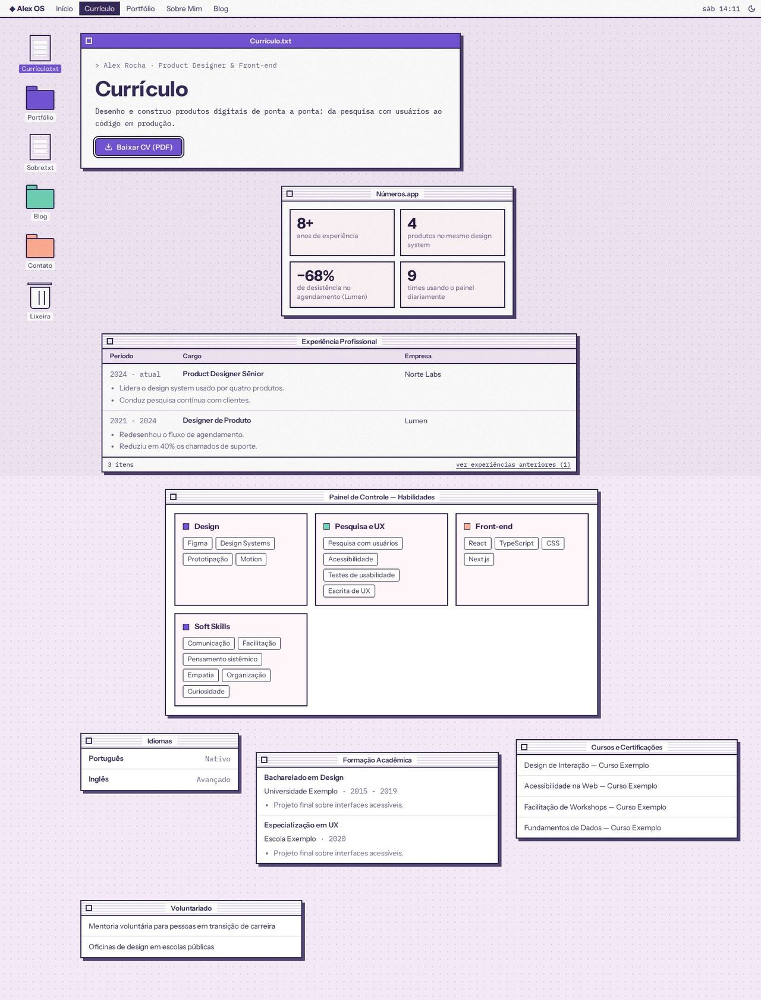
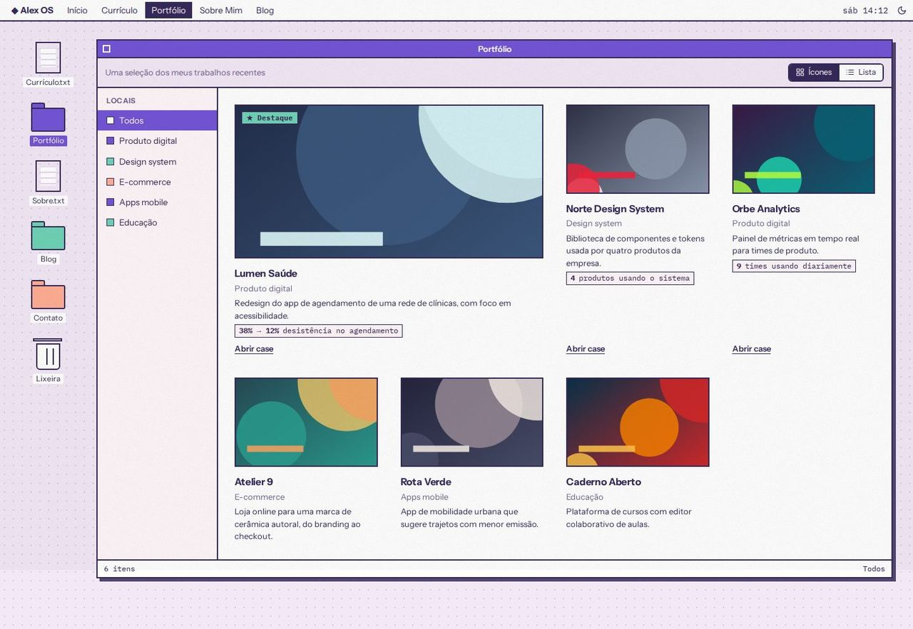
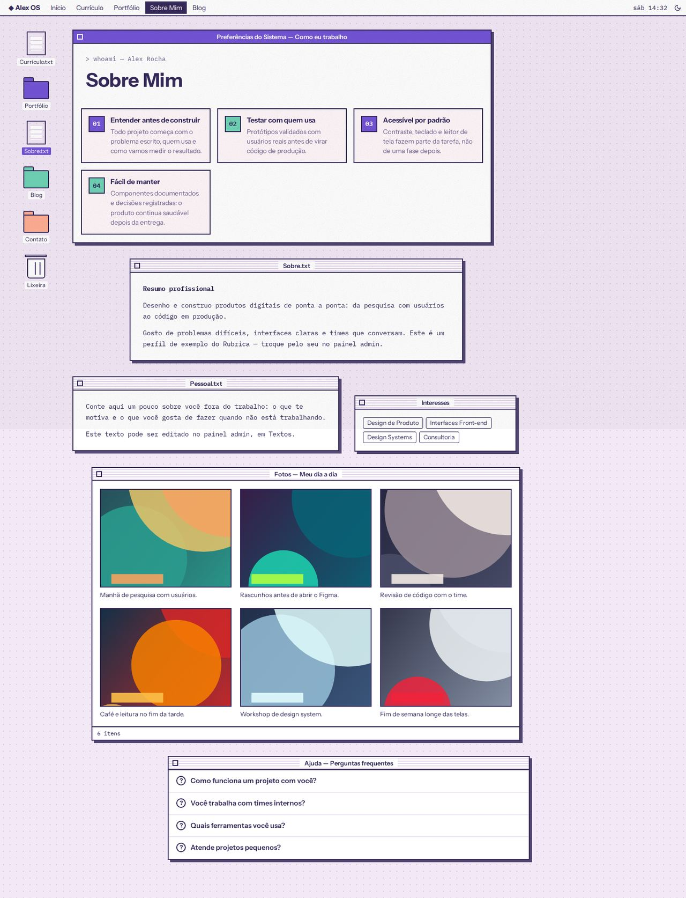
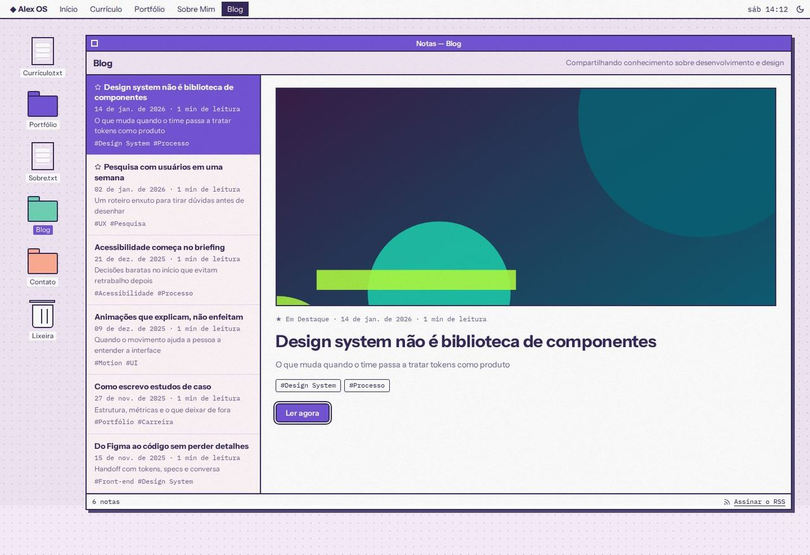

# Desktop Retrô

> _Cada seção é uma janela sobre a área de trabalho — nostalgia e brincadeira._

Capturas com o esquema **Sorbet**, modo claro, textura de grão.

## Conceito

O site vira um **sistema operacional de 1998**. A área de trabalho é um fundo pontilhado (`--subtle` com pontos na cor do texto), e cada seção é uma **janela**: barra de título listrada (`--surface` e `--line`), caixa de fechar decorativa, borda de 2px e **sombra dura** deslocada. A janela "em foco" de cada página tem a barra de título na **primária** (texto em `--on-primary`).

Os botões imitam os do sistema antigo: borda grossa, cantos levemente arredondados e um chanfro interno. O botão padrão de cada caixa (o que o Enter apertaria) ganha o **contorno duplo**. Texto corrido dos arquivos `.txt` usa a fonte mono; títulos e interface usam a principal.

**Regra de ouro:** nenhum elemento cobre texto. As janelas ficam numa coluna, **desencontradas só na horizontal** (cada uma tem largura e deslocamento próprios, que encolhem até caber), e nunca se sobrepõem. Janelas menores podem ficar lado a lado, em linhas que quebram.

- **Fontes recomendadas:** Instrument Sans (principal) e IBM Plex Mono (mono).
- **Aparência recomendada:** esquema `sorbet`, modo claro, textura `grain`.
- **Arquivos do template:** `Layout.tsx`, `DesktopMenuBar.tsx`, `DesktopShared.tsx` e as 5 páginas em `pages/`.
- **Cores:** só as variáveis do esquema; as próprias do layout começam com `--desktop-` (sombra, pontos, hover, cor de ícone, largura e deslocamento das janelas).

## Estrutura global

- **Barra de menu** fixa no topo: marca **"◆ <primeiro nome> OS"** (vem do perfil), os itens de navegação (o ativo em bloco invertido), o **relógio** com o dia da semana e a hora reais e o `<ColorModeToggle />`. No celular, os itens vão para um **menu suspenso** (botão ☰, fecha com Esc, clique fora ou ao navegar) e o relógio mostra só a hora.
- **Ícones da área de trabalho** numa coluna fixa à esquerda: atalhos reais para Currículo.txt, Portfólio, Sobre.txt e Blog (cada um some com o plugin desligado), **Contato** (abre o formulário quando o contact wizard está ligado) e a Lixeira, decorativa. O ícone da página atual fica selecionado. No celular, os ícones viram uma **fileira rolável** abaixo da barra.
- **Páginas do app** (case, post, depoimentos, propostas, pagamento) entram numa janela genérica com título de arquivo ("Case.doc", "Post.txt"…), com margem interna.
- Os textos próprios do layout (nomes de janelas, colunas, rótulos) ficam em `DesktopShared.tsx`, em pt-BR e en-US.
- As janelas "abrem" com uma animação curta em degraus, e a luz de disponibilidade e o cursor piscam; tudo isso é desligado com `prefers-reduced-motion`.

## Páginas

### Início

- **Leia-me.txt** (janela em foco): luz de disponibilidade (quando ligada), "Olá! Aqui é **Nome**.", o cargo em mono, a frase de valor (`home.hero.headline`) como `h1`, a descrição com cursor piscando e os botões **"Ver cases"** (padrão, contorno duplo) e **"Fale comigo"** (abre o formulário).
- **Números.app**: os números de destaque (até 4) em caixas 2×2. A janela some sem números.
- **Cases em destaque**: uma pasta no **modo ícones** com os 3 primeiros projetos com case: miniatura, título, categoria, a primeira métrica do case como etiqueta e "Abrir case". Barra de status com a contagem e "ver todos os projetos →".
- **Sobre.txt**: o texto "sobre" em mono, com os números em destaque sublinhados na primária.
- **O que eu faço**: os serviços numa **lista do Finder** (colunas Nome / Descrição, marcador colorido).
- **Depoimentos · Caixa de entrada (n)**: lista de remetentes à esquerda e a mensagem aberta à direita (clique troca a mensagem). Botões "Ver todos os depoimentos" e "Deixar meu depoimento" conforme os plugins `testimonials` e `testimonials-intake`. Sem o plugin `testimonials`, a janela some.
- **Novo projeto?**: caixa de diálogo com o "!" no acento, "Tem um projeto em mente?" e os botões **"Tenho uma vaga"** e **"Tenho um projeto"** (padrão). Some com o formulário de contato desligado.

### Currículo

- **Currículo.txt** (em foco): nome e cargo, o título, o resumo (primeiro parágrafo do "sobre") e o botão **"Baixar CV (PDF)"**.
- **Números.app** com os mesmos números da home.
- **Experiência Profissional** em **modo lista** (Período, Cargo, Empresa) com os marcadores de cada cargo abaixo da linha. As mais antigas ficam atrás de "ver experiências anteriores (n)", na barra de status.
- **Painel de Controle — Habilidades**: um painel por grupo (campo "Grupo" no admin), com as habilidades em etiquetas, sem níveis numéricos; as soft skills ganham o próprio painel.
- Janelas menores lado a lado: **Idiomas**, **Formação Acadêmica**, **Cursos e Certificações** e **Voluntariado**. Cada uma some quando vazia.

### Portfólio

- Uma única **janela de pasta** com barra de ferramentas (subtítulo e a alternância **Ícones / Lista**).
- As categorias viram a barra lateral **"Locais"** da janela ("Todos" + categorias), que filtra os projetos. Sem categorias, a barra lateral some. No celular, os Locais viram uma fileira rolável.
- **Modo ícones:** o 1º projeto ocupa duas colunas com o selo "★ Destaque" (quando há mais de dois); cada projeto mostra miniatura, título, categoria, descrição curta, a **primeira métrica do case** e **uma ação só**: "Abrir case" quando há case, senão "Abrir projeto ↗" (demo ou repositório).
- **Modo lista:** colunas Nome, Categoria, Resultado e Ação.
- Barra de status com a contagem e a categoria ativa.

### Sobre

- **Preferências do Sistema — Como eu trabalho** (em foco): abre a página com o título e os princípios de trabalho como painéis numerados (01, 02…).
- **Sobre.txt**: o resumo profissional em mono, com os números em destaque. Sem princípios cadastrados, é ele que abre a página, em foco e com o título.
- **Pessoal.txt** (o texto "Fora do trabalho") e **Interesses** (os serviços da home em etiquetas), lado a lado.
- **Fotos — Meu dia a dia**: as fotos com a legenda e as tags **sempre visíveis** abaixo de cada imagem (nada de texto por cima da foto).
- **Ajuda — Perguntas frequentes**: o FAQ em itens recolhíveis (`
`), com o "?" que acende ao abrir.

### Blog

- Um app de **notas**: barra de ferramentas com o título e o subtítulo; à esquerda, a lista de posts (o destaque primeiro, marcado com ★), cada um com data, tempo de leitura, subtítulo e tags, levando a `/blog/<slug>`.
- À direita, o **post em destaque aberto**: capa, data e tempo de leitura, título, subtítulo, tags e **"Ler agora"**.
- Barra de status com a contagem de notas e o link **"Assinar o RSS"** (`/rss.xml`).
- No celular, o post aberto vem primeiro e a lista logo abaixo.

## Limitações conhecidas

- As janelas não se arrastam nem se fecham: a caixa de fechar e a lixeira são decorativas (`aria-hidden`).
- Projetos sem case e sem link de demo ou repositório ficam sem ação (o mesmo dos outros layouts).
- A caixa de entrada da home mostra até 6 depoimentos; o resto fica em "Ver todos os depoimentos".
- O tamanho das fotos do "dia a dia" (`span_size`) é ignorado: todas entram no mesmo grid.
- O relógio usa a hora de quem visita e atualiza a cada 15 segundos.
