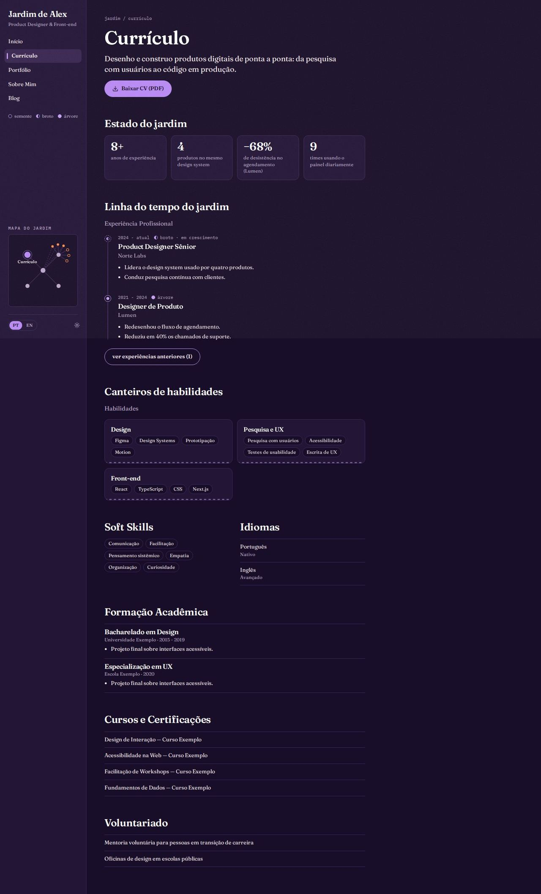
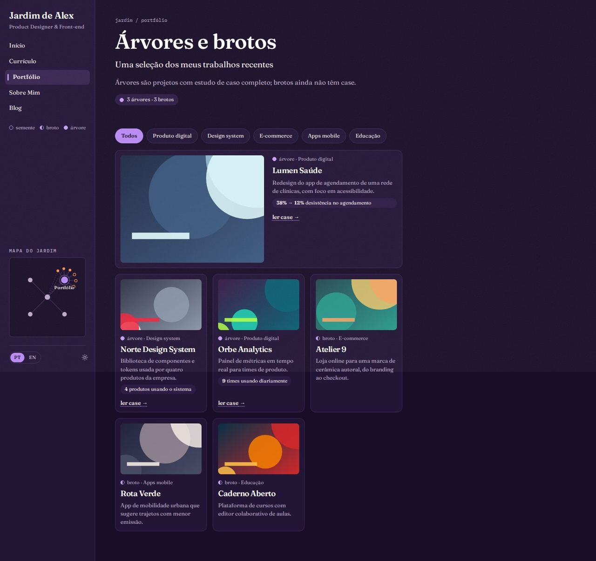
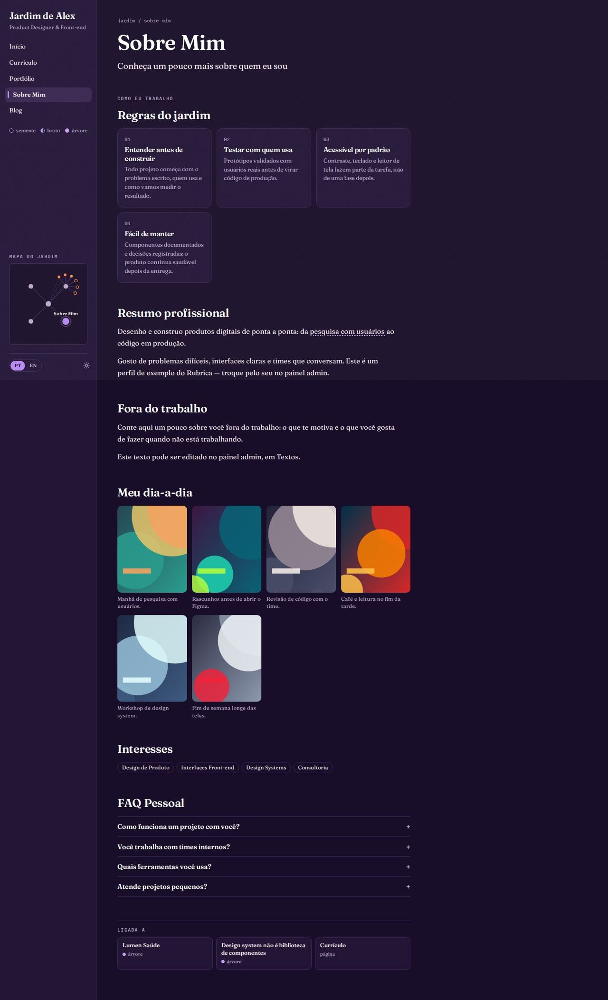
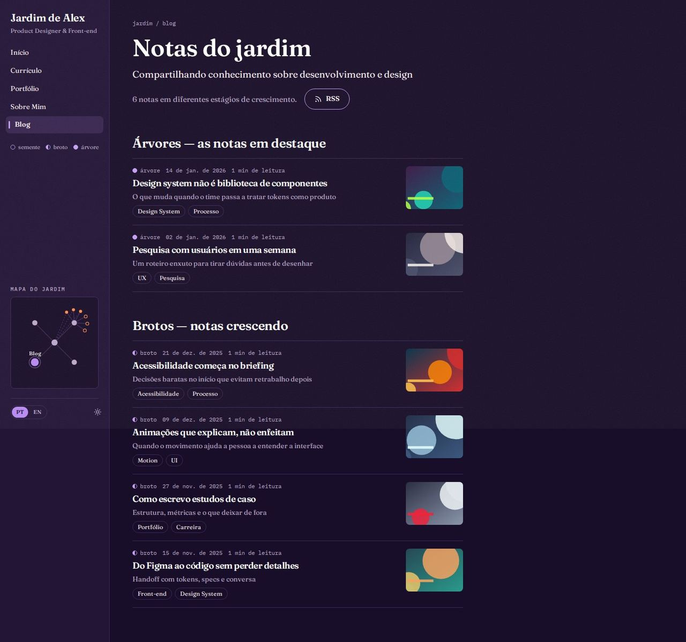

# Jardim Digital

> _Notas com estágio de crescimento, backlinks e mapa de ligações — pensamento em construção._

Capturas com o esquema **Crepúsculo**, modo escuro e textura de grão (a combinação recomendada).

## Conceito

O site é a **entrada de um jardim de notas**. Em vez de um portfólio "terminado", cada página é uma nota que cresce: projetos, posts e experiências recebem um **estágio de crescimento** (semente ○, broto ◐, árvore ●), os textos ligam termos para outras partes do site em sublinhado pontilhado, e uma **barra lateral fixa** mostra o mapa de ligações entre as páginas.

A leitura acontece numa coluna estreita (até ~790px), com títulos em serifa e muito respiro. A **primária** aparece nos botões principais, nos estágios e no nó da página atual do mapa; o **acento** marca os projetos no mapa. Os cartões usam `--surface`, as faixas suaves usam `--subtle` e as linhas usam `--line`, então o layout funciona em qualquer esquema, nos dois modos.

- **Fontes recomendadas:** Fraunces ou Source Serif 4 (principal) e IBM Plex Mono (mono: migalhas, datas, rótulos).
- **Combinação recomendada:** esquema Crepúsculo, modo escuro, textura de grão.
- **Arquivos do template:** `Layout.tsx`, `GardenSidebar.tsx`, `GardenShared.tsx` e as 5 páginas em `pages/`.

## Os estágios de crescimento

Os estágios saem só dos dados que já existem; nada é inventado. A regra fica em `GardenShared.tsx` (`projectStage`, `postStage`, `experienceStage`) e é coberta por `tests/app/templates/garden-stages.test.ts`.

| O quê | Árvore ● | Broto ◐ | Semente ○ |
|---|---|---|---|
| Projeto | tem página de estudo de caso (slug + case) | não tem case | — |
| Post | marcado como destaque | os demais | publicado nos últimos 30 dias (e não destacado) |
| Experiência | encerrada | a atual (período terminando em "atual", "presente", "hoje", "present", "current"…) | — |

As bolinhas são desenhadas em CSS (borda, metade preenchida, preenchida), sempre acompanhadas do nome do estágio.

## Estrutura global

- **Barra lateral fixa** (230px, `position: sticky`) com:
  - o nome do jardim ("Jardim de <primeiro nome>") e o cargo;
  - a navegação (some o que o plugin desliga), com a página atual marcada e `aria-current="page"`;
  - a legenda dos estágios;
  - o **mapa do jardim**: um SVG com o início no centro, as outras páginas em volta e os projetos brotando do portfólio (árvores preenchidas, brotos vazados). As ligações são os links reais do site: início → páginas, portfólio → projetos, e (tracejadas) início → cases em destaque. O nó da página atual (ou do case aberto) fica maior, na primária, com o nome ao lado;
  - o seletor de idioma (só com o plugin `i18n`) e o `<ColorModeToggle />`.
- **Celular e tablet (abaixo de 960px):** a barra vira um topo com o nome, o botão de modo e um menu (Sheet) com a navegação e a legenda. O mapa desce para o fim da página.
- Link "Pular para o conteúdo" no início da página; foco visível em todos os controles; animações (pulso da disponibilidade, halo do mapa) desligadas com `prefers-reduced-motion`.
- As páginas compartilhadas (post, case, depoimentos, propostas) aparecem na coluna de conteúdo, com margem própria.

## Páginas

### Início

- Migalha `jardim / início`, chip com a contagem de árvores e brotos do portfólio e chip de **disponibilidade** (quando ligada).
- **"Oi! Eu sou <nome>."**, a frase de valor (`home.hero.headline`), o cargo e a descrição; botões em pílula **"Ver cases"** e **"Fale comigo"** (abre o formulário).
- **"Estado do jardim"**: os números de destaque (até 4; a seção some sem números).
- **"Árvores do jardim"**: os 3 cases em destaque com miniatura, estágio + categoria, a primeira métrica e "ler case →".
- **"Quem cuida do jardim"**: o texto sobre, com os termos do site ligados em pontilhado (nomes de projetos → case, habilidades → currículo, tags de posts → blog) e os números em negrito; abaixo, **"Ligada a"** com 3 backlinks reais (o primeiro case, o post mais novo e uma página).
- **"Canteiros"** ("O que eu faço"): os serviços como canteiros numerados.
- **"Livro de visitas"**: os depoimentos (citação, nome e cargo), com "Ver todos os depoimentos" e "Deixar meu depoimento" conforme os plugins.
- **"Plante uma conversa"**: "Tem um projeto em mente?" com "Tenho um projeto" e "Tenho uma vaga".

### Currículo

- Título, resumo (primeiro parágrafo do sobre) e **"Baixar CV (PDF)"**.
- **"Estado do jardim"** com os mesmos números da home.
- **"Linha do tempo do jardim"**: as experiências numa linha vertical com anéis — a atual como broto ("em crescimento"), as encerradas como árvore. As mais antigas ficam atrás de "ver experiências anteriores".
- **"Canteiros de habilidades"**: um canteiro por grupo (campo "Grupo" no admin), sem níveis numéricos.
- Soft skills e idiomas lado a lado; formação, cursos e certificações e voluntariado em listas (cada bloco some quando vazio).

### Portfólio

- **"Árvores e brotos"**, com a explicação da regra e a contagem.
- **Filtro por canteiro** (as categorias dos projetos, em pílulas com `aria-pressed`); some sem categorias.
- O primeiro projeto vira um cartão largo, horizontal; os demais ficam no grid. Cada cartão mostra estágio, categoria, a **primeira métrica do case** e **uma ação só**: "ler case →" quando há case (o cartão inteiro é o link), senão "ver projeto ↗" (se houver link).

### Sobre

- **"Regras do jardim"** ("Como eu trabalho"): os princípios de trabalho, numerados, abrindo a página.
- **"Resumo profissional"** (com termos ligados) e **"Fora do trabalho"** (o texto pessoal).
- "Meu dia-a-dia" em grade de fotos com legenda; **"Interesses"** reaproveitando os títulos dos serviços.
- FAQ com `
` (abre e fecha sem JavaScript) e **"Ligada a"** no fim, com backlinks reais.

### Blog

- **"Notas do jardim"** com a contagem e o botão de **RSS**.
- As notas agrupadas por estágio: **árvores** (destaques) primeiro, depois **sementes** (últimos 30 dias) e **brotos**. Cada nota tem estágio, data, tempo de leitura, título com link para `/blog/<slug>`, subtítulo, as tags como canteiros e a capa à direita (some no celular).

## Limitações conhecidas

- Os depoimentos não têm data no banco, então o "Livro de visitas" numera as visitas ("visita 01") em vez de mostrar datas.
- O mapa mostra até 6 projetos e não tem nós para os posts; com muitas páginas desligadas, ele fica mais vazio. Os nós não são clicáveis (a navegação está logo acima).
- Os termos ligados dependem de o texto citar exatamente o nome de um projeto, de uma habilidade ou de uma tag de post; só a primeira ocorrência de cada termo vira link.
- O estágio da experiência atual depende de o período terminar com uma palavra como "atual" ou "presente".
- A barra lateral é fixa na altura da tela; em telas muito baixas, ela rola por dentro.
