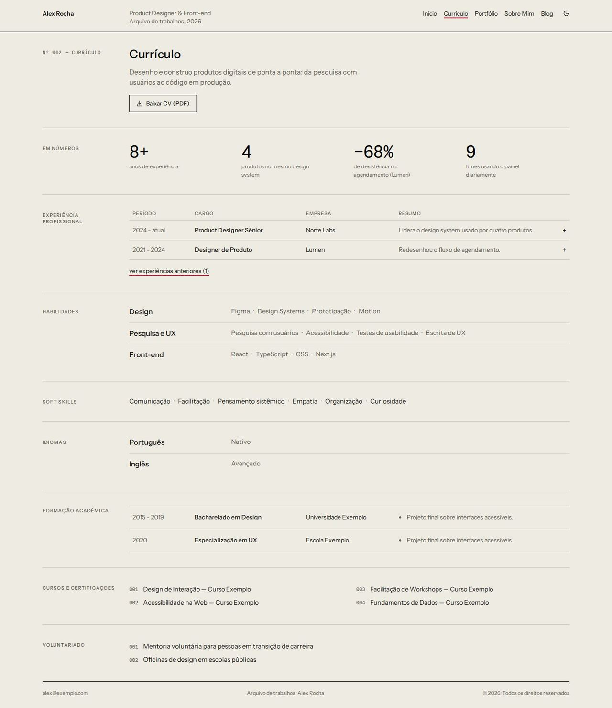
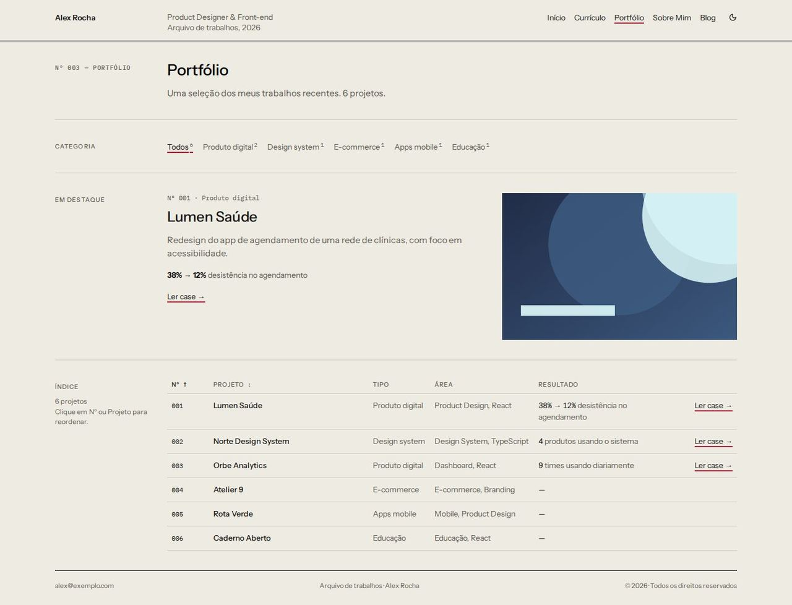
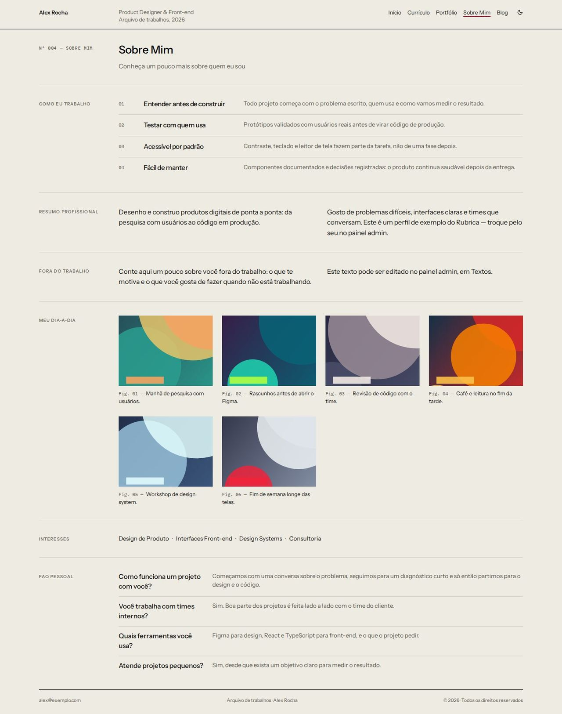
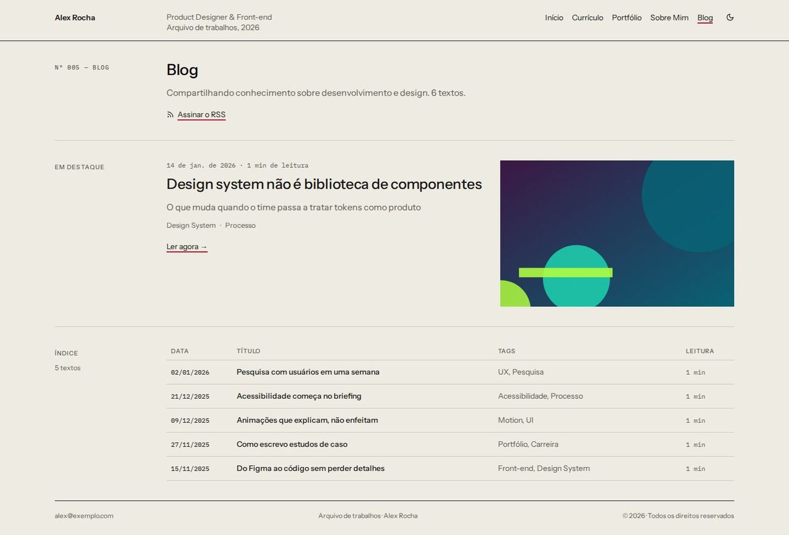

# Índice

> _Lista densa de museu, rótulos à esquerda e imagem que surge no hover — curadoria._

Capturas com o esquema **Sumi**, modo claro. O layout funciona com qualquer esquema, nos dois modos.

## Conceito

O site como **catálogo de arquivo**: tipografia pequena e precisa, muito ar e linhas finas separando tudo. Cada página é uma sequência de **seções rotuladas**: o rótulo em caixa alta fica numa coluna de ~180px à esquerda e o conteúdo à direita. A frase de valor da Home (`home.hero.headline`) é o único momento de tipografia grande.

Os projetos e os posts viram **linhas de um índice** (tabelas de verdade). Ao passar o mouse ou chegar pelo teclado numa linha, ela inverte as cores (fundo na cor do texto) e a imagem do item aparece **na coluna do rótulo, na altura da linha**: nunca por cima da tabela, do rótulo ou de outro texto. Cada página e cada projeto ganham um número de catálogo (`Nº 003`).

A cor de identidade (`--primary`) aparece pouco e com precisão: o sublinhado dos links, o item ativo da navegação e o ponto de disponibilidade. O resto usa `--text`, `--text-muted`, `--line`, `--subtle` e `--surface`.

- **Fontes recomendadas:** Instrument Sans (principal) e IBM Plex Mono (números de catálogo, datas, legendas).
- **Esquema recomendado:** Sumi, modo claro, sem textura.
- **Arquivos do template:** `Layout.tsx`, `IndexHeader.tsx`, `IndexShared.tsx` e as 5 páginas em `pages/`.

## Estrutura global

- **Cabeçalho fixo em 3 colunas:** nome (link para o início) | cargo e "Arquivo de trabalhos, <ano>" | navegação em texto e o botão de modo claro/escuro (`<ColorModeToggle />`). O item ativo é sublinhado na primária. Os itens respeitam os plugins (Currículo, Portfólio, Sobre, Blog).
- No celular o cabeçalho fica com o nome, o botão de modo e "Menu", que abre a navegação em lista.
- **Rodapé** com o e-mail (quando visível), a linha de catálogo e o ano.
- Link "Pular para o conteúdo" no topo, visível ao receber foco.
- `IndexShared.tsx` reúne os textos próprios do layout (pt-BR e en-US), a folha de estilo, a seção rotulada (`IndexSection`), os números de destaque (`IndexMetrics`) e o índice com pré-visualização (`IndexTableSection`).
- As páginas do app que o layout não substitui (post, case, depoimentos, propostas) recebem a moldura e a margem do `Layout.tsx`.

## Páginas

### Início

- **Abertura:** a disponibilidade (ponto na primária + texto) no rótulo, a frase de valor em tipografia grande, a descrição e os links **"Ver cases ↓"** e **"Fale comigo →"** (abre o formulário).
- **Em números:** até 4 números de destaque em lista de definição. A faixa some sem números.
- **Cases em destaque** como índice: Nº | Projeto | Tipo | Área | Resultado (a primeira métrica do case). Hover e foco invertem a linha e mostram a imagem na coluna do rótulo. Cada linha leva para `/portfolio/<slug>`; embaixo, "ver todos os projetos (N) →".
- **Sobre mim** em duas colunas, com os números do texto em destaque.
- **O que eu faço:** serviços em linhas título | descrição.
- **O que falam sobre mim:** até 3 depoimentos lado a lado, com "Ver todos os depoimentos" e "Deixar meu depoimento" conforme os plugins.
- **Contato:** "Tem um projeto em mente?" com "Tenho um projeto →" e "Tenho uma vaga →".

### Currículo

- Cabeçalho com o resumo (primeiro parágrafo do "sobre") e o botão **"Baixar CV (PDF)"**.
- Números de destaque (os mesmos da Home).
- **Experiência como ficha de catálogo:** linhas Período | Cargo | Empresa | Resumo (o primeiro marcador). Cada linha é um botão que expande os marcadores completos. As experiências antigas ficam atrás de "ver experiências anteriores".
- **Habilidades** como lista de definição por grupo (campo "Grupo" no admin), sem níveis numéricos.
- Soft skills, idiomas (idioma | nível), formação (período | curso | instituição | detalhes), cursos e certificações numerados em duas colunas e voluntariado. Cada bloco some quando vazio.

### Portfólio

- **Filtro de categoria** como links de texto com a contagem de cada uma. Some sem categorias.
- **Em destaque:** o primeiro projeto da seleção atual como ficha (número, categoria, descrição, primeira métrica, ação e imagem).
- **Índice completo:** Nº | Projeto | Tipo | Área | Resultado | ação. Ordenação clicável por **número** e por **nome** (cabeçalhos com `aria-sort`), com a mesma pré-visualização na coluna do rótulo. O número de catálogo segue a ordem do admin e não muda ao filtrar.
- **Uma ação só por linha:** "Ler case →" quando há case, senão "Ver projeto ↗" (nova aba). A linha inteira é clicável e o título é o link para o teclado.

### Sobre

- **Como eu trabalho** abrindo a página, como lista numerada de princípios (título | descrição).
- **Resumo profissional** e **Fora do trabalho** em duas colunas.
- **Meu dia a dia** como pranchas: imagem, legenda "Fig. 01 — …" e tags.
- **Interesses:** as tags do dia a dia (ou, sem tags, os serviços da Home).
- **FAQ** como lista de definição (pergunta | resposta).

### Blog

- Cabeçalho com a contagem de textos e o link **"Assinar o RSS"** (`/rss.xml`).
- **Em destaque** no topo: data, tempo de leitura, título, resumo (subtítulo), tags, "Ler agora →" e a imagem.
- **Índice dos demais posts:** Data | Título | Tags | Leitura, com a imagem do post na coluna do rótulo no hover. Cada linha leva para `/blog/<slug>`.
- Sem posts, a página mostra "Nenhum artigo publicado ainda".

## Celular

- Abaixo de 760px os rótulos sobem para cima do conteúdo e as colunas de texto viram uma.
- Abaixo de 900px as tabelas viram **cartões em lista**: um cartão por item, com os campos empilhados e o nome de cada campo à esquerda. No Portfólio, os botões de ordenação continuam visíveis acima da lista. A pré-visualização some.
- As fichas de experiência empilham período, cargo, empresa e resumo.

## Acessibilidade

- Títulos em ordem (h1 da página, h2 nos rótulos de seção, h3 dentro delas), `nav` com `aria-label`, `main` com destino do "Pular para o conteúdo".
- Projetos e posts em `<table>` com legenda para leitores de tela; a pré-visualização é decorativa (`aria-hidden`).
- O foco do teclado também inverte a linha e mostra a imagem. O contorno de foco usa `--text` (contraste garantido pelo esquema).
- Animações (imagem e inversão das linhas) só com `prefers-reduced-motion: no-preference`.

## Limitações conhecidas

- **Não há campos de ano nem de cliente nos projetos.** O índice usa o número de catálogo (ordem do admin) no lugar do ano e a área (tags) no lugar do cliente; a ordenação é por número e por nome. Com campos `year` e `client` em `Project`, as colunas Ano e Cliente e a ordenação por ano entram direto.
- **Não há campo de cidade no perfil**: a segunda linha do cabeçalho mostra "Arquivo de trabalhos, <ano>" em vez da cidade.
- O tempo de leitura é estimado (200 palavras por minuto), como nas outras páginas de blog.
- A legenda da pré-visualização corta títulos longos com reticências; o número de catálogo vem primeiro para continuar visível.
