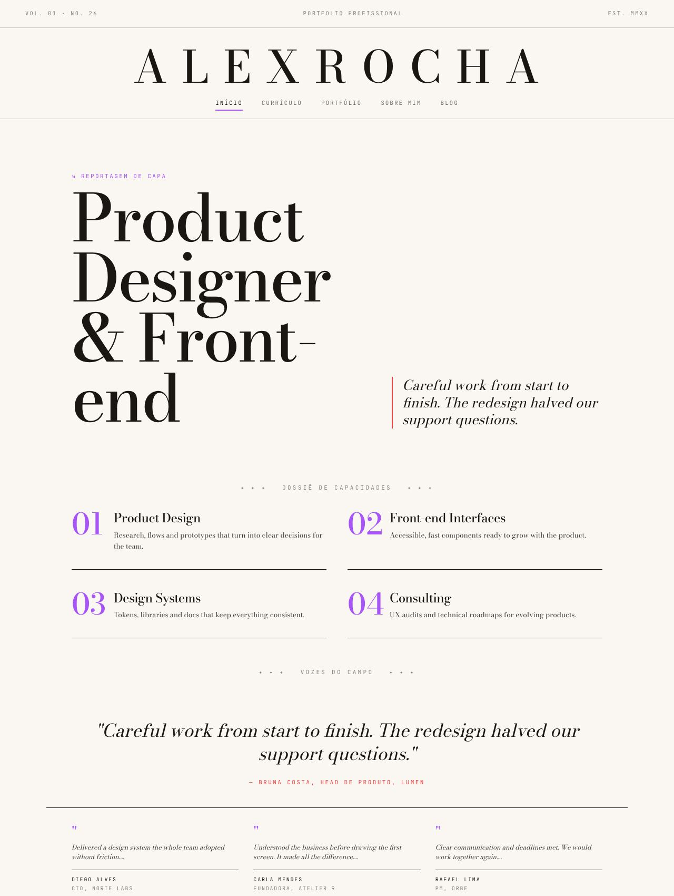
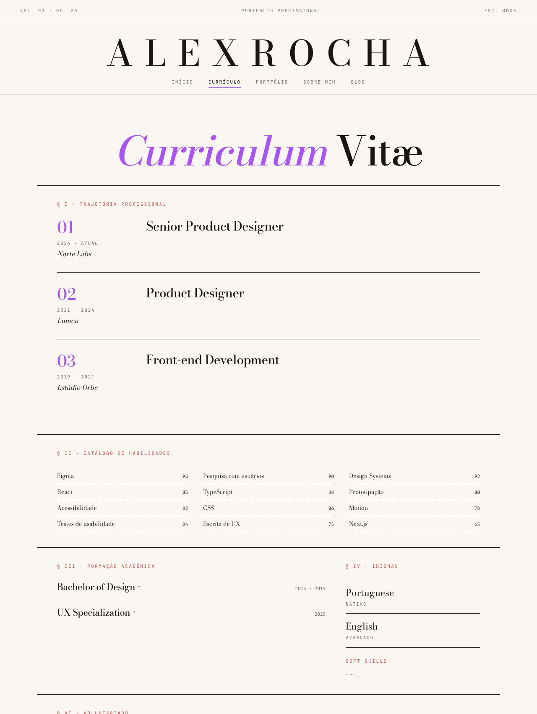
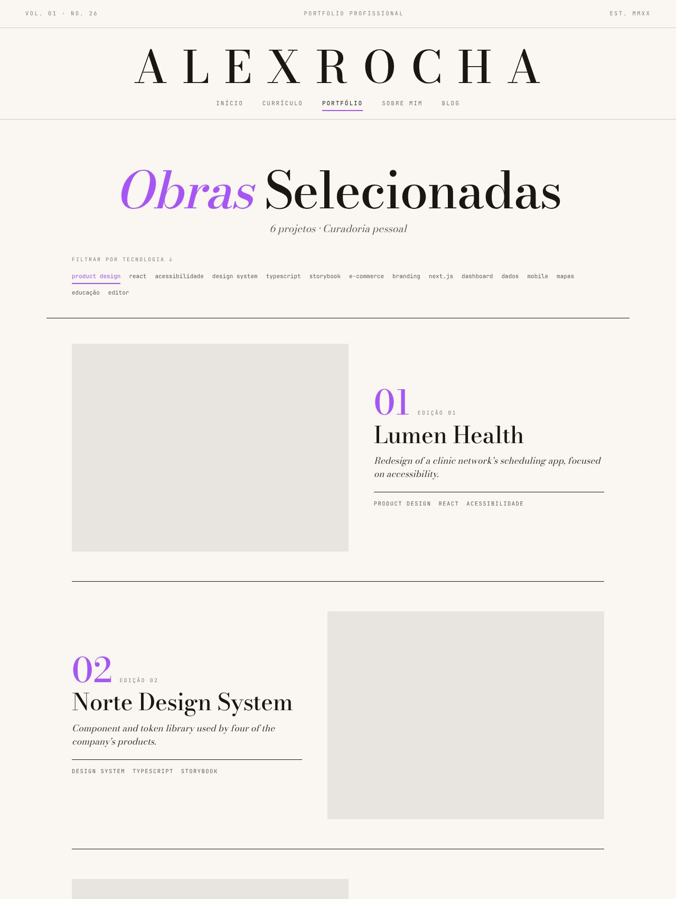
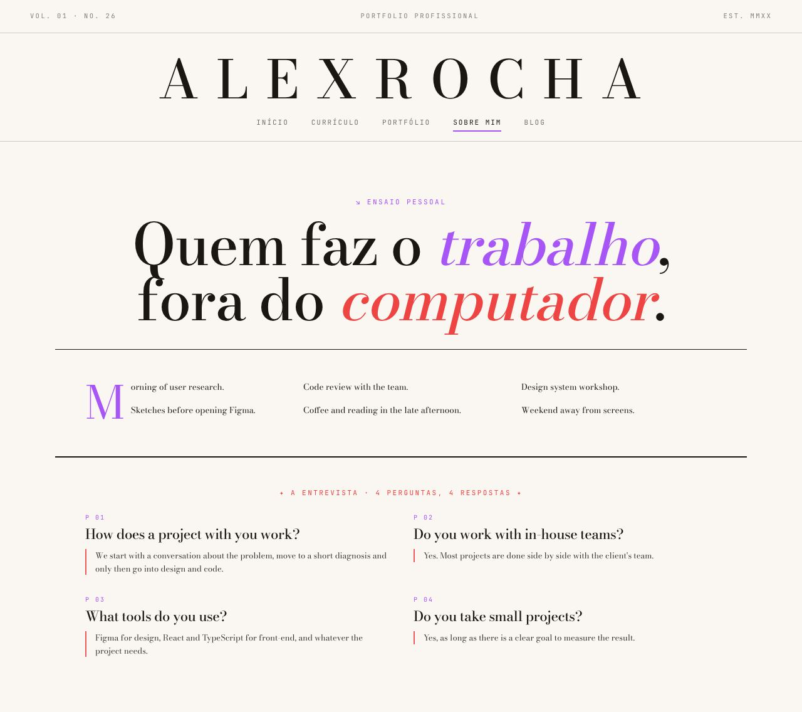
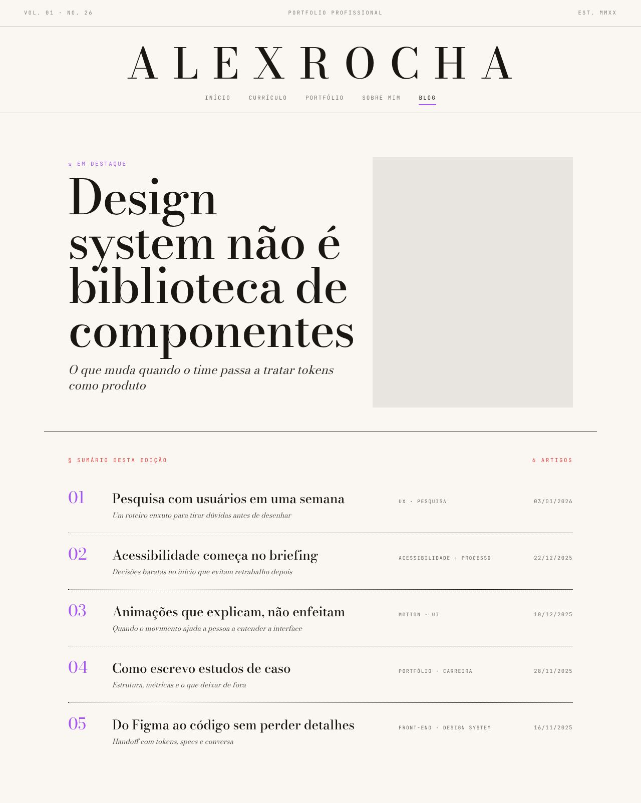

# Magazine

> _Editorial clássico · display serifado · grid assimétrico · áreas de respiro generosas._

Capturas com a paleta **Editorial Cream**. Veja o layout em todas as paletas em [Esquemas de cores](./cores.md#magazine).

## Conceito

O portfólio como uma **revista impressa**. Há um cabeçalho de capa com "Vol. 01 · No. 26" e "Est. MMXX", seções numeradas em algarismos romanos (§ I, § II…) e rótulos editoriais como "Reportagem de Capa", "Dossiê de Capacidades" e "Sumário desta edição". Os títulos são de display (92–124px, peso 500, espaçamento negativo); a sensação serifada vem das fontes recomendadas, e rótulos e metadados usam mono em caixa alta bem espaçada.

A composição é **assimétrica** (`1.4fr 1fr`, `1.2fr 1fr`, `180px 1fr`) e usa muito espaço em branco, com divisórias finas de 0.5px. A **primária** pinta numerais grandes, palavras em itálico nos títulos e capitulares; o **destaque** pinta rótulos de seção, filetes laterais e créditos.

- **Fontes recomendadas:** Bodoni Moda ou IBM Plex Serif (principal) e JetBrains Mono (mono).
- **Arquivos do template:** `Layout.tsx`, `Masthead.tsx` e as 5 páginas em `pages/`.

## Estrutura global

- **Masthead** em três faixas: metadados da edição (com o ícone de modo claro/escuro antes de "Est. MMXX", também no celular; o menu do celular repete o botão com texto); o **nome em caixa alta e espaçado** como título da revista; e a navegação centralizada, com o item ativo sublinhado na primária.
- Itens de plugins desligados somem da navegação (no desktop e no menu mobile, que abre de cima).
- O conteúdo fica numa coluna de até 1200px.

## Páginas

### Início

- **"↘ Reportagem de Capa · cargo"**: a frase de valor vira a manchete, com a descrição em itálico ao lado e dois botões: "Ver cases" e "Fale comigo".
- **Faixa de números** logo abaixo da capa, com até 4 resultados editados no admin (aba Números). Some quando não há números.
- **"✦ Cases em destaque ✦"**: os 3 primeiros projetos com case, cada um com numeral, categoria, a primeira métrica do case e o link "Ler a reportagem".
- **"✦ Dossiê de Capacidades ✦"**: os serviços em colunas, cada um com um numeral grande na primária.
- **"Vozes do Campo"**: um depoimento como citação central em itálico e os demais em colunas.
- **"↘ Carta ao Leitor"**: fechamento com dois caminhos, "Tenho um projeto" e "Tenho uma vaga".

### Currículo

- Título "_Curriculum_ Vitæ" seguido de um **resumo**: o primeiro parágrafo do "sobre" com capitular, os números de destaque e o botão "Baixar CV (PDF)".
- Seções numeradas: **§ I Trajetória Profissional**, **§ II Catálogo de Habilidades**, § III Formação, § IV Idiomas, § V Certificações e cursos, § VI Voluntariado.
- Experiência em grade: período e empresa em itálico à esquerda, cargo e descrição à direita.
- Habilidades **agrupadas por categoria** (campo "Grupo" no admin), sem nível numérico. As sem grupo vão para "Stack".

### Portfólio

- Título "_Obras_ Selecionadas" e a faixa **"Seções desta edição"**, que filtra por categoria. A faixa some quando nenhum projeto tem categoria.
- Projetos como **matérias em zigue-zague**: imagem e texto trocam de lado a cada projeto, com numeral de 64px, categoria, título de 44px, descrição em itálico e a primeira métrica do case.
- Uma ação por projeto: "Ler a reportagem" quando há case, "Ver o projeto ↗" quando há só link de demo.

### Sobre

- Título "Quem faz o _trabalho_, e _como_ ele é feito."
- **§ I Resumo profissional**: o texto "sobre" com capitular e os números em destaque.
- **§ II Como eu trabalho**: os princípios de trabalho (aba Princípios no admin) numerados em colunas. Some quando não há princípios.
- **"Ensaio Pessoal · Fora do trabalho"**: o lado pessoal, depois do profissional.
- O dia-a-dia como **ensaio em colunas de texto**, abrindo com capitular na primária.
- FAQ como **"A Entrevista"**: perguntas numeradas "P 01", respostas com filete no destaque.

### Blog

- **"↘ Em Destaque"**: o post em destaque como matéria de capa, título de 96px e subtítulo em itálico.
- **"§ Sumário desta edição"**: os demais posts como um índice de revista (número, título, tags e data).

## Limitações conhecidas

- As seções de Início, Currículo, Portfólio e Sobre se reorganizam no celular, mas os espaçamentos laterais continuam fixos em 48px.
- Funciona nos dois modos sem ajuste: tudo é tinta (`--text`) sobre papel (`--bg`). No escuro, a textura de papel fica bem mais discreta.
- Os posts do Blog ainda aparecem com blocos de placeholder, e os itens do sumário ainda não têm link.
