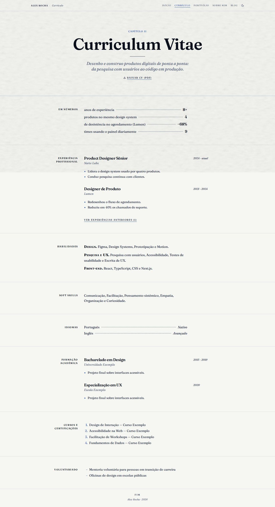
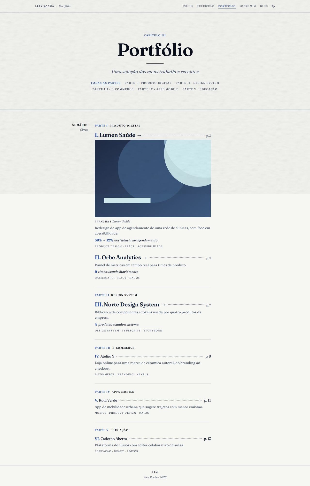
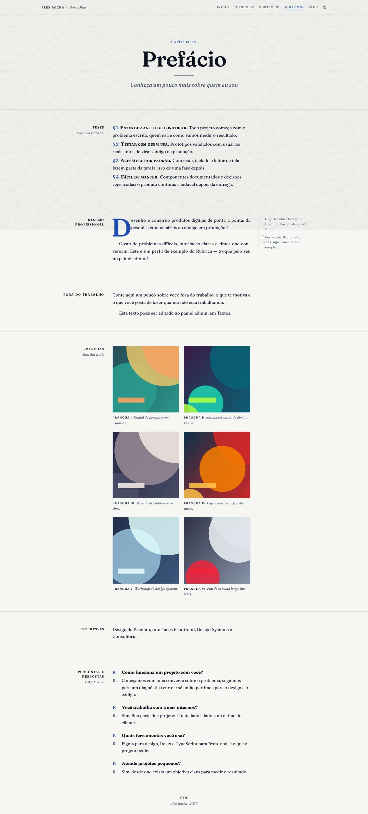
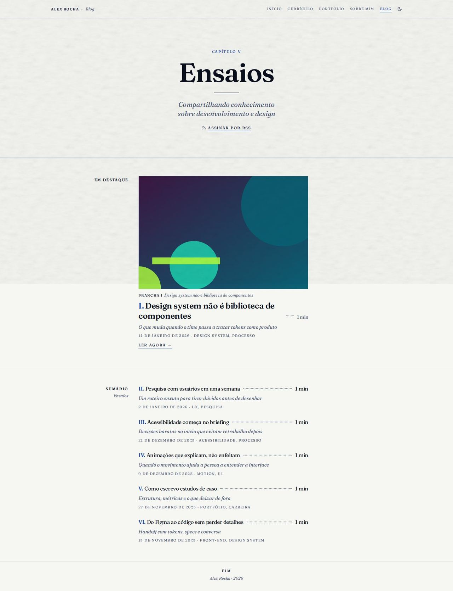

# Monografia

> _O site como livro: folha de rosto, sumário, capitulares e notas na margem — calma e profundidade._

Capturas com o esquema **Azulejo**, modo claro, textura papel e a fonte Fraunces.

## Conceito

Cada página é um **capítulo de livro**. A Home abre com uma **folha de rosto** centralizada e o resto do site segue uma grade de 3 colunas, como a página de um livro bem composto: o **rótulo da seção** à esquerda, alinhado à direita e encostado no texto; a **coluna de leitura** (até 540px); e a **margem** para notas laterais e datas.

Os recursos tipográficos são os de livro: **versalete** (caixa-alta pequena e espaçada) na navegação, nos rótulos e nas ações; **linhas pontilhadas guia** ligando texto e número (rótulo ……… 8+); **numerais romanos** nos sumários; **capitular** no primeiro parágrafo do prefácio; **itálico** em subtítulos, notas e citações; e um **fio duplo** fechando cada folha de rosto. Os botões são links sublinhados na primária; só a correspondência final tem um botão cheio.

A **primária** marca o que é estrutura (rótulos de seção, numerais, capitular, chamadas de nota, sublinhados); o texto secundário usa `--text-muted`, e as divisórias, `--line`. Funciona com qualquer esquema, nos dois modos.

- **Fontes recomendadas:** Fraunces ou Source Serif 4 (principal) e IBM Plex Mono (mono). Versalete, pontilhado e capitular também funcionam em fontes sem serifa.
- **Aparência recomendada:** esquema Azulejo, modo claro, textura papel.
- **Arquivos do template:** `Layout.tsx`, `MonographRunningHead.tsx`, `MonographShared.tsx` e as 5 páginas em `pages/`.

## Estrutura global

- **Cabeçalho corrido** fixo e discreto: à esquerda, "Nome · Seção" (a seção em itálico); à direita, a navegação em versalete (a página atual sublinhada na primária) e o botão de modo claro/escuro (`<ColorModeToggle />`). Itens de plugins desligados somem.
- No celular, a navegação vira um botão **"Sumário"** que abre, logo abaixo do cabeçalho, um sumário com numerais romanos e linhas pontilhadas. Fecha ao trocar de página ou com Esc.
- **Rodapé com fólio**: "fim", o nome e o ano.
- Link "Pular para o conteúdo" no primeiro Tab, foco visível na primária e `lang` do idioma atual (a hifenização segue o idioma).
- **Itálico de verdade:** o CLI carrega só os pesos romanos da fonte. Como o livro vive de itálico, o `Layout.tsx` lê a fonte principal (`--font-sans`) e, se ela tiver itálico no Google Fonts, carrega o itálico (400 e 600) com `<Helmet>`. Fontes sem itálico (Space Grotesk, Manrope, Bricolage Grotesque) ficam com o itálico sintetizado pelo navegador.
- As páginas do app que o layout não desenha (post do blog, estudo de caso, depoimentos…) recebem só a margem, dentro da mesma moldura.
- **Celular:** abaixo de 1100px a margem entra na coluna de leitura; abaixo de 720px a página vira uma coluna só, o rótulo sobe para cima da seção e as notas laterais viram **notas no fluxo do texto** (com fundo levemente tingido); as datas do currículo passam para cima de cada entrada.

## Páginas

### Início

- **Folha de rosto**: a disponibilidade em itálico (quando ligada), o nome enorme, o cargo em versalete, um fio, a frase de valor (`home.hero.headline`) como subtítulo itálico, a descrição curta e duas ações em versalete: **"Ver cases"** (desce até o sumário) e **"Fale comigo"** (abre o formulário de contato).
- **"Em números"**: os números de destaque (admin → Home → Números, até 4) como linhas pontilhadas guia. Some sem números.
- **"Sumário — Cases em destaque"**: os 3 primeiros projetos com página de case, como capítulos: numeral romano, título, linha pontilhada e "p. N", o resumo em itálico e, em versalete, a categoria e a primeira métrica do case. Cada título leva a `/portfolio/<slug>`; no fim, "ver todos os projetos".
- **"Prefácio — Sobre mim"**: o texto "sobre" com **capitular** no primeiro parágrafo e os números de resultado em destaque. As chamadas de nota (¹ ²) levam às **notas na margem**, tiradas do currículo: o cargo atual e a formação. Link para a página Sobre.
- **"Ofícios — O que eu faço"**: os serviços como parágrafos corridos, o título em versalete.
- **"Recepção — O que falam sobre mim"**: até 3 depoimentos como citações (`figure` + `blockquote`) com aspas grandes na primária; "ver todos os depoimentos" e "deixar meu depoimento" conforme os plugins.
- **"Correspondência"**: a chamada final "Tem um projeto em mente?" com **"Tenho um projeto"** (botão cheio) e **"Tenho uma vaga"**, e o **colofão** ("Composto para a web por …, 2026.") com o e-mail, quando ele está visível.

### Currículo

- Abertura de **"Capítulo II — Curriculum Vitae"**, com o resumo (primeiro parágrafo do "sobre") como subtítulo e **"Baixar CV (PDF)"** como link em versalete.
- **"Em números"** com os mesmos números da Home.
- **Experiência profissional** como entradas de livro: cargo, empresa em itálico e o texto, com as **datas na margem**. As mais antigas ficam atrás de "ver experiências anteriores".
- **Habilidades por grupo** (campo "Grupo" no admin) em parágrafos corridos: "**Design.** Figma, Design Systems e Motion." Sem níveis numéricos.
- Soft skills em uma frase; idiomas em linhas pontilhadas (idioma ……… nível); formação com as datas na margem; cursos e certificações numerados; voluntariado. Cada bloco some quando está vazio.

### Portfólio

- Abertura de **"Capítulo III"** com as **Partes**: cada categoria vira "Parte I · Produto digital", "Parte II · …", e o conjunto serve de filtro (com "Todas as partes"). Sem categorias, o filtro some.
- **Sumário de todas as obras**, dividido em partes: numeral romano, título, linha pontilhada e "p. N". A numeração e as páginas seguem a ordem do livro (as partes, na ordem em que aparecem, e os projetos sem categoria no fim), as mesmas da Home.
- **Destaque para os primeiros**: as 3 primeiras obras em corpo maior, e a primeira ganha uma **prancha** (a imagem com legenda).
- Cada obra mostra a descrição, a **primeira métrica do case em itálico** (o número na primária) e as tags em versalete. **Uma ação só**: o título leva ao case (→) quando existe, senão ao link do projeto (↗, em nova aba).

### Sobre

- Abertura de **"Capítulo IV — Prefácio"**.
- **"Teses — Como eu trabalho"** abre a página: os princípios de trabalho (admin → Home → Princípios) numerados como **§ 1, § 2…**, o título em versalete.
- **Resumo profissional** com capitular, números em destaque e as mesmas notas na margem da Home.
- **"Fora do trabalho"**: o texto pessoal.
- **"Pranchas — Meu dia-a-dia"**: as fotos do dia a dia em duas colunas, cada uma com legenda "Prancha I" + descrição e tags.
- **"Interesses"**: os serviços da Home em uma frase.
- **"Perguntas e respostas — FAQ Pessoal"** em lista de definição: "P." na primária e "R." em cinza.

### Blog

- Abertura de **"Capítulo V — Ensaios"** com **"Assinar por RSS"** (`/rss.xml`).
- **"Em destaque"**: o post marcado como destaque (ou o mais recente) com a imagem como prancha, título, tempo de leitura, subtítulo em itálico, data por extenso, tags e "Ler agora".
- **"Sumário — Ensaios"**: os demais posts com numeral romano, título, linha pontilhada e **tempo de leitura**, o subtítulo em itálico e, em versalete, a data e as tags. Cada título abre `/blog/<slug>`.
- Sem posts, o capítulo mostra "Nenhum artigo publicado ainda."

## Limitações conhecidas

- **Os números de página ("p. 3") são decorativos**: saem do tamanho do texto de cada projeto, não de uma paginação real. O projeto não tem campo de ano, então o sumário do Portfólio mostra a página no lugar do ano.
- As notas de margem do prefácio vêm do currículo (cargo atual e formação); ainda não existe um campo para notas livres.
- Para o sumário seguir a ordem das páginas, a Home mostra os cases em destaque na ordem do livro (agrupados por categoria), que pode diferir da ordem do admin.
- O blog não tem busca nem filtro por tag nesta página.
- O itálico carregado pelo `Layout.tsx` depende de uma lista fixa de fontes do CLI; uma fonte nova com itálico precisa entrar nessa lista.
