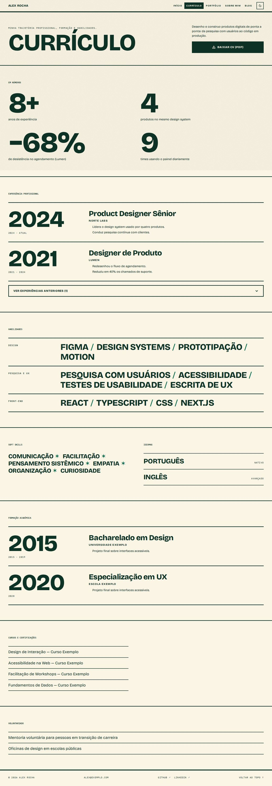
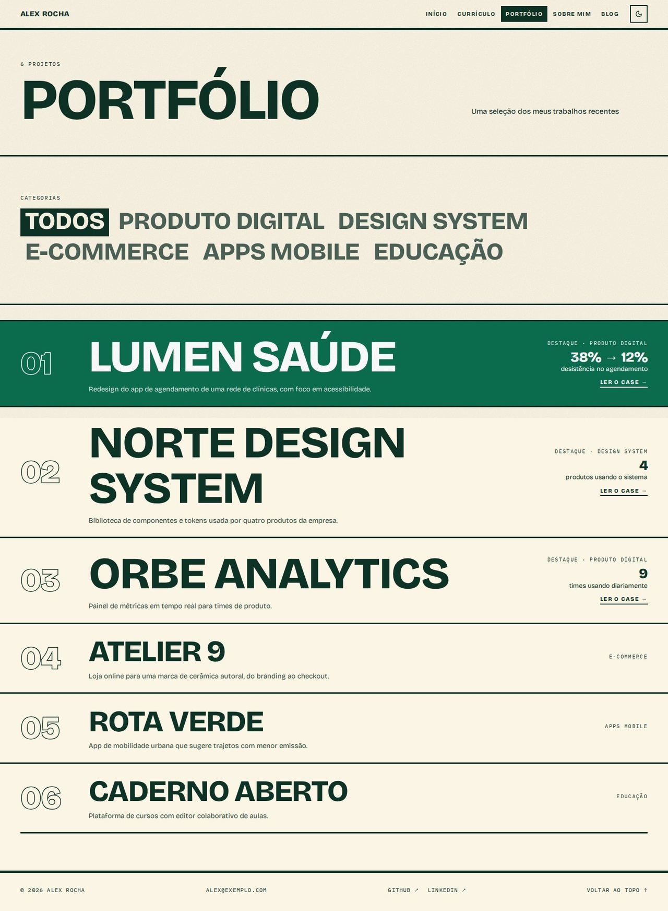
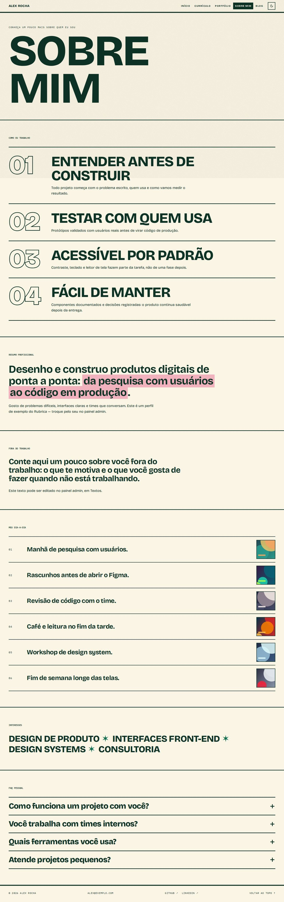
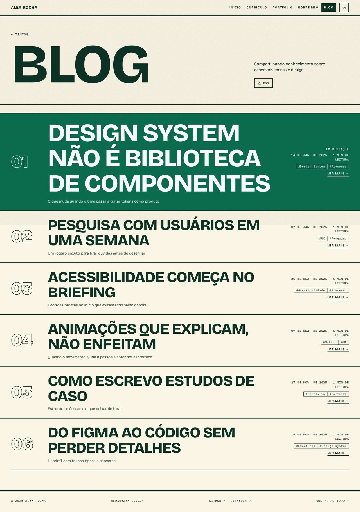

# Pôster Cinético

> _Tipografia gigante do começo ao fim, faixas rolando — impacto._

Capturas com o esquema **Tropicália**, modo claro, textura de grão.

## Conceito

Cada página é um **cartaz**: quase nenhuma imagem, só tipografia em peso máximo, caixa alta e fios grossos separando as seções. O nome de quem assina o portfólio ocupa a largura da tela, o sobrenome aparece **em contorno**, e os projetos, serviços e posts viram **linhas de cartaz** com o título enorme. Uma **faixa rolante** com os nomes dos projetos corta a página logo abaixo do topo.

A tipografia gigante nunca estoura a largura: cada título é dimensionado pela largura do próprio bloco (unidades de contêiner, `cqi`) e pelo comprimento da palavra mais longa, então "Maria Eduarda Albuquerque" ou um título de post com 40 letras cabem em 360px sem rolagem horizontal. Como última garantia, as palavras podem quebrar (`overflow-wrap: anywhere`).

Cores, só pelas variáveis do esquema:

- **`--text` / `--bg`**: os fios, os botões principais (bloco cheio) e a faixa rolante (invertida).
- **`--primary` / `--on-primary`**: a linha de cartaz ativa (a primeira, ou a que está sob o mouse ou o foco), o selo de disponibilidade e a sombra dos botões no hover.
- **`--accent`**: o disco de cor do topo (`mix-blend-mode: multiply` no claro, `screen` no escuro).
- **`--accent-2`**: o marca-texto das declarações, misturado ao fundo (`color-mix`) para o texto em `--text` continuar legível em qualquer esquema.

- **Fontes recomendadas:** Bricolage Grotesque (principal) e IBM Plex Mono (mono: rótulos, datas, tempo de leitura).
- **Esquema recomendado:** Tropicália, modo claro, textura de grão.
- **Arquivos do template:** `Layout.tsx`, `PosterNav.tsx`, `PosterShared.tsx` e as 5 páginas em `pages/`.

## Estrutura global

- **Barra fixa no topo** com fio grosso embaixo: o nome em caixa alta à esquerda (link para o início) e, à direita, a navegação em caixa alta (a página atual num bloco invertido) e o botão de modo claro/escuro. Abaixo de 900px a navegação vira um botão **Menu** que abre os links em tamanho grande (fecha com Esc ou ao trocar de página).
- Itens de navegação somem quando o plugin da página está desligado.
- **Rodapé** com fio grosso: © ano e nome, e-mail (se visível), GitHub/LinkedIn/Behance (se preenchidos) e "Voltar ao topo".
- As páginas do app que nenhum layout substitui (post, case, depoimentos…) recebem a moldura e a margem do `Layout.tsx`.
- `PosterShared.tsx` reúne a folha de estilo e as peças reaproveitadas: `Ticker` (faixa rolante), `PosterRow` (linha de cartaz), `BigNumbers`, `Seal` (selo), `Statement` (declaração com marca-texto), `PageHead`, `Section`/`SectionLabel`, além dos textos próprios em pt-BR e en-US.

## Páginas

### Início

- **Topo:** o primeiro nome enorme (`h1`) e o resto do nome em contorno (`-webkit-text-stroke`; sem suporte, fica preenchido). Ao lado, em **coluna própria**, o disco de cor e o **selo redondo de disponibilidade** (quando ligada no admin). No celular, disco e selo descem para uma faixa só deles: nenhum dos dois cobre texto.
- Bloco com a frase de valor (`home.hero.headline`), a descrição e o cargo; botões em bloco **"Ver cases ↓"** e **"Fale comigo"** (abre o formulário).
- **Faixa rolante** com os nomes de todos os projetos: pausa no hover e num botão próprio; com movimento reduzido fica parada e quebra linha. As repetições do laço ficam escondidas do leitor de tela.
- **Em números:** até 4 números de destaque em 2 colunas, do tamanho de um cartaz (some sem números).
- **Cases em destaque** como linhas de cartaz: número em contorno, nome gigante, categoria e a primeira métrica à direita, link para `/portfolio/<slug>`. A linha ativa fica preenchida na primária.
- **Sobre mim:** o primeiro parágrafo como declaração grande com marca-texto (nos números com unidade; sem eles, no trecho depois dos dois-pontos ou nas últimas palavras) e o resto em texto corrido.
- **O que eu faço:** serviços em caixa alta gigante, descrição à direita.
- **Depoimentos:** uma citação enorme (o tamanho diminui para textos longos) e duas menores; "Ver todos os depoimentos" e "Deixar meu depoimento" conforme os plugins.
- **Chamada final:** "TEM UM PROJETO EM MENTE?" em tamanho de cartaz, com "Tenho um projeto" e "Tenho uma vaga".

### Currículo

- Cabeçalho com "CURRÍCULO" gigante, o resumo (primeiro parágrafo do "sobre") e **"BAIXAR CV (PDF)"** como bloco cheio.
- Números de destaque (os mesmos da home).
- **Linha do tempo** das experiências: o ano de início gigante como âncora, o período em mono, cargo, empresa e descrição ao lado. As mais antigas ficam atrás de "ver experiências anteriores".
- **Habilidades por grupo** (campo "Grupo" no admin) em palavras grandes separadas por barras, sem níveis numéricos.
- Soft skills em palavras e idiomas com o nível em mono; formação na mesma linha do tempo; cursos, certificações e voluntariado em listas com fios. Cada bloco some quando vazio.

### Portfólio

- Cabeçalho com "PORTFÓLIO" gigante e a contagem de projetos.
- **Categorias como palavras grandes clicáveis** ("Todos" + as categorias); a ativa fica num bloco invertido. Sem categorias, o filtro some.
- Todos os projetos como linhas de cartaz: os 3 primeiros (sem filtro) com o título maior e a marca "Destaque"; descrição, categoria e a **primeira métrica do case**.
- **Uma ação só** por linha: "Ler o case →" quando há case, senão "Ver projeto ↗" (abre o link do projeto). Sem nenhum dos dois, a linha não é clicável.

### Sobre

- Cabeçalho com "SOBRE MIM" gigante.
- **"Como eu trabalho"** abre a página: princípios numerados com o número em contorno e o título em tamanho de cartaz.
- **Resumo profissional** como declaração grande com marca-texto; **"Fora do trabalho"** como declaração média.
- **Meu dia-a-dia** em linhas numeradas, com a foto pequena à direita.
- **Interesses** (os serviços da home) em palavras grandes.
- **FAQ** em sanfona (`
`), perguntas grandes e um "+" que gira.

### Blog

- Cabeçalho com "BLOG" gigante, a contagem de textos e o link do **RSS**.
- Posts como **manchetes gigantes** em linhas: o post em destaque primeiro (maior, com "Em destaque"), depois os demais. Data e tempo de leitura em mono, até 3 tags e "Ler mais →" (abre `/blog/<slug>`).

## Limitações conhecidas

- O ajuste da tipografia usa uma largura média de letra por fonte (`K_CAPS`/`K_NUM` em `PosterShared.tsx`), calibrada para Bricolage Grotesque. Com uma fonte bem mais larga, palavras longas podem quebrar no meio (sem estourar a tela); ajuste as constantes se trocar a fonte.
- Navegadores sem unidades de contêiner (`cqi`) usam um tamanho por `clamp()` da largura da tela, menos preciso.
- O contorno usa `paint-order` para esconder as sobreposições internas dos glifos da fonte variável; navegadores sem esse suporte mostram pequenos traços dentro de algumas letras.
- A primeira linha de cartaz fica sempre preenchida quando nada está sob o mouse; em telas de toque, a linha tocada fica preenchida até tocar em outra.
- Não há busca nem filtro por tag no blog.
