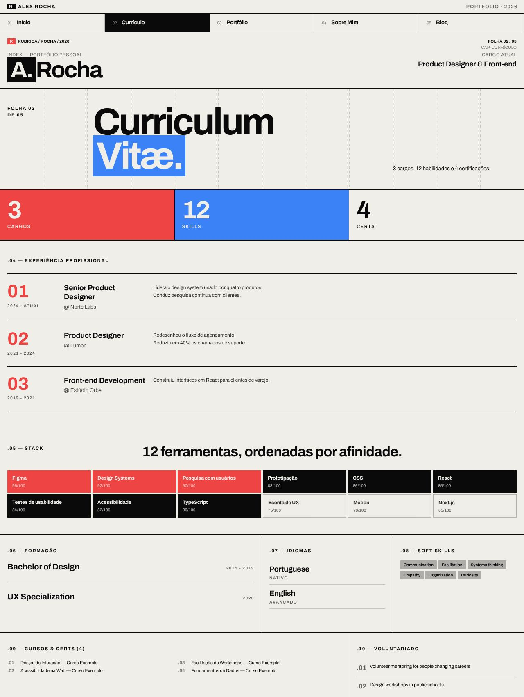
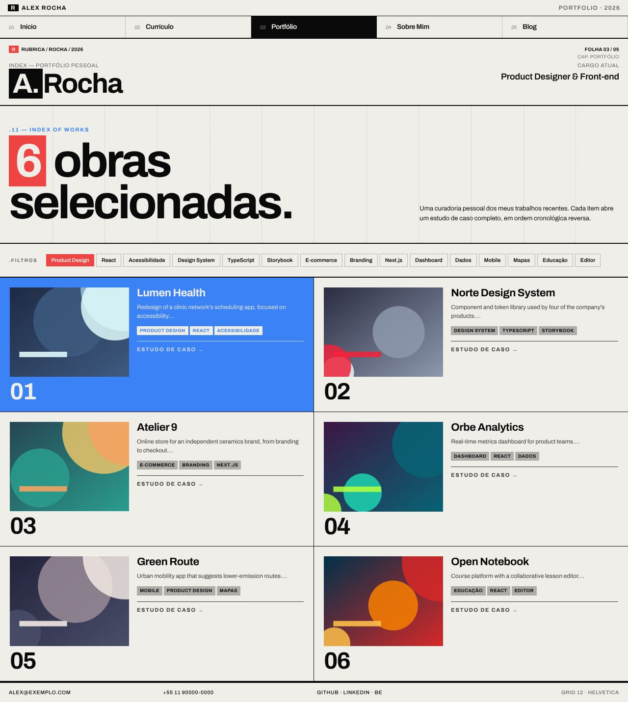
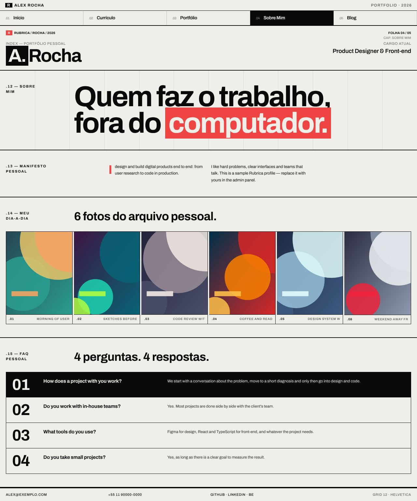
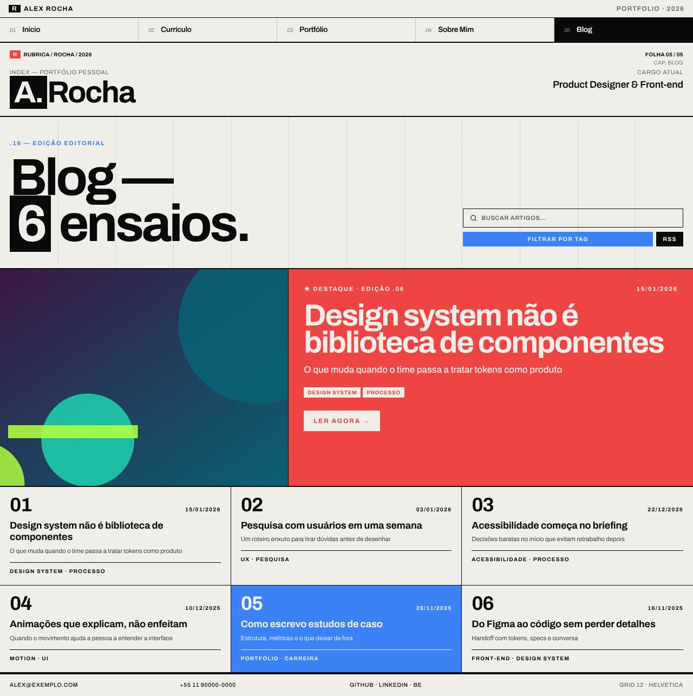

# Swiss Grid

> _Grid de 12 colunas, tipografia forte, design suíço rigoroso._

Capturas com a paleta **Paper Noir**. Veja o layout em todas as paletas em [Esquemas de cores](./cores.md#swiss-grid).

## Conceito

Inspirado no Estilo Tipográfico Internacional, o layout trata cada página como uma **folha de cartaz** montada sobre um grid de 12 colunas, que fica visível como linhas verticais pontilhadas nos cabeçalhos. A tipografia é pesada (peso 900, espaçamento negativo, títulos de 88–132px) e os rótulos são pequenos, em caixa alta e espaçados.

A cor entra em **blocos sólidos**: a primária e o destaque viram fundo de cards e palavras-chave (com texto na cor do fundo), e a cor do texto também vira fundo em blocos invertidos. Não há cantos arredondados — a única forma circular é o avatar. A numeração editorial é contínua entre as páginas: `.01` na Home até `.16` no Blog, como capítulos de uma mesma publicação.

- **Fonte recomendada:** Archivo — o layout usa só `--font-sans`, sem fonte mono.
- **Arquivos do template:** `Layout.tsx`, `Sidebar.tsx` (navegação), `SwissShared.tsx` (moldura das páginas) e as 5 páginas em `pages/`.

## Estrutura global

- **Navegação** (`SwissNav`): faixa com um "R" invertido, o nome, "Portfolio · 2026" e o ícone de modo claro/escuro (também no celular; o menu lateral repete o botão com texto); abaixo, uma barra de 5 colunas iguais numeradas `.01`–`.05`. O item ativo e o hover ficam invertidos. Itens de plugins desligados somem; no celular, vira um menu lateral.
- **Moldura de página** (`SwissShell`), em todas as páginas:
  - **Cantos**: "Rubrica / sobrenome / ano" à esquerda; "Folha 0X / 05" e o capítulo à direita.
  - **Masthead**: "Index — Portfólio Pessoal" sobre o nome com a inicial invertida (ex.: **A.** Rocha) e o cargo atual à direita.
  - **Rodapé** em 4 colunas com contato.

## Páginas

### Início (Folha 01)

- Hero em 8 das 12 colunas com o **título principal** (texto editável em Textos), o nome em bloco na primária ao lado do cargo e dois botões: **"Ver cases"** e **"Fale comigo"** (abre o formulário de contato). Avatar e texto "sobre" nas outras 4 colunas.
- **Faixa de números** logo abaixo do topo: até 4 resultados cadastrados no admin (Home → Números), o primeiro invertido. Sem números, a faixa volta a mostrar a stack principal.
- Capítulo .02 **"Cases em destaque"**: os 3 primeiros projetos com estudo de caso, com categoria, a primeira métrica do case em bloco na primária e link para o case.
- Capítulo .03: os 4 primeiros serviços em 4 colunas, o primeiro em bloco na primária.
- Capítulo .04 "Vozes": o primeiro depoimento em destaque invertido, os demais em lista ao lado.
- Capítulo .05: fechamento na primária com dois caminhos, **"Tenho um projeto"** e **"Tenho uma vaga"**.

### Currículo (Folha 02)

- Título **"Curriculum Vitæ."** com "Vitæ." sobre o destaque; ao lado, o **resumo** (primeiro parágrafo do "sobre") e o botão **"Baixar CV (PDF)"**.
- Faixa com os **números de resultado** do admin; sem números, mostra cargos, habilidades e certificações.
- Experiência em linhas de 3 colunas: as 2 mais recentes abertas e as anteriores atrás de "ver experiências anteriores".
- **Habilidades agrupadas por área** (campo "Grupo" no admin), em chips sem nível numérico; as sem grupo vão para "Stack".
- Formação, idiomas e soft skills lado a lado; cursos e voluntariado no fim.

### Portfólio (Folha 03)

- Título **"6 obras selecionadas."** com o número em bloco na primária.
- Barra `.filtros` **por categoria** e funcional ("Todos" + categorias dos projetos). Fica escondida quando nenhum projeto tem categoria.
- Projetos em grid de 2 colunas com imagem 4:3, número grande, título, descrição, a primeira métrica do case e até 3 tags; o primeiro projeto em bloco no destaque.
- Uma ação por projeto: **"$ cat case.md →"** quando há estudo de caso, ou "Ver projeto ↗" quando só há link de demo.

### Sobre (Folha 04)

- Título "Quem faz o trabalho e **como.**" com a última palavra em bloco na primária.
- **.13 Resumo profissional**: o texto "sobre" em até 3 parágrafos, o primeiro com capitular e os números de resultado em destaque.
- **.14 Como eu trabalho**: os princípios cadastrados no admin (Home → Princípios) em colunas numeradas, o primeiro na primária.
- **.15 Fora do trabalho**: o texto pessoal, depois do conteúdo profissional.
- Galeria do dia-a-dia em 6 colunas (fotos 4:5) e FAQ em linhas de 3 colunas, a primeira invertida.

### Blog (Folha 05)

- Título **"Blog — 6 ensaios."** com o número invertido.
- Destaque dividido em imagem (5/12) e um painel na primária com "★ Destaque", data, título de 56px, tags e "Ler agora →".
- Os demais posts em grid de 3 colunas, numerados, um deles em bloco no destaque.

## Limitações conhecidas

- Só a navegação, a faixa de números, os cases em destaque e o fechamento da Início se reorganizam no celular; o resto das páginas usa grids e tamanhos fixos.
- A busca do Blog é visual (sem ação).
- Os destaques em bloco ("Vitæ.", "como.", números do currículo) põem a cor do fundo sobre a primária/destaque. Em esquemas cujo destaque é médio no modo claro (ex.: `midnight-blue`, `sorbet`, `tropicalia`), o contraste desses blocos fica baixo.
- Alguns textos são fixos no código: "Portfolio · 2026", "Grid 12 · Helvetica", "Folha X / 05".
