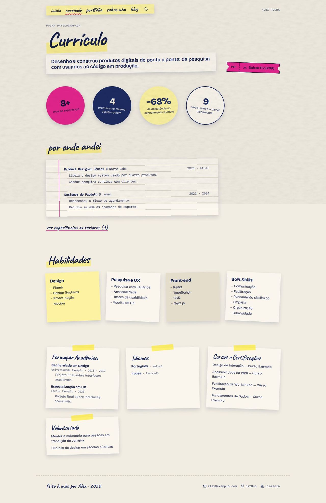
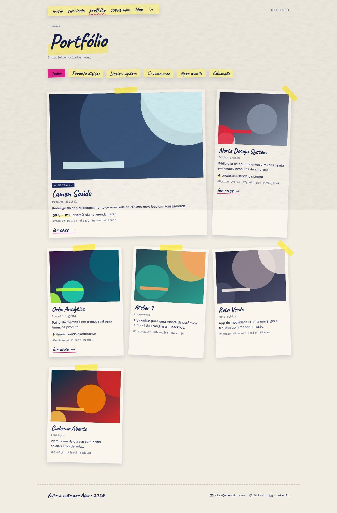
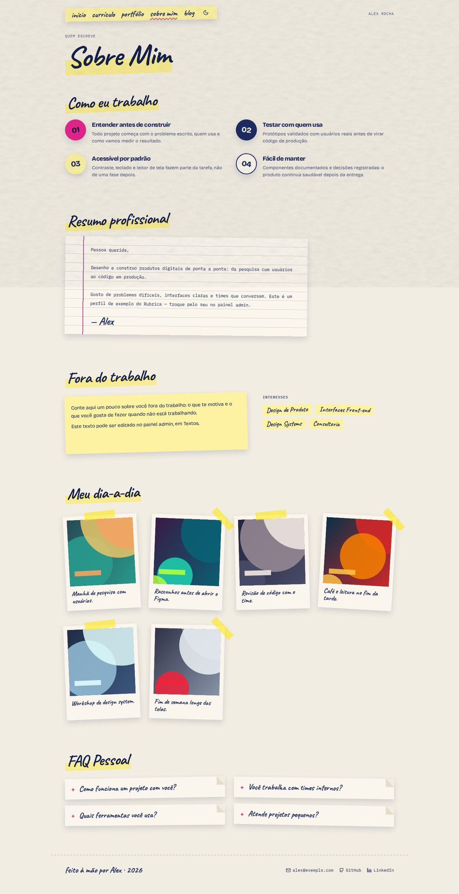
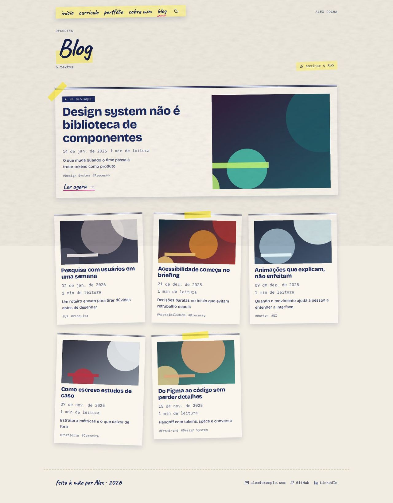

# Zine

> _Colagem: polaroides, fita adesiva, post-its e letra à mão. Autoral._

Capturas com o esquema **Riso** no modo claro, textura papel. O layout usa o esquema completo e funciona com qualquer esquema, nos dois modos.

## Conceito

O site é um **fanzine feito à mão**. Cada seção é um material de colagem: os números viram adesivos redondos, os cases viram polaroides presas com fita, o "sobre" é uma carta datilografada em papel pautado, os serviços são post-its, os depoimentos são bilhetes colados e o contato é um cupom de recortar.

Tudo fica em grid/flex no fluxo normal, com rotações pequenas. **Fita, adesivos, manchas e rotações nunca cobrem texto**: a fita fica na margem do papel (no meio da borda de cima ou atravessando só o triângulo da quina), e as manchas de cor ficam atrás da foto, longe do texto. No celular as rotações caem para cerca de um terço e a decoração encolhe.

Uso do esquema:

- **Primária** (com `--on-primary`): ingresso principal, primeiro adesivo, um post-it, margem da carta, sublinhados à mão.
- **Acento** (`--accent`): segunda mancha atrás da foto e o fundo das fotos ausentes.
- **Terceira cor** (`--accent-2`): fita adesiva e marca-texto, sempre translúcidas ou misturadas com o papel (`--zine-tape-solid`) para o texto continuar no `--text`. Nunca é fundo de texto pura.
- **Texto** (`--text` sobre `--bg`): etiqueta do cargo e o adesivo "tinta".
- As manchas usam `mix-blend-mode: multiply` no claro e `screen` no escuro.

- **Fontes recomendadas:** Bricolage Grotesque (principal) e IBM Plex Mono (mono). A letra à mão é a **Caveat**, carregada pelo próprio `Layout.tsx` com `<Helmet>`; sem ela, cai em Segoe Print / Bradley Hand / Comic Sans MS / `cursive`.
- **Esquema recomendado:** Riso, modo claro, textura papel.
- **Arquivos do template:** `Layout.tsx`, `ZineNav.tsx` (navegação e rodapé), `ZineShared.tsx` (estilos, textos próprios em pt-BR/en-US e os materiais: `Tape`, `Polaroid`, `PostIt`, `Sticker`, `TicketFace`, `Letter`, `HandTitle`) e as 5 páginas em `pages/`.

## Estrutura global

- **Navegação**: uma tira de fita adesiva levemente girada, com os links em letra à mão e o botão de modo claro/escuro (`ColorModeToggle`) no fim. A página atual ganha um sublinhado ondulado na primária. Os links seguem os plugins (currículo, portfólio, sobre e blog somem quando desligados). À direita, o nome em mono (só no computador).
- Link "Pular para o conteúdo" para quem navega pelo teclado.
- **Rodapé**: "feito à mão por <primeiro nome> · <ano>" em letra à mão, com e-mail (se visível), GitHub e LinkedIn.
- As páginas compartilhadas (post, case, depoimentos…) recebem margem do `Layout.tsx`.

## Páginas

### Início

- **Capa**: "oi, eu sou <primeiro nome>!" em letra à mão, o cargo numa etiqueta, a frase de valor (`home.hero.headline`) numa tira de papel girada, a descrição em mono e dois **ingressos recortados**: "Ver cases" (some sem cases) e "Fale comigo" (abre o formulário).
- À direita, a **polaroide do perfil** com meio-tom na primária sobre a foto (ou uma trama de pontos quando não há foto), duas manchas de cor atrás e o **adesivo redondo de disponibilidade** (só quando ligada) sobre a área da foto.
- **"em números"**: até 4 números de destaque como adesivos redondos (primária, tinta, fita e papel tracejado). O tamanho do número diminui conforme o comprimento, para não vazar do círculo. A faixa some sem números.
- **"coisas que fiz"**: os 3 cases em destaque como polaroides com fita, a primeira métrica no marca-texto e "ler case →". Depois, "ver todos os projetos".
- **"uma cartinha"**: o texto "sobre" como carta datilografada em papel pautado com margem colorida, números em destaque no marca-texto e assinatura à mão. "mais sobre mim →" quando o plugin do sobre está ligado.
- **"o que eu faço"**: os serviços como post-its de 4 tons.
- **"o que dizem por aí"**: até 6 depoimentos como bilhetes colados (texto à mão, cortado em 220 caracteres), "Ver todos os depoimentos" e "Deixar meu depoimento" conforme os plugins.
- **Cupom de recortar**: borda tracejada, tesoura, "Tem um projeto em mente?" e duas caixas de marcar, "Tenho um projeto" e "Tenho uma vaga", que abrem o formulário no fluxo certo. Embaixo, "recorte, marque e mande para <e-mail>".

### Currículo

- Cabeçalho com "Currículo" à mão, o resumo (primeiro parágrafo do "sobre") numa tira de papel e o ingresso **"Baixar CV (PDF)"**.
- Números de destaque como adesivos.
- **"por onde andei"**: as experiências numa folha datilografada em papel pautado; as mais antigas ficam atrás de "ver experiências anteriores".
- **Habilidades**: um post-it por grupo (campo "Grupo" no admin), mais um post-it de soft skills. Sem níveis numéricos.
- **Fichas presas com fita**: formação, idiomas, cursos e certificações e voluntariado. Cada ficha some quando vazia.

### Portfólio

- Cabeçalho "Portfólio" à mão com a contagem de projetos.
- **Filtro por categoria** em pedaços de fita (a aba ativa vira primária). Sem categorias, o filtro some.
- **Mural de polaroides**: o primeiro projeto ganha o selo "★ destaque" e ocupa duas colunas (no computador, quando o filtro está em "Todos"). Cada polaroide mostra a categoria, a descrição, a **primeira métrica do case no marca-texto**, até 4 tags e **uma ação só**: "ler case →" quando há case, senão "ver projeto ↗" (link do projeto). Sem nenhum dos dois, não há ação.

### Sobre

- **"Como eu trabalho"** abrindo a página: os princípios numa lista numerada, cada número num adesivo redondo.
- **"Resumo profissional"**: o texto "sobre" como carta datilografada, com os números no marca-texto.
- **"Fora do trabalho"**: o texto pessoal num post-it e, ao lado, os **interesses** em pedaços de fita (as etiquetas do dia a dia; sem elas, os serviços).
- **"Meu dia-a-dia"**: polaroides com a legenda à mão.
- **FAQ** como bilhetes dobrados (`
`): a pergunta à mão, a resposta ao abrir.

### Blog

- Cabeçalho "Blog" à mão com a contagem de textos e o link "assinar o RSS".
- **Recorte em destaque**, maior: selo, título grande, data, tempo de leitura, subtítulo em duas colunas de jornal, tags e "Ler agora →", com a imagem ao lado.
- Os demais posts como **recortes de jornal** colados num grid, com imagem, título (link para o post), data, tempo de leitura, subtítulo e tags.

## Limitações conhecidas

- A frase da capa é "oi, eu sou <nome>!" sem artigo ("o"/"a"), porque o layout não sabe o gênero da pessoa.
- O link do RSS aponta para `/rss.xml`, gerado no build por `scripts/generate-rss-feed.ts`. Em desenvolvimento, sem o build, o arquivo não existe.
- As linhas do papel pautado ficam alinhadas com o texto da carta, mas uma descrição de experiência com HTML diferente de parágrafos e listas simples pode sair um pouco da pauta.
- Projetos sem case e sem link do projeto ficam sem ação no mural.
- Depoimentos longos aparecem cortados em 220 caracteres na Início; o texto inteiro fica em `/depoimentos`.
- Em esquemas cuja terceira cor é igual à do texto (Sumi, Alto Contraste), a fita e o marca-texto ficam cinza.
